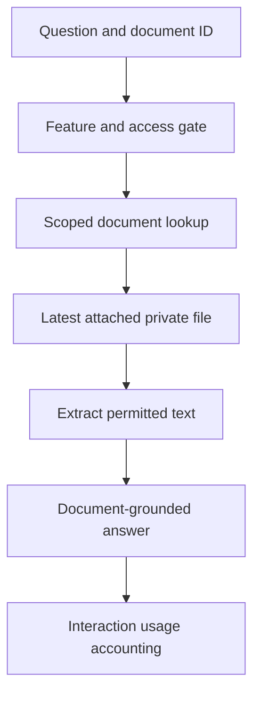

<!-- content/ai/ai-context-and-document-qa.md — Teach EstateIQ-derived engineering boundaries. -->
---
title: "Conversation context and document Q&A"
slug: ai-context-and-document-qa
section: projects
summary: "Separate portfolio analysis, remembered scope, and answers grounded in one private document."
order: 13
tags: [ai, estateiq, architecture, implementation]
status: established-pattern
lastReviewed: "2026-10-12"
sources: [reference_sources/estateiq-inspection.md]
related: [deterministic-ai, private-document-lifecycle, frontend-state-contracts]
---

## Two different sources of answers

Portfolio Copilot reads structured domain facts through selectors. Document Q&A reads text extracted from a particular authorized file. They should not share an implied authority to answer every question. A lease PDF can describe a contract; it cannot establish today's allocated payment balance without the ledger.

The inspected documents architecture explicitly separates these sources. It also marks image-only PDFs without extractable text as a user-facing limitation rather than an implemented OCR pipeline.

## Conversation scope is a contract

The conversation orchestrator classifies intent, resolves scope, normalizes it, handles clarification, chooses the response mode, and attaches metadata. Previous context can help interpret a follow-up; it should not override an explicit current request.

Distinguish the requested organization, entity, time range, comparison period, and selected tool. A frontend page hint is useful for routing, but must not bypass server-side organization/entity resolution. If an entity no longer exists or lies outside the current scope, fail or clarify instead of borrowing another record with a similar label.

## One drawer at the shell boundary

The inspected DashboardLayout mounts a single Copilot drawer and owns its open/close state. It uses current organization context and exposes an opening action through context. Domain pages contribute page-aware prompts without constructing competing global drawers.

This is a useful frontend pattern: keep workspace-level interactions at the shell, feature behavior in the feature, and transient inputs locally. It avoids multiple focus traps and inconsistent conversations when navigating between domain pages.

## Document Q&A request boundary

**Text alternative:** Access gates precede the scoped document lookup and latest-file extraction. Answers are grounded in that document's text and interaction usage is recorded. File storage URLs and provider internals do not become frontend response fields.

The targeted source search confirms an organization-filtered document lookup in document Q&A views. Documentation describes access gating before file lookup/extraction and shared interaction usage accounting. The review did not execute provider calls or verify billing concurrency behavior.

## Preview state and cleanup

The documented viewer fetches an authorized Blob, creates a browser object URL, and cleans it up when the workspace stops using it. Ask-AI mode presents preview and chat together. Chat history is session-only and resets when the preview closes.

A Blob URL is a local presentation handle, not backend authorization. Recheck access when fetching the file. Clean up object URLs, abort obsolete fetches, preserve focus when opening/closing the modal, and show explicit unsupported-file errors.

## Verify leakage and context errors

Ask about a different document, send a foreign document identifier, change organizations during a preview request, close/reopen the chat, and supply an image-only PDF. Confirm no unauthorized file/text reaches the response and that unsupported inputs produce an honest limitation.

For portfolio follow-ups, change the time period and issue an explicit different-domain question. Verify routing rebuilds current scoped facts rather than using stale conversation numbers. Provider errors should not fabricate a confident answer.
