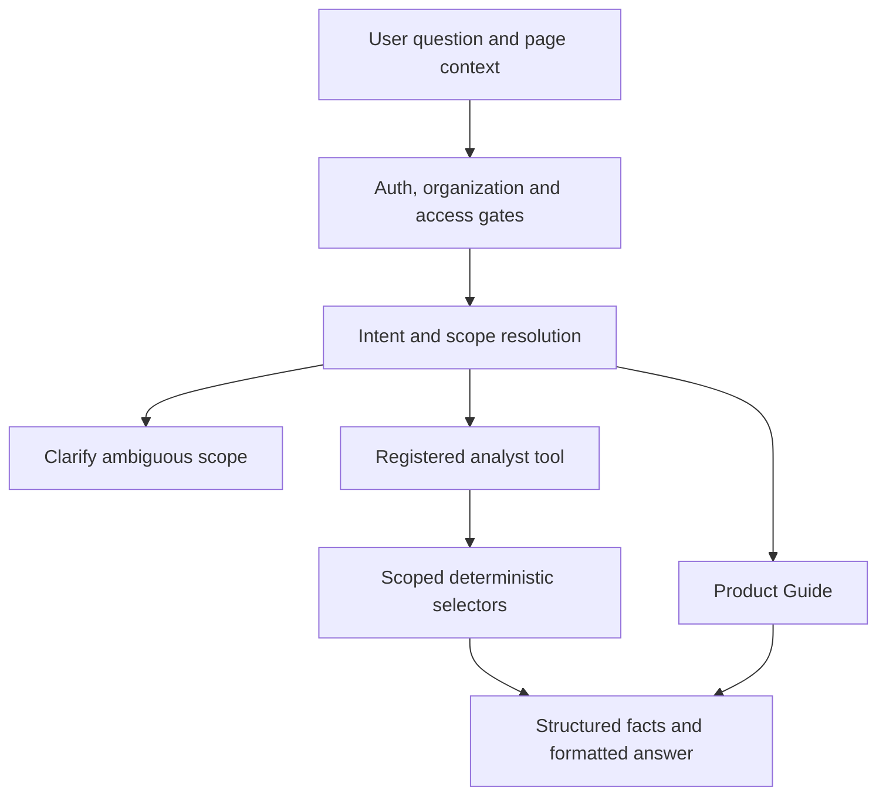

<!-- content/ai/deterministic-ai.md — Teach EstateIQ-derived engineering boundaries. -->
---
title: "AI grounded in structured truth"
slug: deterministic-ai
section: ai
summary: "Route questions to scoped tools and keep financial facts out of model-generated calculations."
order: 12
tags: [ai, estateiq, architecture, implementation]
status: established-pattern
lastReviewed: "2026-10-12"
sources: [reference_sources/estateiq-inspection.md]
related: [ai-context-and-document-qa, ledger-and-read-models, estateiq-tenant-boundary]
---

## Learn the connection model

For the concepts behind connecting an AI host to external capabilities, read [MCP: tools and context](/guide/mcp-fundamentals). MCP supplies an integration contract; the scoped business facts still come from the application.

## Start with a fact-producing system

EstateIQ's portfolio Copilot is a read-only interpretation layer. It does not own charges, payments, leases, expenses, or balances. Domain selectors produce the facts, and registered tools decide how to answer a supported question.

The inspected message view, conversation orchestrator, and analyst router support that division. Architecture documentation describes optional LLM presentation for portfolio Copilot as planned; a product label saying AI does not establish that every answer calls a language model.

## Follow one message

**Text alternative:** Authenticate and gate the request before resolving intent and scope. Ambiguity produces clarification. Help routes to Product Guide; analytical questions route to registered selector-backed tools. Both produce structured responses.

## Request and response contracts

`backend/apps/ai_copilot/views/message_views.py` resolves the organization, checks subscription standing and daily usage when applicable, validates input, delegates response building, and validates output before returning. The inspected quota lookup is user-based; do not casually relabel it an organization-wide counter.

Response fields, tool identifiers, route names, and page context are contracts. A frontend renderer should not need to parse prose to discover the selected period or destination. Store structured source and scope information alongside the explanation where supported.

## Tool selection is deterministic behavior

`routing/analyst_router.py` selects from a priority-ordered registry, supports safe contextual follow-ups, and prevents direct domain requests from being hijacked by prior context. A tool still rebuilds fresh data after selection. The router should not calculate financial metrics itself.

Product help such as “how do I post rent?” must route to the owning lease-ledger action. Portfolio analysis such as “what remains outstanding?” must resolve the intended period/entities and query the appropriate scoped selector. A vague prompt should not silently borrow stale amounts from the last answer.

## Keep the LLM seam narrow

If a provider is introduced for presentation, pass only permitted structured facts and require the response to preserve their meaning. The provider must not invent missing totals, compute balances, issue financial mutations, or enlarge the selected scope. Handle timeout and unavailable-provider cases with a deterministic fallback or explicit unavailable state according to policy.

Treat user text and document text as untrusted input. Prompt instructions cannot confer authority to query another tenant or call a mutation. The tool registry and API/service policy must enforce that boundary independently of the model's willingness to follow it.

## Verify with fixtures and routing cases

For synthetic charges and allocations, assert the selector's numbers and the structured answer agree. Check Product Guide precedence, direct intent versus historical context, unsupported scope, missing membership, quota denial, and a foreign entity ID.

Existing EstateIQ test files were located for routing, scope, analyst tools, API contracts, and product-guide matching. Their existence is not a passing test result; rerun the relevant suite when adapting the pattern. Record any provider path separately from deterministic tool coverage.
