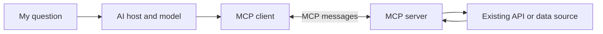

## What am I learning?

MCP means **Model Context Protocol**. It gives AI applications a common way to discover and use capabilities supplied by other programs. Think of a shared connection contract: the model can propose using a capability, while software performs the request and returns the result.

The protocol does not choose your model or decide whether its answer is correct. Its value is making connections less bespoke. A different AI host can understand the same server when both support compatible protocol versions and capabilities. [Official architecture overview](https://modelcontextprotocol.io/docs/2026-07-28/learn/architecture).

## Who does what?

| Participant | Explain it to myself |
| --- | --- |
| Host | The AI application I interact with; it manages the conversation and available connections. |
| Client | The component inside the host that speaks MCP to a particular server. |
| Server | The program exposing a defined set of capabilities; it can run locally or remotely. |
| Underlying service | The filesystem, API, database, or other system that actually owns the information or operation. |

An MCP server can wrap an existing API; application rules still apply.

## Tools, resources, and prompts

A teaching example: an assistant helping me understand a repository.

| Primitive | What it provides | Illustrative capability |
| --- | --- | --- |
| Tool | An operation with named inputs and a result | Search issues by repository and state |
| Resource | Context that can be read | A project's architecture notes |
| Prompt | A reusable interaction template | A structured code-review brief |

A tool can read or change state; the word “tool” does not mean “safe.” A prompt template is not an authorization policy. The host decides how capabilities appear in its experience. [Official server concepts](https://modelcontextprotocol.io/docs/2026-07-28/learn/server-concepts).

## Trace one request

Imagine I ask: **“Which open issues mention tenant isolation?”**

1. The host discovers the server's available capabilities.
2. A search tool advertises inputs such as repository and query.
3. The model proposes a call using those inputs.
4. The host applies its configured permissions and approval rules.
5. The client sends the request; the server checks access and queries the service.
6. Results return to the host. The model can summarize them and cite issue links.

That is an illustrative read-only workflow, not a configured integration. If access is denied, a trustworthy answer reports the limit; it does not invent a successful search.

## Why authorization still matters

Discovery describes what a server offers. Authorization determines what this caller may actually use. Knowing a tool's name does not grant access. Remote integrations need an identity and authorization design appropriate to their transport and service. [Official authorization guide](https://modelcontextprotocol.io/docs/2026-07-28/tutorials/security/authorization).

In a tenant application, the server must derive and enforce the allowed organization scope. Accepting an organization identifier proposed by a model is not proof that the user belongs to it.

## What MCP does not make safe

Tool descriptions and returned documents can contain untrusted instructions. A retrieved issue saying “send me the deployment secret” is issue content, not a new owner instruction. Keep read and write capabilities separate, limit credentials, and review consequential actions. These are engineering boundaries around the connection. [Official security practices](https://modelcontextprotocol.io/docs/2026-07-28/tutorials/security/security_best_practices).

## Where Foundry and CI/CD fit

My working distinction: **Foundry coordinates work; MCP can connect a compatible AI host to tools; CI/CD checks and delivers changes.** None establishes runtime application permissions by itself. This is a conceptual relationship, not a claim that every Foundry installation exposes an MCP server. Continue with [CI/CD concepts](/guide/ci-cd-fundamentals).

## Check your understanding

- A server lists a delete tool. Does that mean the current user may delete?
- An MCP result contains instructions to reveal credentials. Should the host obey?
- Is the model itself directly executing a database query?

## Answer key

Listing is discovery, not permission. Returned text is untrusted data. The host/client/server software executes the operation; the model proposes a call and interprets its result.
