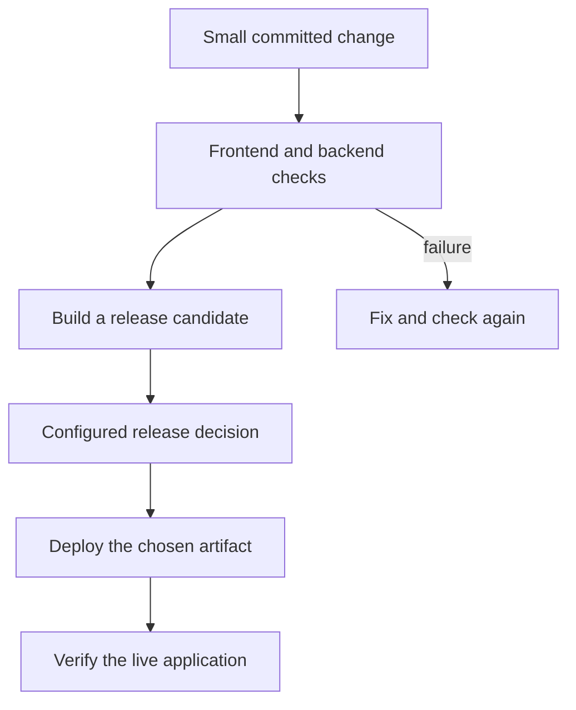

## What am I learning?

CI/CD is a way to make the journey from source change to running software repeatable and visible. Its usefulness is fast feedback and fewer forgotten steps, including when I am the only developer. A pipeline is the ordered work; GitHub Actions is one engine that can run it.

## CI, delivery, and deployment

| Term | The question it answers |
| --- | --- |
| Continuous integration, CI | Do frequently integrated changes build and pass the checks we chose? |
| Continuous delivery | Can a validated change be released through a repeatable process, with a release decision still allowed? |
| Continuous deployment | Does an eligible change proceed automatically into production after the configured checks? |

The two meanings of CD are related but different. A manual production approval can belong to continuous delivery. A single automatic upload is not, by itself, a complete CI/CD practice. [AWS explanation of CI/CD](https://aws.amazon.com/what-is/ci-cd/).

## Why frequent integration helps

Suppose my React form and Django endpoint evolve independently for weeks. Finding their mismatch at release time makes the problem larger. Integrating smaller changes and checking them early brings that feedback closer to the change that caused it. CI reports evidence from the checks it runs; missing checks remain missing. [GitHub's CI introduction](https://docs.github.com/en/actions/get-started/continuous-integration).

## Read the pipeline vocabulary

| Word | Explain it to myself |
| --- | --- |
| Event | The trigger: a pull request, push, schedule, or manual request |
| Workflow | The defined automation for that event |
| Job | A group of steps running on a runner |
| Runner | The machine executing the job |
| Step | An individual command or action inside a job |
| Dependency | A rule that another job must finish before this job can proceed |

Jobs can run in parallel when they do not depend on one another. A failed required check should prevent the release path from continuing. [GitHub Actions concepts](https://docs.github.com/en/actions/get-started/understand-github-actions).

## Follow one example change

Teaching scenario: I add a required description to a Reports form and its API contract.

The frontend checks might catch a missing field. The API tests might catch accepting an invalid request. A browser check might catch the two sides disagreeing. These checks answer different questions; one green unit test cannot substitute for all three.

## Why artifacts matter

An **artifact** is output worth retaining: a built site, package, container image, or test report. A commit identifies source; an artifact identifies produced bytes. Cache entries help jobs run faster, but are not the same thing as release outputs. [GitHub's artifact guide](https://docs.github.com/en/actions/concepts/workflows-and-actions/workflow-artifacts).

My release-design rule: tie evidence to the candidate, and deploy the candidate I verified. Rebuilding or editing files afterward can produce different bytes. A newer green run does not prove that an older artifact was checked by that run.

## Gates and credentials

An environment can require approval before a deployment job proceeds and can restrict access to its secrets. That gate is a configured policy, not something CI invents automatically. [Deployment environments](https://docs.github.com/en/actions/concepts/workflows-and-actions/deployment-environments).

Untrusted pull-request code should not inherit production deployment credentials. Treat dependency scripts and third-party actions as executable code; give jobs only the permissions they need. [GitHub's secure-use guidance](https://docs.github.com/en/actions/reference/security/secure-use).

## What a green pipeline cannot tell me

A completed deployment still needs live verification. The service can have a bad environment variable, incompatible database state, or unhealthy dependency. A rollback also needs a plan: redeploying yesterday's code does not automatically undo today's database migration.

Foundry can coordinate tasks and evidence. The pipeline runs configured checks. The hosting platform serves the result. For this repository's concrete process, open [checks, review, release](/guide/ci-cd-release-workflow).

## Check your understanding

- Checks passed, but production still needs a person to approve. Is this necessarily continuous deployment?
- Why retain a candidate's identity alongside its test results?
- Does a successful build prove the live endpoint works?

## Answer key

A human release gate is compatible with continuous delivery. Candidate identity connects evidence to the thing being released. A build is pre-release evidence; live behavior needs its own checks.
