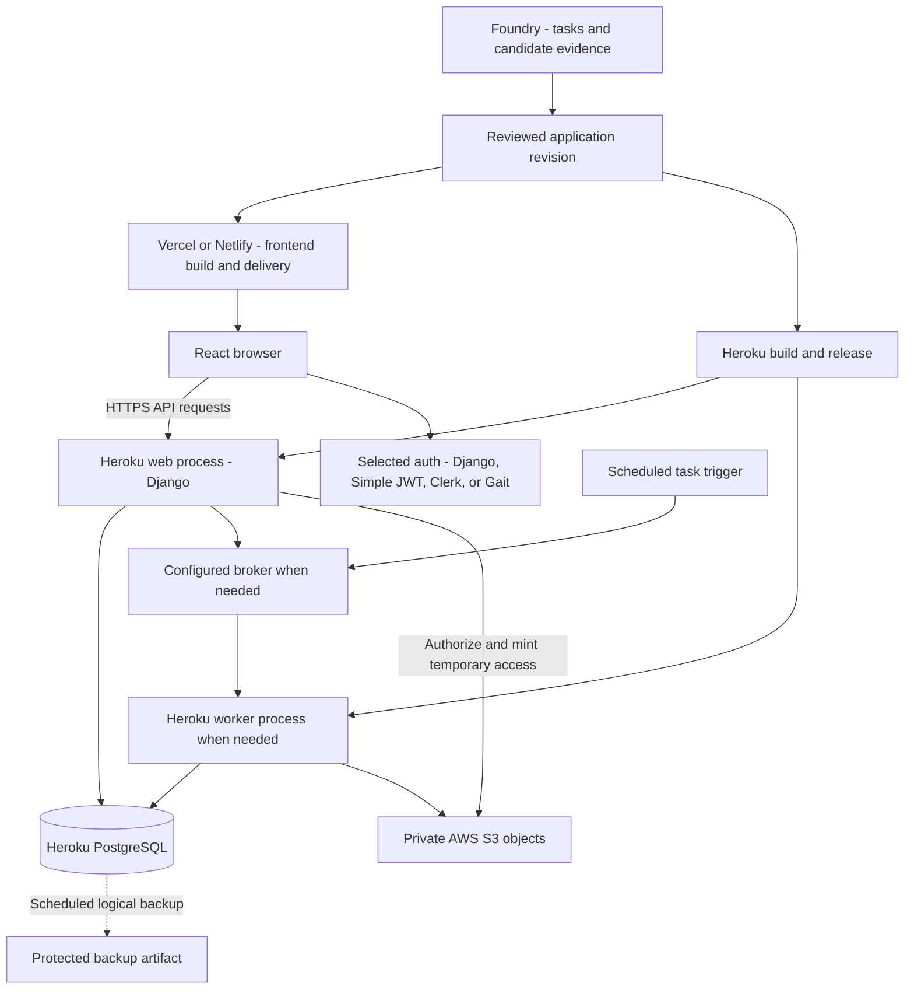

<!-- content/deployment/deployment-platforms.md — Map Anthony's hosting experience to explicit runtime responsibilities. -->
---
title: "Heroku, frontend hosting, and S3"
slug: deployment-platforms
section: deployment
summary: "Connect Heroku application processes, Vercel or Netlify frontend delivery, and private S3 files."
order: 8
tags: [deployment, heroku, vercel, netlify, aws, s3, storage]
status: established-pattern
lastReviewed: "2026-10-12"
sources: [reference_sources/stack-context.md]
related: [backup-and-scheduled-tasks, authentication-options, system-overview]
---

## Start with the platforms I actually use

Heroku is my main application hosting platform. I have also used Vercel for frontend delivery and AWS S3 for object storage. This handbook is currently delivered by Netlify. AWS experience described here is S3; ECS, RDS, VPC, and broader AWS designs are future reference topics rather than a claim of deployed experience.

The diagram is a representative composition of these tools, not an assertion that all of my projects have this exact topology.



**Text alternative:** Foundry supports candidate review before separate frontend and Heroku delivery. React calls a Django web process. The selected identity mechanism supplies authentication. PostgreSQL holds durable business data. Optional broker/worker processes execute jobs and store files in S3. Scheduling triggers work, while database backup is a separate protected operation.

## Heroku process responsibilities

The web process handles HTTP requests; a worker consumes background jobs; release-time commands prepare the deployment according to an explicit migration plan. They use the same application revision but have different responsibilities and scaling needs. A scheduler is a trigger, not a continuously running web request.

**Procfile · reference excerpt, adapt module and queue settings**

```text
# Procfile — Define independent application process responsibilities.
web: gunicorn config.wsgi:application
worker: celery -A config worker --loglevel=info
release: python manage.py migrate --noinput
```

This excerpt assumes configured Gunicorn, Celery, Django, database credentials, and a supported broker. It is not installed in this frontend repository. Add a worker only when the application needs one. Avoid publishing operational commands without their dependencies and environment assumptions.

A release migration must remain compatible with the running and rollback revisions. Rolling back application code does not undo data migrations. Check release logs, smoke-test a real request, and observe error rates and worker health rather than considering a build success sufficient.

## Frontend delivery with Vercel or Netlify

A Vite handbook produces static `dist/` assets. History-based routes need the host's SPA fallback so a direct article URL loads. This project has that configuration in `netlify.toml`; a separate Vercel deployment would need the equivalent platform setup. See [Vercel's Vite guide](https://vercel.com/docs/frameworks/frontend/vite).

Frontend and API origins may differ. Record frontend/API/auth origins per environment and configure CORS, credential transport, CSRF, and callback URLs accordingly. A variable compiled into a frontend bundle is public even when entered through a host's environment settings. Never put a database password or private provider key there.

## AWS S3 is durable file storage

Store object references in the database and file bytes in private S3 objects. A container or dyno's filesystem is suitable for temporary processing, not the durable home of generated reports. Keep upload, validation, generation, publication, and cleanup states explicit.

Authorize report access before issuing a short-lived download URL. A presigned URL carries temporary access granted by the signing credentials and can be shared by its holder. Its effective lifetime can be limited by the underlying credentials. Avoid recording the URL in general application logs. See [AWS presigned URL behavior](https://docs.aws.amazon.com/AmazonS3/latest/userguide/using-presigned-url.html).

Use least-privilege S3 access, appropriate encryption and retention, and a cleanup policy for abandoned uploads or failed generation. Object versioning and lifecycle rules should be recorded as configured facts, not assumed protections.

## Verify the deployment as one request flow

Load a direct frontend route. Make an authenticated API request using the project's selected identity mechanism. Read a scoped report, queue a job if supported, observe durable completion, and download only through the authorized path. Repeat with a foreign organization identifier and expect denial.

Then inspect web/worker logs using the same request/job identifiers. Confirm secrets are absent from frontend assets and signed file URLs are absent from telemetry. Use separate staging data and credentials for these exercises.

## Planned AWS flagship deployment

[Lumen](/guide/lumen-platform-design) is the flagship planned for dedicated EC2 service instances behind an ALB. Follow its [AWS topology](/guide/lumen-aws-architecture), [security plan](/guide/lumen-aws-security), and [release gates](/guide/lumen-aws-release). This extends the intended platform coverage; it does not turn earlier S3 experience into a claim of completed EC2 deployment.
