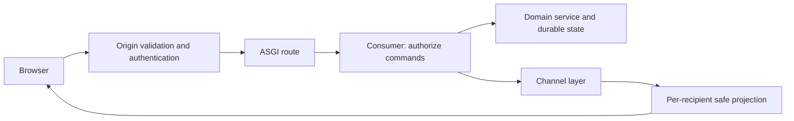

<!-- content/django/django-channels.md — Curated engineering guidance and reference examples. -->
---
title: "Channels: authenticated real-time systems"
slug: "django-channels"
section: "django"
summary: "Map ASGI, consumers, channel layers and reconnect behavior to the gaming platform."
order: 2.7
tags: ["django", "architecture", "practical guide"]
status: "established-pattern"
lastReviewed: "2026-10-13"
sources: ["reference_sources/django-toolkit.md"]
related: ["gaming-multiplayer-flow", "gaming-poker-tournaments", "reliable-job-lifecycle"]
---

## Start with the connection contract

Read [WebSockets: design the live connection](/guide/websocket-design) for transport choices, authentication, message contracts, reconnects and React lifecycle. This chapter covers the Django implementation boundaries.

## Add Channels for a real requirement

HTTP fits ordinary request/response work. WebSockets fit live game state, presence and bidirectional commands. A connection is a long-lived transport, not permission to receive every event.

ASGI routes protocols to consumers. A consumer handles connection and message events. A channel layer passes events between instances; a production Redis layer needs an actual reachable Redis service. An in-memory layer cannot connect independent processes.

## Establish identity, then authorize the room

Validate WebSocket origins. Cookie-based credentials can accompany cross-site connection attempts; accepting any origin is unsafe. Channels' `AuthMiddlewareStack` integrates Django session authentication. A JWT design needs a deliberately implemented verifier; do not assume session middleware verifies a bearer token. Avoid putting long-lived credentials into logged URLs. See [Channels security](https://channels.readthedocs.io/en/stable/topics/security.html).

On connect, check access to the game or room. On every command, check current role, turn and game status. Recheck sensitive state as membership or session validity changes. A guessed group name is not an access-control boundary.

## The server owns game state

Validate move inputs and apply transitions on the server. Broadcast only the recipient-safe representation: poker opponents must not receive another player's hole cards. Do not send a complete secret state object and ask the browser to hide it.

The [gaming multiplayer flow](/guide/gaming-multiplayer-flow) and [poker chapter](/guide/gaming-poker-tournaments) show these boundaries. Their inspected process-local timer limitations remain limitations, not a guarantee of distributed scheduling.

## Reconnect from an authoritative snapshot

Treat disconnection as normal. Reauthenticate and reauthorize, retrieve a current snapshot, then resume events with a defined ordering or version policy. Deduplicate commands where retries are possible. Presence is transient and should not decide durable financial or game results.

Use database-safe adapters for synchronous ORM work inside async consumers, or supported async ORM operations with their documented transaction constraints. An `async def` containing blocking calls still blocks useful work.

## Verify more than a connection

Test invalid origin, missing credentials, unauthorized room, forged move, duplicate command, private-data filtering, disconnect/reconnect and multiple server processes. Rate-limit messages and bound payload sizes. A connected socket alone proves none of these properties.
