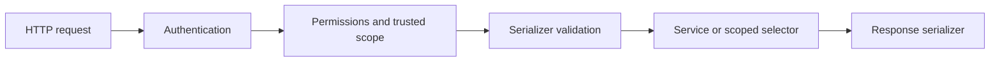

<!-- content/django/django-rest-boundaries.md — Curated engineering guidance and reference examples. -->
---
title: "Serializers, authentication and permissions"
slug: "django-rest-boundaries"
section: "django"
summary: "Separate valid input, verified identity and permission to act."
order: 2.3
tags: ["django", "architecture", "practical guide"]
status: "established-pattern"
lastReviewed: "2026-10-13"
sources: ["reference_sources/django-toolkit.md"]
related: ["django-views", "authentication-options", "tenant-isolation"]
---

## Follow the request boundaries

This is a conceptual flow; DRF performs authentication and initial permission checks before dispatch, while object checks occur when the view retrieves an object. Your workflow can need additional domain authorization after input validation.

## Serializers describe a contract

Use explicit fields rather than exposing every model column. Mark server-managed identifiers and timestamps read-only. Validate cross-field rules in `validate`, and return field-specific errors where possible. Validate a related record against the authorized organization; accepting a syntactically valid foreign ID is not enough.

Avoid putting a large multi-model financial workflow inside a serializer's `create`. The serializer can pass validated values into an explicit transactional service.

## Authentication is not authorization

Authentication establishes who presented the request. Permissions decide whether that identity may perform the operation. A valid JWT does not prove membership in the requested organization. Middleware selecting an organization does not prove access either.

Start the learning API with session authentication; choose the real application's [authentication method](/guide/authentication-options) deliberately. Session writes need CSRF protection. Cross-origin browser access needs an explicit CORS policy; CORS does not authorize an API caller.

## Keep lists bounded and errors stable

Choose pagination and expose a stable ordering with a tie-breaker. Whitelist filter and ordering fields instead of treating arbitrary request strings as ORM instructions. Use DRF's error handling for expected validation and permission errors; unexpected failures belong in server-side diagnostics with sensitive values excluded.

Request throttles can improve fairness but are not a complete abuse or denial-of-service defense. Apply limits to expensive commands, uploads and provider calls at the appropriate layers.

## Verify the contract

Test anonymous access, another user's record, another organization's related ID, read-only field injection, invalid input and pagination boundaries. Assert both the response and the absence of forbidden writes. See the [DRF permission reference](https://www.django-rest-framework.org/api-guide/permissions/) for object-check limitations.
