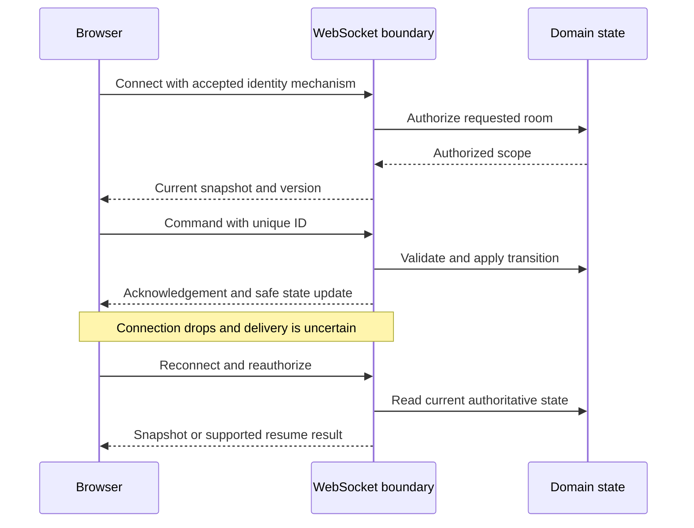

<!-- content/django/websocket-design.md — Design the real-time protocol before wiring Django Channels. -->
---
title: "WebSockets: design the live connection"
slug: websocket-design
section: django
summary: "Choose the transport, define messages, authenticate connections and recover safely after disconnects."
order: 2.65
tags: [websocket, realtime, channels, reconnect, react, gaming]
status: established-pattern
lastReviewed: "2026-10-13"
sources: [reference_sources/websockets.md, reference_sources/projects-inspection.md]
related: [django-channels, gaming-multiplayer-flow, gaming-poker-tournaments, django-cors]
---

## Choose the transport for the interaction

| Requirement | Starting choice |
| --- | --- |
| Occasional refresh of a dashboard | HTTP polling with a deliberate interval |
| One-way server updates, client commands remain HTTP | Consider server-sent events |
| Frequent two-way game, chat or collaborative interaction | Consider WebSockets |

A WebSocket provides a persistent two-way connection. It does not supply your message contract, application permissions or recovery policy. The [WebSocket API reference](https://developer.mozilla.org/en-US/docs/Web/API/WebSockets_API) describes the browser interface. For Django implementation, continue to [Channels](/guide/django-channels).

## Give connection state a visible meaning

Distinguish connecting, connected, reconnecting, disconnected and access denied. Do not present a disabled live connection as an empty game or an empty chat history. A connected transport still needs an authorized subscription and an authoritative snapshot.



The diagram describes a recommended contract, not a claim that every inspected game implements replay or resumable events.

## Authenticate and authorize separately

For browser connections, use a deliberate cookie-session or short-lived ticket/token design. The native browser WebSocket constructor cannot attach arbitrary Authorization headers like Axios. Never assume the Axios interceptor authenticates a socket. Avoid long-lived tokens in URLs that may be logged.

Validate the handshake's Origin and authorize the requested room before joining a group. WebSocket origin handling is separate from HTTP CORS response headers; adding `CORS_ALLOWED_ORIGINS` alone does not secure a socket. Origins can also be forged by non-browser clients, so origin validation is not identity verification. Recheck operation permissions and handle revoked sessions or removed membership while a connection remains open.

The [Channels security guide](https://channels.readthedocs.io/en/stable/topics/security.html) covers origin validators and cookie-based connection risks.

## Define commands, events and acknowledgements

Use explicit message types and validated payloads. A synthetic command envelope might look like:

```json
{
  "type": "game.move",
  "command_id": "demo-command-42",
  "expected_version": 17,
  "payload": { "cell": 4 }
}
```

The server derives the caller and authorized game from trusted connection context. It checks the turn, input and current version before changing state. A command acknowledgement must distinguish accepted, rejected and already applied; a browser `send()` returning does not prove durable completion.

An accepted command can produce different events for different recipients. In poker, another player's hole cards never belong in your payload. Broadcast a safe projection rather than raw internal state.

## Recover without duplicating work

Use capped exponential reconnect delays with jitter. Stop automatic retries for a known authorization denial, and cancel reconnect timers on logout, navigation or unmount. A reconnect creates a new authorization boundary, not a continuation of old permission.

Transport ordering on one connection does not solve gaps between connections or concurrent producers. Use server-defined versions or sequence identifiers, detect gaps and fetch a fresh snapshot. Only offer replay if the backend actually retains and authorizes a replay stream.

After a lost response, a retried command needs a server-side deduplication policy. For commands where duplicates matter, bind the command ID to the actor, target and payload; do not blindly replay every queued action after reconnect.

## Keep the React connection deliberate

Place connection lifecycle in a feature hook or a shared provider where sharing is intentional. UI components render connection state and emit commands. Clean up listeners, timers and the socket when the owner unmounts; development remounts should not leave duplicate subscriptions.

When events affect TanStack Query data, either update a known cache entry from an authoritative event or invalidate the relevant scoped query. Do not mutate unrelated tenant caches or create a second competing source of truth. Keep transient presence separate from durable domain records.

## Heartbeats, load and deployment

Browser JavaScript does not expose protocol ping frames directly. If the application needs a heartbeat, define application messages and timeouts, or use the server's transport-level support appropriately. Tune the policy around the proxy's idle limits. Follow the [browser client guide](https://developer.mozilla.org/en-US/docs/Web/API/WebSockets_API/Writing_WebSocket_client_applications) for lifecycle events.

Bound message sizes, rates and queues. The standard browser WebSocket interface has no automatic backpressure; decide whether to coalesce replaceable updates or disconnect a slow consumer rather than buffer indefinitely.

Deploy secure `wss://` connections from HTTPS pages and use a host/proxy that supports long-lived upgraded connections. In Django, an ASGI process serves the socket; a static frontend host does not. A [Channels layer](https://channels.readthedocs.io/en/stable/topics/channel_layers.html) connects instances, while durable business state remains elsewhere. Its existence does not guarantee event persistence or exactly-once delivery.

## Verify the failure cases

Test missing identity, rejected origin, foreign room, revoked membership, malformed payload, duplicate command, stale version, private-data filtering, disconnect during mutation and reconnection on another server instance. Confirm logout closes the connection and clears private state.

Use the [gaming case study](/guide/gaming-multiplayer-flow) to connect these decisions to real code. These checks remain proposed; this handbook opens no live socket and runs no Channels service.
