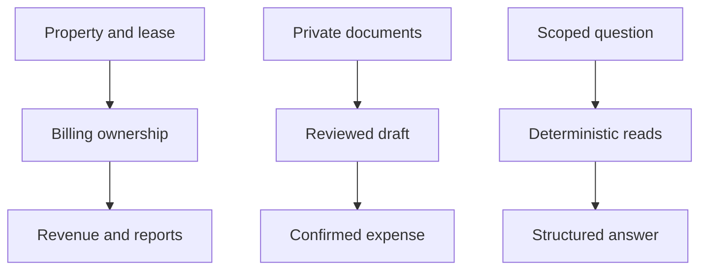
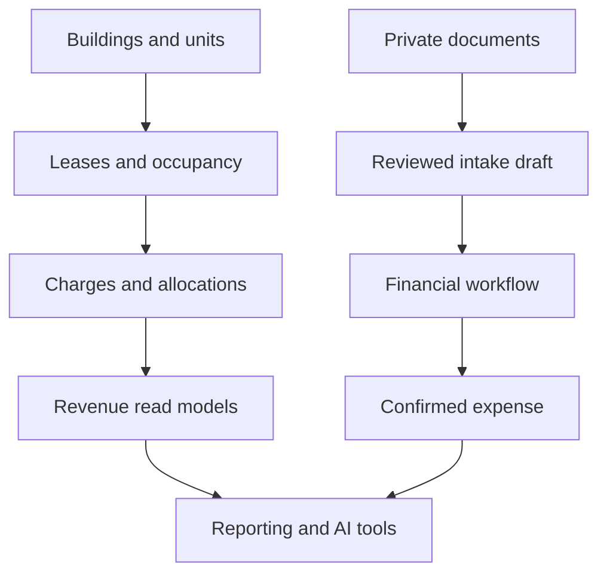

<!-- content/estateiq/estateiq-domain-map.md — Teach EstateIQ-derived engineering boundaries. -->
---
title: "EstateIQ: the domain map"
slug: estateiq-domain-map
section: projects
summary: "Understand who owns each fact before adding APIs, AI, or automation."
order: 10
tags: [estateiq, estateiq, architecture, implementation]
status: established-pattern
lastReviewed: "2026-10-13"
sources: [reference_sources/estateiq-inspection.md]
related: [estateiq-tenant-boundary, ledger-and-read-models, deterministic-ai]
---

## A modular monolith with explicit ownership

EstateIQ deploys a Django application organized into domain packages, with a React/TypeScript client organized into features. A domain boundary is a responsibility inside the codebase; it does not imply a separate service or database. That distinction keeps transactional workflows practical without turning every feature into infrastructure.

The source review inspected architecture documents and representative implementation files. It did not execute the backend suite or audit production. “Present in source” and “verified in production” remain different claims.

## The complete ownership map

| Domain | Owns | Consumers and boundaries |
| --- | --- | --- |
| Identity and tenancy | Accounts, organizations, active membership, selected scope | Every scoped API; no financial calculations |
| Buildings and units | Property structure and unit identity | Leasing, expenses, property finance |
| Leasing | Tenant relationships, effective lease lifecycle, occupancy | Billing and reporting; no payment allocation |
| Billing | Lease charges, payments, allocations | Revenue and portfolio reporting |
| Revenue | Deterministic read models over Billing | Frontend and AI tools; no revenue writes |
| Expenses | Confirmed spend, categories, vendors, evidence links | Reporting and tax preparation |
| Property finance | Owner-side financing and obligations | Reporting; separate from tenant receivables |
| Documents | Private files, metadata, preview, extracted text | Evidence and document Q&A |
| Document intake | Incoming artifacts, extraction and review drafts | Confirmation workflow; no automatic accounting truth |
| Financial workflows | Cross-domain orchestration | Delegate actual writes to owning services |
| Reporting | Aggregate read contracts | Dashboard; no replacement financial ledger |
| Tax documents | Accountant-preparation composition | Review issues and links; planned packet features stay labeled |
| Onboarding | Derived setup status and next steps | Client and Copilot; no duplicate completion truth |
| Subscriptions | Owner-to-platform entitlement and provider synchronization | Feature gates; separate from lease billing |
| AI Copilot | Intent, tool routing, context, structured presentation | Selector-backed facts; read-only financial behavior |
| Operations | Delivery, schedules, logs, backup and recovery practices | Require configuration and execution evidence |

## Follow the ownership chain

## Project architecture

**Text alternative:** Property and lease → Billing ownership → Revenue and reports. Private documents → Reviewed draft → Confirmed expense. Scoped question → Deterministic reads → Structured answer. These are responsibility lanes; the detailed diagram below describes the connected workflow.

## Detailed flow

**Text alternative:** Property structure supports leases; leases own their ledger history; Revenue reads charge/allocation facts for reporting and AI. Private documents produce reviewed drafts, and a workflow delegates confirmed expense creation to the expense domain.

## Locate the boundaries in the repository

Backend owners live under `backend/apps/`; shared tenancy and permission mechanisms live under `backend/shared/`. Frontend features live under `frontend/src/features/`. Domain architecture pages live under `docs/architecture/domains/`. Tests belong near the domain whose behavior they protect.

For a new feature, identify the owning records and services first. Then identify read-model consumers, cache invalidation, authorization, and evidence links. A dashboard card is a view of domain truth, not a new owner of that truth.

## Verify a vertical slice

Choose a synthetic organization and one lease. Trace a write through authentication, active membership, input contract, service transaction, models, selector response, and frontend cache refresh. Repeat with a foreign organization and confirm no mutation. Then compare dashboard and AI answers with the same selector results.

## Errors this map helps prevent

A document extraction should not silently create an expense. Revenue should not post charges. Subscription billing should not be merged into lease receivables. An AI response should not calculate a balance independently. Correct those failures at the owning boundary rather than patching the presentation to hide disagreement.
