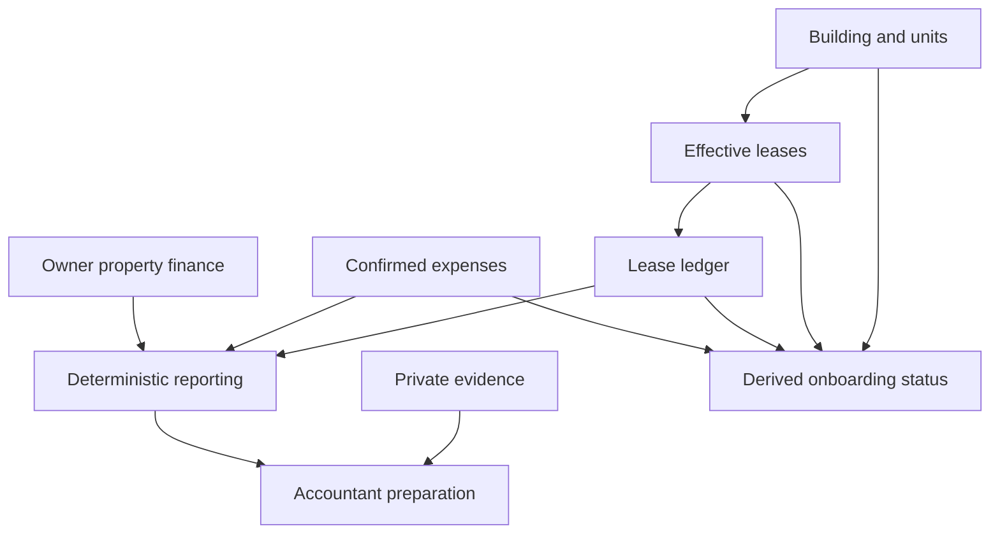

<!-- content/estateiq/estateiq-domain-workflows.md — Teach EstateIQ-derived engineering boundaries. -->
---
title: "Property, onboarding, finance, and tax workflows"
slug: estateiq-domain-workflows
section: projects
summary: "Connect the rest of the system without creating duplicate sources of truth."
order: 17
tags: [estateiq, estateiq, architecture, implementation]
status: established-pattern
lastReviewed: "2026-10-12"
sources: [reference_sources/estateiq-inspection.md]
related: [estateiq-domain-map, ledger-and-read-models, private-document-lifecycle]
---

## Property structure before financial activity

Buildings and units supply stable property identity. Leasing connects people and contracts to those units. The documented occupancy rule derives from effective active leases rather than a manually maintained occupied boolean.

That matters during turnover: a unit's timeline persists while each lease keeps its own ledger. UI navigation should distinguish current operational context from historical records instead of opening a combined unit balance.

## Onboarding derives progress

The documented onboarding chain is building, units, lease, ledger activity, and expenses. Selectors derive setup status from organization-owned records and expose stable next-step contracts to clients and Copilot. Preferences and interaction events can persist; duplicate has-building or completed-finance booleans should not compete with domain truth.

A new organization with no data is a valid empty state. The UI should guide the next safe action rather than crash, render invented totals, or imply that a checklist established readiness.

## Expenses and owner-side property finance

Expenses owns confirmed spend, category/vendor relationships, and supporting evidence. Property Finance owns owner-side financing and recurring obligations such as mortgage, insurance, and property-tax records. Neither owns lease charges or payment allocation.

Reporting consumes deterministic selectors/contracts from these domains. Explain metric inclusion rules before combining spend, financing, and receivables: visually adjacent cards do not establish that their values share an accounting basis.

## Accountant preparation is composition

Tax Documents composes income, expenses, documents, buildings, and property-finance facts into review/readiness surfaces. Missing evidence and uncategorized records route back to their owning domains. This is not a tax-advice, deduction, filing, or compliance engine.

The inspected source documentation marks formal PDF/ZIP packet phases as planned. Preserve that status until an implemented export and failure exercise provide evidence. A packet-preview UI should not be described as a completed durable export job.

**Text alternative:** Property and lease facts support ledger activity and derived onboarding. Confirmed expenses and owner finance contribute to reporting. Reporting plus evidence support accountant preparation without moving ownership of the underlying facts.

## Build a vertical workflow

For a synthetic unit, create a lease through its owning service, post a documented charge, attach an authorized evidence document where needed, and observe the derived dashboard/setup state. If a mutation changes several read surfaces, invalidate every affected cache contract rather than maintaining duplicate state in components.

For an accountant-review item, deep-link to the exact record owner. Do not let a report silently edit a category or invent a missing receipt. Cross-domain coordination belongs in a workflow layer that delegates actual writes.

## Verification and limitations

Test lease date boundaries, turnover history, missing setup data, foreign property relationships, finance/expense scope, consistent selected periods, and links from review issues to authorized records. Confirm that deleting or archiving source data changes derived onboarding/readiness appropriately.

This chapter reconciles domain documentation. Detailed schema, algorithms, and deployment outcomes require their own code review and tests before labeling each workflow verified.
