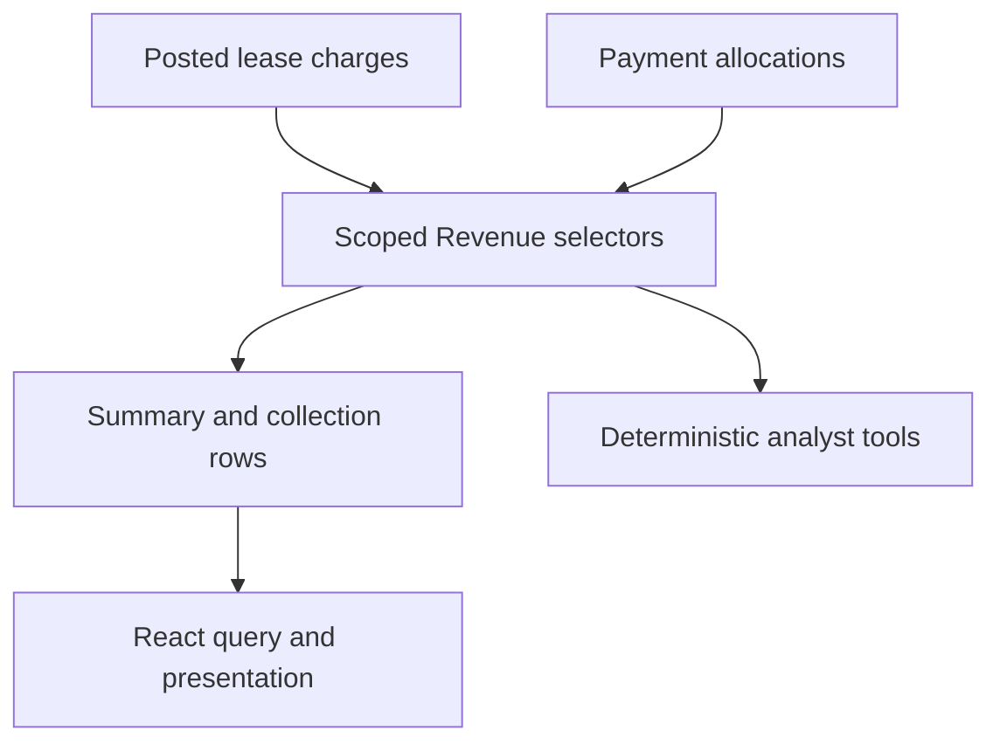

<!-- content/estateiq/ledger-and-read-models.md — Teach EstateIQ-derived engineering boundaries. -->
---
title: "Ledger truth and derived read models"
slug: ledger-and-read-models
section: projects
summary: "Use charges and allocations as durable facts, then build Revenue and reporting from them."
order: 14
tags: [estateiq, estateiq, architecture, implementation]
status: established-pattern
lastReviewed: "2026-10-12"
sources: [reference_sources/estateiq-inspection.md]
related: [estateiq-domain-map, deterministic-ai, estateiq-domain-workflows]
---

## The lease owns its financial history

EstateIQ's Billing domain is a lease receivables subledger. A unit has a timeline of leases; each lease preserves its own charges, payments, allocations, and derived balance. Replacing a tenant should not move old accounting rows into a new lease's ledger.

This chapter is an engineering explanation of the documented domain, with synthetic amounts. It is not accounting advice or a claim that every listed invariant has been exercised in this review.

## Payment is not allocation

A charge records an amount owed. A payment records money received. An allocation applies payment to a charge. Unapplied money remains received cash but does not automatically reduce a particular charge's balance.

For a synthetic charge of 1,000 and a payment of 700 with only 500 allocated to that charge, the charge's remaining balance is 500; the payment has 200 unapplied. Showing a mutable paid flag or subtracting the full payment from every charge would misrepresent the records.

## Revenue is a read model

The inspected Revenue architecture says the domain has no database models or write services. It reads Billing data through organization-scoped selectors and exposes summary and collection-row contracts. Operational actions lead back to the owning lease ledger.

**Text alternative:** Posted charges and allocations feed organization-scoped Revenue selectors. The same structured read contracts support frontend summaries and deterministic AI analysis.

The documented selected-period equations use posted charges for expected amount and their allocations for collected amount. Outstanding is their difference. A no-charge gap is an operational finding, not invented revenue. Table rows and summary totals use consistent filters so separately implemented calculations do not drift.

## Mutations belong to the owning service

A billing service should validate organization scope, workflow rules, allowable allocation, and transaction boundaries. Database constraints protect structural invariants; locking and explicit concurrency policy protect operations that depend on changing balances.

The exact remedies depend on the implemented schema. Do not copy a lock excerpt without checking which rows and predicates prevent the race. An aggregate computed before acquiring the necessary lock can still be stale.

## Refresh downstream views deliberately

After posting a charge or allocating payment, refresh the relevant ledger, Revenue lists/summaries, and dashboard consumers. Organization and normalized filters belong in query identity. Use authoritative responses where possible and invalidate derived views whose totals may have changed.

An AI answer should rebuild facts rather than treat the last formatted response as financial memory. A document or frontend component should not create a parallel balance calculation.

## Verify the synthetic history

Test partial allocation, unapplied cash, two payments against one charge, tenant turnover with separate leases, filtering by period/entity, and cross-organization denial. Compare the list, summary, dashboard, and analyst tool under the same filters. A review of source documents alone does not establish these checks passed.
