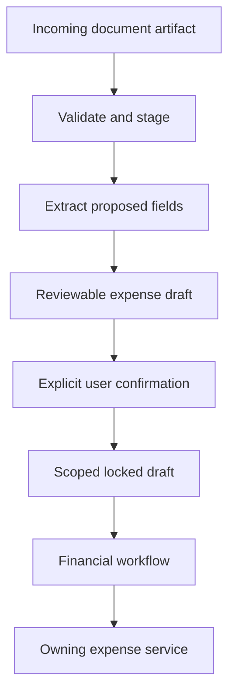

<!-- content/estateiq/private-document-lifecycle.md — Teach EstateIQ-derived engineering boundaries. -->
---
title: "Private documents and reviewed intake"
slug: private-document-lifecycle
section: projects
summary: "Keep canonical files, extracted drafts, and confirmed financial records at distinct trust boundaries."
order: 15
tags: [estateiq, estateiq, architecture, implementation]
status: established-pattern
lastReviewed: "2026-10-13"
sources: [reference_sources/estateiq-inspection.md]
related: [ai-context-and-document-qa, ledger-and-read-models, estateiq-tenant-boundary]
---

## A file is evidence, not a financial record

EstateIQ documents store private evidence and metadata. Intake captures incoming artifacts and proposed values. Expenses owns confirmed spend. A receipt extraction may propose a category or amount, but confirmation must pass domain rules before it becomes financial truth.

The source inspection covered document storage documentation, targeted file-view code, and the intake draft-confirmation service. It did not upload real files or run extraction/provider workflows.

## Canonical files and private delivery

The documented upload pipeline validates supported PDF/image inputs, converts supported images to a canonical PDF, computes a hash, and records original plus canonical metadata. Storage paths include organization/document context. A path naming convention improves organization; authorization still happens in the backend.

EstateIQ's inspected `document_file_views.py` scopes DocumentFile queries by organization and builds a `FileResponse` with `nosniff`. Its current preview/download design streams through the authorized backend, rather than returning raw storage URLs.

That distinction corrects an important generic assumption: short-lived S3 URLs are one possible design, but this application's observed path is backend-authorized streaming. Both need a permission boundary; they have different revocation, bandwidth, and caching tradeoffs.

## From intake draft to expense

**Text alternative:** Incoming artifacts are validated and staged; extraction proposes fields in a review draft. User confirmation locks the scoped draft and delegates confirmed financial creation through the owning workflow/service boundary.

The inspected `expense_draft_confirmation_service.py` runs transactionally, obtains an organization-scoped locked draft, requires pending status, rejects an already linked expense, validates required confirmed fields, and delegates to Financial Workflows. Those are observable source behaviors, not an executed race-condition test result.

## Preserve the confirmation boundary

Required fields include a permanent document link, scope, amount, date, and category. Related organization-owned records must remain compatible with the selected organization. A confident extraction does not bypass review or establish that an accounting operation is valid.

The cross-domain workflow coordinates evidence links while the owning Expense service retains its write rules. If an operation fails, transaction and storage cleanup semantics must be understood separately: a database rollback does not automatically delete an object already uploaded to S3.

## Recovery and verification

Use synthetic PDFs/images for size/type checks, conversion failure, unsupported files, duplicate ingestion, expired staging cleanup, foreign document IDs, and preview/download denial. Submit confirmation twice and concurrently; check that the resulting durable expense behavior matches the service contract without duplicate financial records.

Inspect storage outcomes after partial failure and make abandoned-object cleanup observable. For preview, verify object URL cleanup and cancellation when changing organizations. For Q&A, verify the document-specific source boundary and image-only limitation.
