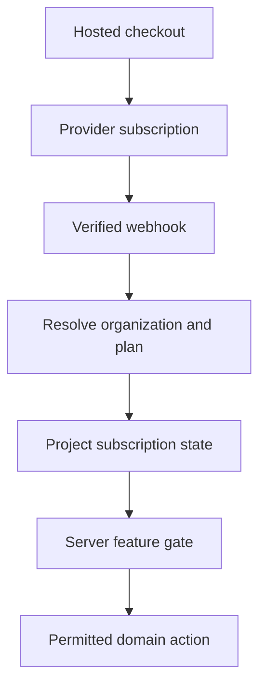

<!-- content/estateiq/subscriptions-and-feature-gates.md — Teach EstateIQ-derived engineering boundaries. -->
---
title: "Subscriptions, webhooks, and feature gates"
slug: subscriptions-and-feature-gates
section: projects
summary: "Separate SaaS entitlement from lease accounting and enforce access on the server."
order: 16
tags: [estateiq, estateiq, architecture, implementation]
status: established-pattern
lastReviewed: "2026-10-12"
sources: [reference_sources/estateiq-inspection.md]
related: [estateiq-domain-map, deterministic-ai, backup-and-scheduled-tasks]
---

## Two different meanings of billing

EstateIQ's subscriptions domain concerns the owner paying the platform. The lease Billing domain concerns receivables from tenants. They have different customers, records, providers, and consistency expectations. Do not use one subscription status to infer that a lease payment settled.

The reviewed instructions describe plan limits, trial state, provider synchronization, and feature gates. This guide omits mutable commercial prices; inspect current seeded plans and product contracts when implementing.

## Provider events establish provider-backed state

Subscription instructions describe signature verification before processing Stripe webhook events. The inspected handler maps provider subscription data through configured plans to an organization's subscription and uses `update_or_create` to mirror state. It can synchronize a missing provider mirror before processing.

Repeated upserts help repeated events converge; they do not by themselves prove protection against stale out-of-order events, every concurrency race, or lost delivery. Record event identity, ordering policy, reconciliation, and observable failure handling where needed. A successful browser redirect is not proof that backend subscription state is synchronized.

**Text alternative:** The hosted provider emits a verified event that maps to organization/plan state. Backend feature gates consult the resulting state before the domain action. Frontend checkout return is presentation, not authoritative state.

## Gate order and separate authority

The documented policy checks a recognized demo organization first, then subscription standing, then plan limits. A demo exemption must not bypass authentication, membership, or organization-object isolation. Keep the exemption narrowly tied to intended synthetic demo behavior.

The inspected AI message view applies standing and usage checks before response construction. Its usage lookup is user-based, so quota semantics must be documented accurately. A frontend upgrade prompt is useful feedback, but the backend denies unsupported access even if the caller bypasses the UI.

## Trials and scheduled transitions

Local trials without a provider subscription and provider-backed trials have different transition owners. The instructions describe a management command for local expiration and webhook updates for provider-backed state. Do not apply both transitions blindly to the same subscription.

Treat scheduled expiration as idempotent maintenance with last-success monitoring. A missed trigger must have a recovery path, and grace-period decisions need explicit timestamps and timezone rules rather than scattered UI conditions.

## Frontend consistency

After a limit-changing action such as unit creation, refresh subscription status/usage consumers as well as the domain list. After checkout, refetch authoritative state and explain pending synchronization when appropriate. Avoid optimistically granting paid access from a redirect query parameter.

## Verify the provider boundary

Exercise invalid signatures, duplicate and out-of-order events, missing organization metadata, unknown price mappings, delayed synchronization, expired local trials, canceled access, grace-period boundaries, and foreign organization requests. Check logs and durable state rather than response codes alone.

The reviewed handler's own idempotency claim is a design intention supported by the upsert shape. This handbook review did not run webhook replay tests or inspect live provider settings.
