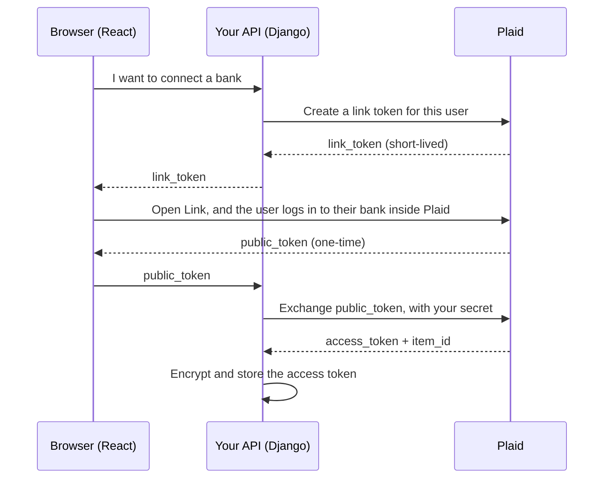

<!-- content/finance/plaid-fundamentals.md — Teach how Plaid Link and the token exchange connect a bank account safely. -->
---
title: "How Plaid works: Link, tokens, and environments"
slug: plaid-fundamentals
section: finance
summary: "Learn how a bank account gets connected without your app ever seeing the bank password, and why each token in the flow exists."
order: 2
tags: [finance, plaid, link, access token, public token, oauth, sandbox, production, banking, concepts, education]
status: established-pattern
lastReviewed: "2026-10-21"
sources: [reference_sources/financial-libraries-review.md]
related: [financial-libraries, plaid-transaction-sync, plaid-security-and-failures, tenant-isolation, authentication-options]
lesson:
  level: Intermediate
  duration: 60 minutes
  prerequisites: [financial-libraries, tenant-isolation]
  objectives:
    - Explain Items, accounts and products in Plaid's model
    - Walk through the Link flow and say why each token exists
    - Exchange a public token safely on the server, bound to the right user and tenant
    - Keep sandbox and production credentials, data and settings fully separate
---

## Why this matters

Moneta shows a household's balances and transactions from their real banks. To do that, something has to log in to those banks on the household's behalf. You definitely don't want that something to be your app holding people's bank passwords. That would make your database one of the most valuable targets on the internet.

Plaid solves this. The user logs in to their bank inside Plaid's own window, and your app receives a token that can *read* their data, but never their password. Understanding exactly how that hand-off works is the foundation for everything else in this track.

## The big idea

Think of a **valet key**. When you hand your car to a valet, you can give them a special key that starts the car but can't open the trunk or glovebox. They can do the one job you need, nothing more, and you never hand over your house keys.

Plaid gives your app a valet key to a bank connection, called an **access token**. Your app can use it to read transactions. It can't move money, and it never reveals the user's bank login.

A few words to learn:

- An **Item** is one login at one institution. If a household connects their Chase login, that's one Item, even if it covers a checking account, a savings account and a credit card.
- **Accounts** are the individual accounts inside an Item.
- **Products** are what you're allowed to do with the Item: Transactions, Balance, Auth and so on. You choose them when the user connects, and each one can cost money. Moneta requests only Transactions.
- **Link** is Plaid's connection window that runs in your frontend.

## The Link flow, one step at a time

Getting that access token takes a short relay of tokens. It can look over-engineered at first, so let's follow it and see why each step exists.



**Step 1: the link token.** Your server asks Plaid for a **link token**, describing who is connecting and which products you want. It's a short-lived permission slip that lets the browser open Link. It expires after 4 hours (30 minutes when reconnecting an existing Item).

**Step 2: the user connects inside Link.** Link runs in Plaid's window. The bank login, multi-factor codes and any OAuth redirect to the bank all happen there. Your app never sees any of it.

**Step 3: the public token.** When the user finishes, Link gives the browser a **public token**. Think of a **coat-check ticket**: by itself it's not your coat, it can be used only once, and only at the counter.

**Step 4: the exchange.** The browser sends the public token to *your server*, and your server exchanges it with Plaid, proving its identity with your **secret**, for the permanent **access token** and an **item ID**.

Why not just give the browser the access token directly? Because the browser is the least trusted place in your system. It can be inspected, extended by browser add-ons and attacked by malicious scripts. The public token is worthless without your secret, and your secret only lives on the server. The relay exists so the valuable token never touches the browser at all.

**Pause and check:** an attacker steals a public token from someone's browser. What can they do with it? (Almost nothing. Exchanging it requires your Plaid secret, which lives only on your server, and it can be used only once.)

## Sandbox and production

Plaid gives you separate environments, each with its own secret:

- **Sandbox** uses fake institutions and test credentials. Free and safe for building.
- **Production** connects to real banks with real people's data.

An access token from one environment doesn't work in the other. That sounds like it would prevent mix-ups, but in practice mixing still happens: a production secret saved in the sandbox setting, or sandbox data shown next to real data. Moneta hit the first one, and it's why Moneta now does three things:

1. **Separate secrets in separate settings**: `PLAID_SECRET` for sandbox, `PLAID_PRODUCTION_SECRET` for production. Selecting the environment selects the secret; you can't accidentally pair them.
2. **Tag every record with its environment.** Connections, balances and transactions all record whether they're sandbox or production, and every query filters by the active one.
3. **A release gate for production.** Even with production credentials present, real-bank linking stays off until a separate flag is turned on deliberately.

## Modern patterns

**Exchange on the server, always.** The browser only ever handles the link token and the one-time public token.

**Bind each connection attempt to a user and tenant.** When you create a link token, also create a short-lived "attempt" record tied to that exact member and household. When the public token comes back, accept it only for that attempt, only from that member, only once, and only before it expires. This stops someone from completing a link into another household.

**Request only the products you need.** Every extra product means more data you're responsible for, and often more cost. Start with exactly what the feature uses.

**Never trust browser-supplied metadata for ownership.** Link's success callback includes institution and account details. Treat them as display hints. Ownership comes from your server-side attempt record, and real account data comes from Plaid's API.

**Handle bank OAuth redirects explicitly.** Many banks send users to their own site to log in and then back to yours. Register the exact return URL with Plaid, and resume the same attempt when the user comes back, instead of starting over.

**Configure webhooks at link-token time.** Pass your webhook URL when creating the link token, so the Item notifies you when new data is ready. You'll build the receiver in [lesson 2](/guide/plaid-transaction-sync).

## Mistakes to avoid

- **Sending the access token to the frontend**, even "just to display something." It's the valet key.
- **Exchanging the public token in the browser** with a secret bundled into JavaScript. Anything in the bundle is public.
- **One secret setting reused for both environments.** It invites exactly the mix-up Moneta had.
- **Trusting `metadata.institution` from the browser** to decide ownership or identity.
- **Requesting every product "just in case."** More data, more cost, more responsibility.
- **Logging Plaid responses in full.** They contain financial data and identifiers.

## Let's build it

We'll implement the server side in Django, using the official `plaid-python` client.

**Step 1: create a link token, bound to an attempt.**

```python
from plaid.model.link_token_create_request import LinkTokenCreateRequest
from plaid.model.link_token_create_request_user import LinkTokenCreateRequestUser
from plaid.model.products import Products
from plaid.model.country_code import CountryCode

def start_link(member, household):
    attempt = LinkAttempt.objects.create(
        member=member,
        household=household,
        environment=settings.PLAID_ENV,
        expires_at=timezone.now() + timedelta(minutes=30),
    )
    response = plaid_client.link_token_create(LinkTokenCreateRequest(
        user=LinkTokenCreateRequestUser(client_user_id=str(member.id)),
        client_name="Moneta",
        products=[Products("transactions")],
        country_codes=[CountryCode("US")],
        language="en",
        webhook=settings.PLAID_WEBHOOK_URL,
    ))
    return attempt.id, response["link_token"]
```

`client_user_id` is your own stable ID for the user, never an email address or other personal detail.

**Step 2: open Link in React.**

```tsx
import { usePlaidLink } from "react-plaid-link";

const { open, ready } = usePlaidLink({
  token: linkToken,
  onSuccess: (publicToken) => completeLink.mutate({ attemptId, publicToken }),
});
```

The public token goes straight to your API. It's never saved to `localStorage`.

**Step 3: exchange it, safely.**

```python
from plaid.model.item_public_token_exchange_request import ItemPublicTokenExchangeRequest

def complete_link(member, attempt_id, public_token):
    with transaction.atomic():
        attempt = (LinkAttempt.objects.select_for_update()
                   .get(id=attempt_id, member=member, consumed_at__isnull=True))
        if attempt.expires_at < timezone.now():
            raise AttemptExpired()
        attempt.consumed_at = timezone.now()
        attempt.save()

    exchange = plaid_client.item_public_token_exchange(
        ItemPublicTokenExchangeRequest(public_token=public_token)
    )
    return save_connection(attempt, exchange["item_id"], exchange["access_token"])
```

Read it closely. The lookup includes `member=member`, so another user's attempt simply isn't found. `consumed_at__isnull=True` makes it single-use, and the row lock stops two simultaneous completions. Only after those checks does the server call Plaid. `save_connection` encrypts the access token before storing it; [lesson 3](/guide/plaid-security-and-failures) shows how.

**Checkpoint:** try completing the same attempt twice, and completing it as a different member. Both must fail without calling Plaid.

## Your turn

In a Plaid sandbox (or Moneta's sandbox mode):

1. Create a link token for a test member and open Link.
2. Log in with Plaid's sandbox test credentials.
3. Exchange the public token on the server and store the encrypted access token.
4. Confirm the access token never appears in browser storage, API responses or logs.
5. Write tests for the expired, replayed and wrong-member cases.

**You're done when:** a sandbox Item is connected, and all three negative tests pass without reaching Plaid.

## Check your understanding

1. What's the difference between an Item and an account?
2. Why does Plaid return a public token instead of an access token to the browser?
3. What does binding a link attempt to a member and household protect against?
4. Why should sandbox and production use separate secret settings, not one setting you swap?
5. The success callback says the institution is "Chase." Should you trust that to decide which household owns the connection?

## Answer key

1. An Item is one login at one institution. Accounts are the individual accounts that login can see, such as checking and savings.
2. The browser is the least trusted part of the system. A public token is one-time and useless without your server's secret, so stealing it gains little. The permanent access token never leaves the server.
3. Someone completing a link into a household that isn't theirs, replaying an old attempt, or completing it after it expired.
4. With one setting, a single wrong paste pairs a production secret with sandbox mode, or the reverse. Separate settings, chosen by the environment, make that mistake impossible to make silently.
5. No. Browser metadata is a display hint. Ownership comes from your server-side attempt record, and account details come from Plaid's API.

## Recap

- The user logs in inside Plaid; your app gets a read-only valet key, the access token.
- Link token → public token → server-side exchange → access token. Each step keeps the valuable token away from the browser.
- Bind attempts to a member and tenant; make them single-use and short-lived.
- Separate sandbox and production secrets, data and switches.

Next up: [Lesson 2, syncing transactions and webhooks](/guide/plaid-transaction-sync), where you'll use that access token to keep data accurate.

## Go deeper

- [Plaid Link overview](https://plaid.com/docs/link/)
- [Plaid OAuth guide](https://plaid.com/docs/link/oauth/)
