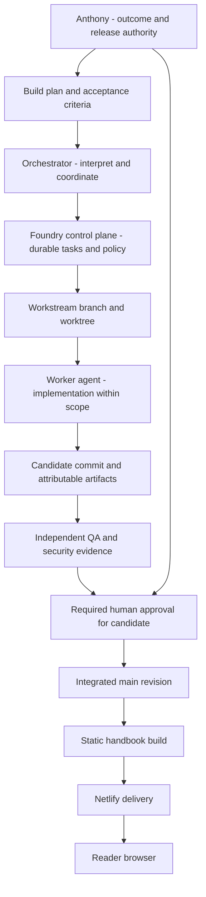

<!-- content/foundry/building-with-foundry.md — Explain Foundry as Anthony's primary engineering workflow. -->
---
title: "Build with Foundry"
slug: building-with-foundry
section: foundry
summary: "Turn a build plan into durable tasks, isolated work, review evidence, and a controlled release."
order: 0
tags: [foundry, build, agents, workstreams, evidence, security, release, recovery]
status: established-pattern
lastReviewed: "2026-10-12"
sources: [reference_sources/foundry-inspection.md]
related: [foundry-repository, system-overview, security-boundaries, frontend-architecture]
---

## Learn the tool connection concept

Curious about MCP? Read [how AI connects to tools and context](/guide/mcp-fundamentals) to distinguish the connection protocol from Foundry work coordination and application permissions.

## Start with the complete setup tutorial

New to Foundry? Follow [Foundry from zero](/guide/foundry-repository): create and open a GitHub repository, install the Python tool, initialize native configuration, register owner trust, start sessions, run a first task, and understand release/CI/recovery. Each step identifies where to type it and what to verify.

## Where Foundry fits

Foundry is my primary engineering workflow for building applications. It surrounds the development process: plans become tasks, work is assigned to workstreams, implementation produces artifacts, and release decisions use evidence tied to a candidate revision.

It is a development control plane. The running application still consists of the browser, API, database, workers, and delivery infrastructure. Foundry does not authenticate an application's users or check their report permissions. Those are runtime responsibilities described in the [security guide](/guide/security-boundaries).

## The build and release system



**Text alternative:** Anthony defines the outcome and acceptance criteria. An orchestrator coordinates tasks through Foundry. A scoped workstream produces a candidate and artifacts. Review evidence and required human approval support integration. The resulting handbook builds into static assets served by Netlify to readers.

The diagram shows the intended governed path. The first handbook deployment was a direct manual Netlify deployment, not a completed Foundry-governed release. Initializing Foundry alone does not establish all the gates in this diagram.

## Native repository structure

This repository uses the native layout created by `foundry init`. Foundry's older documentation also describes `.claude/state/`; do not mix that legacy layout into this project by copying examples blindly.

| Location | Responsibility |
| --- | --- |
| `.foundry/foundry.yaml` | Project identity, branches, provider and runtime configuration |
| `.foundry/project/` | Project component and architecture descriptions |
| `.foundry/policy/` | Capabilities, evidence requirements, and gates |
| `foundry/state` branch | Durable control-plane state, separate from application history |
| `.foundry/state/` | Local worktree attached to the state branch |
| Workstream branches/worktrees | Isolated candidate changes and reviewable diffs |
| `content/` and `src/` | Handbook product content and browser application |

Current project settings identify the task prefix as `ENG`, the main branch as `main`, the state branch as `foundry/state`, and the level as local. Providers are configured as Claude and runtime engine as auto; these settings are configuration, not proof that a worker is installed, authenticated, running, or container-isolated. Sessions are currently configured off.

## Start with facts, then define the task

Use the installed CLI to reconstruct state before relying on an old conversation. On this machine the CLI is available in the sibling Foundry virtual environment; a normal tool installation exposes it as `foundry`.

**Terminal · project repository root, installed Foundry required**

```bash
# Step 1: Reconstruct local facts without changing task authority.
foundry boot
# Step 2: Inspect work and next actions.
foundry status
# Step 3: Validate repository and state consistency.
foundry validate
# Step 4: Inspect recovery facts without applying changes.
foundry recover
# Step 5: Discover the installed task commands before creating work.
foundry task --help
```

Write an outcome with observable acceptance criteria. For this handbook, “add diagrams” should mean rendered runtime and request-flow diagrams, structured text alternatives, correct guide links, and no diagram rendering failures. “Add security” should specify the trust model, permission matrix, negative tests, and which deployed headers must be observed.

## Workstreams and artifacts

Assign bounded ownership and agree on the contract before implementation. A content workstream and a frontend renderer workstream can share the Mermaid fence convention without editing each other's files. An isolated branch makes changes inspectable; a worktree provides a separate checkout, not an automatic security sandbox.

Artifacts are attributable outputs such as a candidate commit, a handoff, test output, or a review. Foundry distinguishes submitting an output from accepting it. A worker's statement that a task is complete should not satisfy its own release gate.

Discover exact command arguments with `foundry workstream --help`, `foundry artifact --help`, and `foundry run --help`. Do not copy invented task identifiers or invocation syntax into a production workflow.

## Evidence belongs to the candidate

A passing test report is evidence for the revision it tested. Changing the candidate afterward can invalidate that evidence. Security review must examine the actual diff and relevant negative paths; QA must verify the actual application behavior. Human approvals in configured native projects are bound to exact commits rather than a general permission to ship whatever comes next.

For a frontend handbook, validation should include metadata and internal links, typechecking, a production build, diagram rendering, keyboard interactions, responsive reading, and hosted deep links. Foundry's installed test help describes governed .NET and Django evidence; do not claim that running `npm run build` automatically creates governed frontend evidence. Inspect the actual evidence contract before integrating JavaScript checks.

## Development security versus application security

| Concern | Foundry development control | Application runtime control |
| --- | --- | --- |
| Scope | Agent path and capability policy | Tenant membership and object permissions |
| Identity | Agent sessions and human principals | Selected Django session, JWT, Clerk, or Gait contract |
| Isolation | Worktrees and configured supervised runtimes | Scoped queries and infrastructure boundaries |
| Secrets | Protected paths and runtime environment limits | Server-side secret storage and least privilege |
| Approval | Candidate review and release authority | Authorized user actions and workflow transitions |
| Evidence | Revision-bound artifacts and reviews | Audit events, metrics, and denial tests |

Declared agent identity, a worktree, or an orchestrator prompt does not provide the same enforcement as a configured container boundary or verified signed approval. Required GitHub checks also need actual branch protection. Treat each control as configured, observed, or still proposed; do not infer enforcement from the diagram.

## Recovery and release

After interruption, inspect Git and Foundry state before restarting work. `foundry recover` is read-only by default; applying recovery is a separate deliberate action. Check dirty worktrees, candidate revisions, and pending artifacts so a restarted agent does not overwrite or repeat work.

`foundry checkpoint --help` describes narrative checkpoint recording. Use it to persist what is done, the remaining gaps, evidence, and the next action; a checkpoint does not grant task authority or replace a release approval.

Before using `foundry release`, inspect its help and project evidence policy. The installed command describes checking evidence, trial integration, approval, and publication. Netlify publication remains a separate delivery concern unless an actual configured integration connects it. A Foundry merge does not prove a Netlify deployment succeeded.

## Current handbook adoption and next steps

Foundry initialization is complete, and the native configuration/state layout exists. This chapter's source inspection confirms the available concepts and commands. It does not establish signed principal registration, policy adoption, required branch checks, worker sandboxing, or a governed release for this handbook.

The next adoption step is to map content/frontend ownership and validation commands into the project configuration, inspect capability and evidence requirements, and establish the human authority and review workflow required by the selected policy. That setup should be a concrete adoption task rather than an implied guarantee attached to `foundry init`.
