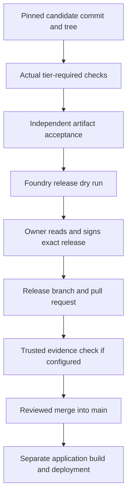

<!-- content/foundry/foundry-review-release.md — Teach one numbered stage of Foundry repository setup and operation. -->
---
title: "07 · Review the exact candidate and release it"
slug: foundry-review-release
section: foundry
summary: "Pin evidence to real content, distinguish documentation checks from code tests, and sign deliberately."
order: 35
tags: [foundry, tutorial, setup, github, repository, agents]
status: established-pattern
lastReviewed: "2026-10-13"
sources: [reference_sources/foundry-tutorial-inspection.md, reference_sources/foundry-inspection.md]
related: [foundry-first-task, foundry-github-recovery]
---

## Step 1 — Freeze the candidate

**Orchestrator terminal · main checkout**

```bash
git rev-parse agent/documentation/demo-1-guide
git rev-parse 'agent/documentation/demo-1-guide^{tree}'
```

Record both outputs. The commit identifies a point in history; its tree identifies file content. Commands requesting a candidate commit must receive the full commit SHA. Quote the tree expression in zsh.

## Step 2 — Decide what the tier requires

The first task changes `docs/project-orientation.md`, a documentation/records path under the inspected tier rules. Do the actual factual, command and link checks promised in its criteria. Do not claim an application test suite passed when the demo has no application suite.

For a later code task, inspect the current evidence policy and release plan. A code change can require accepted full tests, Security and QA evidence on the candidate. A frontend `npm run build` is build evidence; it is not automatically a governed full-test report.

The inspected `foundry test --help` supports governed .NET/Django paths and a Python release path. It does not offer an interchangeable JavaScript full-suite preset. For a React feature, map the real test commands and evidence contract deliberately; do not fabricate compatible evidence by changing a summary string. Use the [Reports walkthrough](/guide/reports-contract) to define meaningful feature behavior.

## Step 3 — Start role-bound reviewers when required

**Orchestrator terminal · its own session**

```bash
foundry --session-file /path/to/orchestrator.env review start DEMO-1 \
  --role security --candidate FULL_CANDIDATE_COMMIT
foundry --session-file /path/to/orchestrator.env review start DEMO-1 \
  --role testing --candidate FULL_CANDIDATE_COMMIT
```

Use real full commit values. Each command prints the reviewer's brief and session-file path. Follow its worktree instructions; it may print a command for creating the detached review checkout rather than create it automatically. These reviews are optional practice if the docs tier does not require them, but are not optional for a code tier that does.

The reviewer reads the exact candidate, writes its findings or QA result, and submits an artifact from its own role-bound session. The brief supplies the supported command. For example:

```bash
foundry --session-file /path/to/security.env artifact add DEMO-1 security-review:orientation \
  --commit FULL_CANDIDATE_COMMIT --workstream security-review \
  --summary "Actual review result and tracked findings"
```

QA uses a `qa-report` from its testing session. Bind a repository report with `--path` when that report exists so its contents are attributable. Use real review results, not copied PASS text. The Orchestrator inspects and accepts the actual artifact IDs from its own session.

## Step 4 — Keep evidence current

A fix changes the candidate tree. Refresh the tests/reviews required for that changed content. If `main` gained relevant code after the candidate branched, update the candidate, resolve conflicts, and collect applicable new evidence. Do not change the candidate after obtaining approval and describe the old evidence as current.



## Step 5 — Read the release plan

**Orchestrator or owner terminal · demo main checkout**

```bash
foundry release --task DEMO-1 \
  --candidate agent/documentation/demo-1-guide --dry-run
```

The plan checks the candidate, tier, adopted target trust, required evidence and integration feasibility. Follow missing-evidence messages. A dry run does not sign approval, publish a branch, or change `main`; the inspected trial merge can write Git objects.

For the public demo, proceed to the GitHub compatibility section in the next chapter before treating any CI check as binding. Local release validation and hosted enforcement are separate checkpoints.

## Step 6 — Approve and sign personally

**Your own interactive terminal · demo main checkout**

```bash
foundry release --task DEMO-1 --candidate agent/documentation/demo-1-guide
```

Read the changed paths, candidate commit/tree, evidence producers and acceptors, and sensitive-path notices. Respond to prompts one at a time. When asked for a tree prefix, use the displayed tree prefix rather than the commit prefix. Signing comes from the owner identity/key prepared earlier.

The normal remote path prepares a signed release branch and pull request. It does not automatically merge the PR or prove an application deploy. Follow the actual output; accept no fabricated approval and use no `--direct` bypass to make a failing governance check disappear.

After publication, review the PR and applicable checks on GitHub. Merge under the project's declared/enforced policy, then pull `main`. Code-tier requirements and GitHub CI compatibility may block this step until their configuration is complete; a prepared tutorial command is not a claim that this release ran.

## Checkpoint

You understand what was actually checked, who accepted it, and what your signature approves. Continue to [GitHub enforcement and recovery](/guide/foundry-github-recovery) to complete the operational setup.
