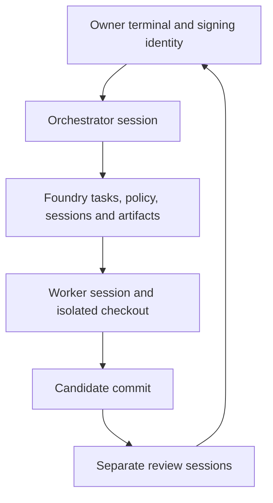

<!-- content/foundry/foundry-sessions.md — Teach one numbered stage of Foundry repository setup and operation. -->
---
title: "05 · Open the agent and start a working session"
slug: foundry-sessions
section: foundry
summary: "Put terminal commands and agent prompts in the right places, then boot from durable state."
order: 33
tags: [foundry, tutorial, setup, github, repository, agents]
status: established-pattern
lastReviewed: "2026-10-13"
sources: [reference_sources/foundry-tutorial-inspection.md, reference_sources/foundry-inspection.md]
related: [foundry-human-authority, foundry-first-task]
---

## Step 1 — Open the project, not the tool repository

**Your terminal · application main checkout**

```bash
cd ~/Projects/foundry-demo
git branch --show-current
git status --short
foundry boot --json
foundry status
foundry recover
```

Expected: the demo's `main` checkout and coherent local state. The boot command reconstructs facts without changing task authority. A checkpoint is narrative context to inspect, not permission to override policy.

When you work on the Foundry product itself, open its source folder instead. For everyday application work, open the application folder.

## Step 2 — Launch your interactive agent

Launch the Claude or Codex application/CLI you already have installed and authenticated, in this project folder. The inspected build supports interactive repository instructions for this path. It does not provide a supervised Codex model adapter merely because Codex is selected in your editor.

Use this text **in the agent chat**, not as a shell command:

```text
Boot as the Orchestrator for foundry-demo.
Read AGENTS.md and the latest Foundry boot facts.
Compare durable task and policy state with Git.
Report Status, In flight, Decisions waiting, and Next actions.
Do not treat checkpoint text as approval or change owner trust.
```

With the managed instructions deliberately installed in chapter three, their defined “Moonrise” phrase can invoke the same routine. The explicit prompt makes the behavior understandable without relying on a nickname.

## Step 3 — Give a bounded outcome

**Agent chat**

```text
Prepare the first task: a project orientation guide.
It should describe the actual repository purpose and layout,
how to inspect Foundry state, and the next learning task.
Keep implementation within docs/project-orientation.md.
Show the task criteria and ownership before starting the worker.
I will perform owner-only bootstrap and signing steps in my terminal.
```

The Orchestrator should separate the desired output from its permissions, create a plan, and identify the worker/review roles. A prose agreement is not an accepted artifact or signed release.

## Step 4 — Understand the session bootstrap

The tutorial configured `sessions: required`. An agent cannot bootstrap an arbitrary declared identity to avoid that requirement. In the next chapter, you create the first task and mint its Orchestrator session from your own terminal. The agent then uses the generated session file on its Foundry commands.

| Identity | How it acts |
| --- | --- |
| Human owner | Owner terminal and adopted signing identity |
| Orchestrator | Session for the reserved `orchestration` workstream |
| Documentation worker | Its own task workstream/session and worktree |
| Security and QA reviewers | Separate role-bound review sessions for a pinned candidate |

Each generated env file contains a token; pass its path to the owning agent, never its contents. Interactive session possession identifies the acting session, but processes sharing your OS account are not strongly isolated merely by different files.

## Step 5 — Know what the runtime settings mean



A manually opened agent in a Git worktree has a separate checkout. Enforced container filesystem/network limits require an actually configured and verified runtime. Read `foundry runtime --help` before adopting that separate path; do not describe `runtime.engine: auto` as proof that a worker ran in a container.

## Checkpoint

The Orchestrator can report real project facts and a bounded first task, and you know how its session will be bootstrapped. Continue to [run the first task](/guide/foundry-first-task).
