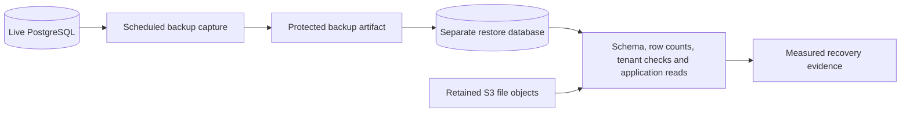
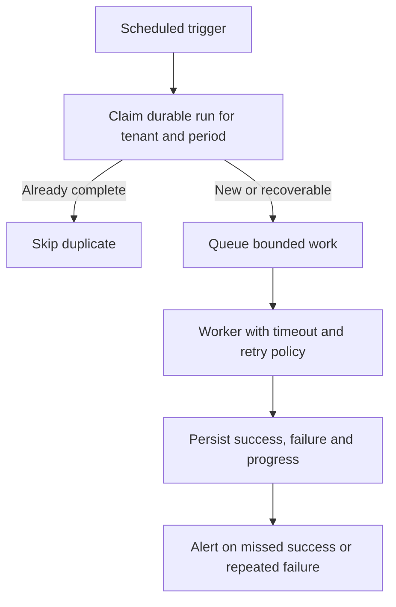

<!-- content/operations/backup-and-scheduled-tasks.md — Explain automated backups, restore evidence, and reliable scheduling. -->
---
title: "Automatic backups and scheduled tasks"
slug: backup-and-scheduled-tasks
section: operations
summary: "Separate backup capture from proven recovery, and scheduled triggers from reliable job completion."
order: 9
tags: [backup, restore, scheduled tasks, scheduler, heroku, recovery, cron]
status: established-pattern
lastReviewed: "2026-10-12"
sources: [reference_sources/stack-context.md]
related: [deployment-platforms, security-boundaries, tenant-isolation]
---

## Two kinds of automation

Automatic backups protect recoverability; scheduled tasks initiate recurring application work. Both need monitoring and an owner. A configured schedule is not evidence that its latest execution succeeded, and a captured backup is not proof that it restores correctly.

These guides reflect my use of backups and scheduled tasks, but no live account settings or restore history have been inspected for this handbook.

## Schedule and inspect PostgreSQL backups

Heroku PGBackups supports scheduled logical backups for applicable database offerings. Verify the current database product and plan first; do not assume every Heroku database has identical backup capabilities. The [PGBackups documentation](https://devcenter.heroku.com/articles/heroku-postgres-backups) covers scheduling and backup inspection.

**Terminal · reference commands, synthetic application name**

```bash
# Step 1: Review existing schedules before making a change.
heroku pg:backups:schedules --app example-app
# Step 2: Configure a daily backup for the selected attachment.
heroku pg:backups:schedule DATABASE_URL --at '02:00 America/New_York' --app example-app
# Step 3: Inspect captured backups and their outcomes.
heroku pg:backups --app example-app
```

These commands are examples; they were not run against your applications. Scheduling changes remote configuration. Confirm the attachment, timezone, retention policy, and product support in the target environment.

Protect backup artifacts with restricted access and encryption. A backup download link is sensitive. Do not expose it in a public handbook, build log, or issue comment. Database backup does not automatically back up S3 file contents or guarantee that restored database references match the files still available.

## Prove recovery with a separate restore



**Text alternative:** Capture a protected database backup, restore into a separate disposable database, and verify schema, representative data, tenant boundaries, application reads, and referenced S3 files. Record timing and findings as recovery evidence. The exercise must not overwrite production.

Choose a backup with a recorded completion time. Restore into an isolated environment with separate credentials. Check migrations/schema, representative synthetic rows, tenant relationships, and an application read. Validate file references against retained storage objects, then remove the disposable environment through the approved cleanup process.

RPO describes acceptable data loss; RTO describes acceptable restoration time. As a proposed example, a daily backup can leave close to a day of changes outside the latest capture if no other recovery mechanism exists. Measure the actual recovery process and data gap; do not convert a desired target into a guarantee.

## Scheduled tasks need a durable outcome

A scheduler initiates work at a configured interval. Use it to enqueue heavier work when a worker system exists, rather than running long processing inside the trigger. For small management commands, keep the execution bounded and record durable success/failure.

Heroku Scheduler is best-effort and recurring jobs must tolerate missed or duplicate triggers. A dedicated clock process is another option when the application needs stronger scheduling control. See [Heroku Scheduler](https://devcenter.heroku.com/articles/scheduler) and [custom clock processes](https://devcenter.heroku.com/articles/scheduled-jobs-custom-clock-processes).

For each recurring job, record its purpose, timezone, interval, tenant scope, expected duration, timeout, last-success threshold, retry rules, and owner. Examples include expired-token cleanup, report retention, outbox dispatch, and reconciliation. These have different consequences when a run is missed; they should not share an unexplained universal retry policy.

## Idempotency and overlap

Give recurring work a durable run identity such as `(job type, organization, period)`. Enforce uniqueness where appropriate and make each step safe to retry. If processing stops halfway, record a cursor or item-level progress so recovery does not repeat an irreversible side effect.



**Text alternative:** A scheduled trigger claims a durable tenant/period run, skips completed duplicates, queues bounded work, records the worker result and progress, and alerts on missed success or repeated failure.

A lock can prevent overlap, but abandoned locks need expiry or ownership recovery. Do not claim exactly-once execution. Verify that duplicate triggers, retries, and worker crashes produce the intended durable result without duplicate emails, exports, or destructive cleanup.

## Security and verification

A scheduled command runs with service authority; it does not inherit a safe tenant scope from a browser. Resolve and validate the organizations/items it may process. Protect scheduler credentials and restrict destructive maintenance separately from routine reads.

Test a missed trigger, two simultaneous triggers, a crash after an item completes, an unavailable broker, a failed backup, and a failed restore. Confirm the expected record, alert, retry, and recovery action for each. Preserve the results with revision/configuration context in the project's evidence; Foundry can coordinate this engineering work, but cannot make an untested restore successful by recording a checklist.
