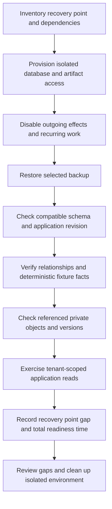

<!-- content/operations/recovery-runbook.md — Teach proposed incident exercises and evidence boundaries. -->
---
title: "Recovery drill: database, files, and measured downtime"
slug: recovery-runbook
section: operations
summary: "Prove an application can recover by restoring in isolation and checking its complete data boundary."
order: 27
tags: [drills, resilience, security, operations, ai, foundry]
status: proposed-design
lastReviewed: "2026-10-13"
sources: [reference_sources/resilience-drills.md, reference_sources/estateiq-inspection.md, reference_sources/stack-context.md]
related: [backup-and-scheduled-tasks, private-document-lifecycle, reliable-job-lifecycle, reports-release]
---

## Define success before restoring

A backup artifact is an input to recovery, not its result. This proposed runbook uses a disposable environment with synthetic fixtures. It does not change your Heroku databases, S3 objects, schedules, or accounts.

State the incident, selected recovery point, acceptable missing data, and what must work before the exercise closes. Include database relationships, private files, tenant-scoped reads, and the application's ability to serve those records.

## Record a complete inventory

| Recovery dependency | Record before the drill |
| --- | --- |
| PostgreSQL | Product/attachment, recovery mechanism, snapshot recovery point, schema revision |
| Private artifacts | Bucket/key conventions, retained object versions, encryption/access dependencies |
| Application | Compatible code/configuration, required migrations, isolated credentials |
| External effects | Email, payment, webhooks, workers, and scheduler disabled or isolated |
| Identity | Synthetic sign-in method and active/revoked membership fixtures |
| Evidence | Operator, timings, assertions, missing records/files, and cleanup ownership |

Heroku PGBackups documents backup inspection and restores. Restoration writes into its target database; verify the target deliberately and use an isolated target for an exercise. Availability, retention, and recovery mechanisms depend on the actual database offering. [Heroku PGBackups](https://devcenter.heroku.com/articles/heroku-postgres-backups).

## Run in isolation



Do not attach recovered rows to a live worker that can resend historical notifications. Restored application configuration needs deliberate isolation even if the database itself is disposable.

## Verify more than row counts

Compare schema and migration state, then inspect canonical fixture relationships: North's report belongs to North, its creator and membership are coherent, and South cannot retrieve it. Check deterministic values from the restored records. A matching count can conceal wrong relationships or missing data.

Resolve a representative set of private file references. Verify content/integrity, object versions where applicable, encryption-key access, and the authorized delivery path. A database snapshot does not include S3 object bytes. Restoring an older row may reference an object subsequently deleted or overwritten unless your retention/version policy covers that interval.

Test a missing object explicitly. The application should return a controlled unavailable result and retain an actionable record, rather than exposing another tenant's object or presenting a broken download as healthy.

## Measure recovery point and readiness separately

Use the following authored example to distinguish the measurements:

| Timestamp | Synthetic event |
| --- | --- |
| 02:00 | Selected backup's established recovery point |
| 08:20 | Service interruption begins |
| 08:25 | Isolated restoration begins |
| 08:55 | Database restoration finishes |
| 09:10 | Application, tenant, and file checks finish |

The gap between recovery point and interruption is 6 hours 20 minutes. That is the possible unrecovered window in this fixture, not proof that every change in that window is lost. Restoration plus verification takes 45 minutes from the start of the restore exercise. Incident-to-readiness takes 50 minutes and is the broader downtime measurement.

Do not use backup completion time as a recovery point unless the mechanism establishes that equivalence. Desired RPO/RTO targets and observed drill results belong in separate fields. Record what was actually recovered and what remains missing.

## Write the recovery evidence

```text
Exercise: synthetic database + private-file restoration
Target: isolated environment; outgoing effects disabled
Code/schema revision: <record>
Backup identifier and established recovery point: <record>
Incident / restore-start / restore-end / ready timestamps: <record>

Checks:
- Schema and application compatibility
- Canonical fixture relationships and deterministic facts
- North readable; South foreign-ID denied
- Representative artifact versions and integrity
- Missing-object handling

Gaps and measured data window: <record>
Observed readiness time versus target: <record>
Cleanup owner and completion: <record>
```

Bring the completed evidence to a Foundry review in the real application. The [restore decision drill](/lab/resilience) only practices the decision; it does not restore or verify a backup.
