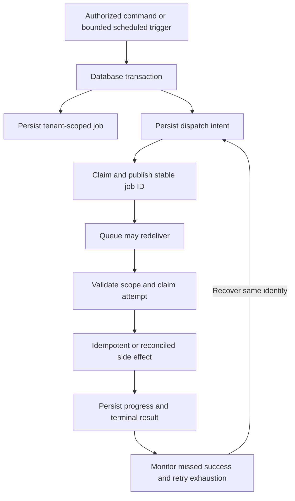

<!-- content/operations/reliable-job-lifecycle.md — Teach proposed incident exercises and evidence boundaries. -->
---
title: "Reliable jobs: outbox, leases, and retries"
slug: reliable-job-lifecycle
section: operations
summary: "Make recurring work recoverable across missed triggers, worker crashes, and external side effects."
order: 26
tags: [drills, resilience, security, operations, ai, foundry]
status: proposed-design
lastReviewed: "2026-10-13"
sources: [reference_sources/resilience-drills.md, reference_sources/estateiq-inspection.md, reference_sources/stack-context.md]
related: [backup-and-scheduled-tasks, reports-release, tenant-isolation, recovery-runbook]
---

## Give work a durable identity

The Reports walkthrough creates a synchronous draft. A PDF export or recurring reconciliation adds independent components: a trigger, persisted job, dispatch mechanism, worker, storage/provider effects, and monitoring. An API response or running web process proves none of those components completed the job.

For an export, use `(tenant, actor, command key)` to identify the business command. For a scheduled reconciliation, use `(job type, tenant, business period)`. Delivery attempts have separate IDs; a retry does not replace the business identity.

## Persist the job and its dispatch intent together

Write the authorized job and an outbox record in one database transaction. A dispatcher claims eligible outbox records, publishes their stable job identity, and records publication. A crash after publish but before marking publication can produce a duplicate message. The worker must therefore tolerate redelivery.

A commit callback can avoid dispatching before a transaction commits, but a process can still die before the callback successfully publishes. It is not a durable replacement for recorded dispatch intent and recovery scanning.



This is a proposed design for the separate application. The handbook does not run an outbox, queue, worker, or scheduler.

## Define the worker contract

| Field or policy | Purpose |
| --- | --- |
| Tenant and authorized initiating actor/service | Reconstruct permitted scope without trusting message text |
| Business job identity | Converge duplicates and recover the same operation |
| State and durable step progress | Distinguish queued, running, succeeded, retryable, and terminal failure |
| Attempt/lease token and expiry | Allow recovery while rejecting stale workers' state updates |
| Input version and artifact identity | Avoid silently producing a different export under one identity |
| Attempt limit, timeout, and next eligible time | Bound retry behavior and resource consumption |
| Correlation ID and last-success time | Connect logs to a durable outcome |

Claim a job transactionally. On completion, update it only if the attempt still owns the lease. An expired worker must not overwrite a newer attempt's result. This fencing protects database updates; an external email or upload needs its own deduplication/reconciliation policy.

## Acknowledge the crash windows

Celery documents retry behavior and acknowledgment options, including late acknowledgment for tasks designed to tolerate repeated execution. These settings do not provide exactly-once external effects. Verify worker-loss behavior in the installed version and configuration. [Celery task documentation](https://docs.celeryq.dev/en/stable/userguide/tasks.html).

| Crash point | Expected recovery |
| --- | --- |
| Job committed, not yet published | Dispatcher finds pending intent |
| Published, intent not marked | Worker handles duplicate stable job ID |
| Worker claims and stops before processing | Expired lease becomes eligible under policy |
| External provider succeeds, local result missing | Reconcile provider identity/outcome before repeating effect |
| Old worker resumes after a new claim | Stale completion rejected by attempt token |
| Retry limit exhausted | Terminal failure with an owner and recovery action |

A database unique constraint prevents duplicate rows for that constrained identity. It does not make an email and a PostgreSQL commit atomic. Use provider idempotency where available, and explicitly handle outcomes that cannot be proven.

## Detect missed schedules

Heroku Scheduler describes its execution as best-effort. A durable last-success threshold and missing-period scan can reveal work that never completed even if the schedule configuration exists. [Heroku Scheduler](https://devcenter.heroku.com/articles/scheduler).

Define the business timezone, period boundaries, and daylight-saving behavior. Store timestamps consistently, and decide which business period a delayed run belongs to. Bound catch-up by eligible periods and batch size. Two triggers for the same tenant/period should converge; a late trigger must not create another completed run.

## A Foundry verification brief

```text
Outcome: Tenant-scoped export jobs recover without duplicate durable artifacts.

Evidence required:
- Two simultaneous triggers for one business identity converge.
- Broker outage leaves dispatch intent recoverable.
- Worker crash and expired lease resume the same operation.
- Stale attempt cannot mark a newer attempt complete.
- External success/local uncertainty is reconciled before repetition.
- Foreign-tenant artifact and job IDs are denied.
- Missed-success alert and bounded backfill are exercised.

Release evidence: actual worker, dispatcher, scheduler, and monitor configuration.
```

Run the [job decision drills](/lab/resilience), then implement and execute these cases in the owning application. Keep exported exercise notes separate from queue and database test results.
