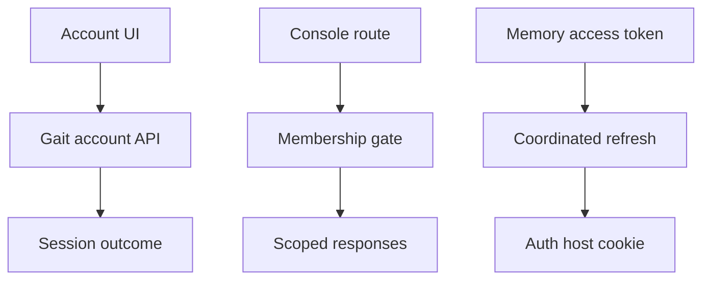
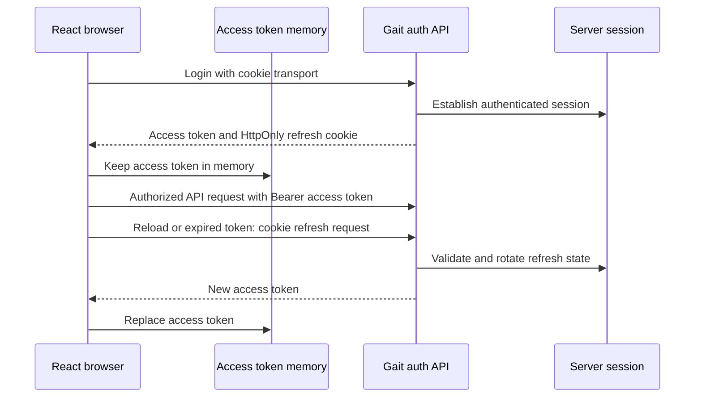

<!-- content/projects/authflow-design.md — Explain inspected project architecture and design boundaries. -->
---
title: "AuthFlow: browser & console design"
slug: "authflow-design"
section: "projects"
summary: "A React account experience and workspace console with memory access tokens and a server-owned refresh cookie."
order: 41
tags: ["projects", "architecture", "authflow"]
status: "established-pattern"
lastReviewed: "2026-10-13"
sources: ["reference_sources/projects-inspection.md"]
related: ["gait-sdk-design", "gait-backend-design", "foundry-project-design"]
---

## The browser-facing part of Gait

AuthFlow is the React frontend for Gait's authentication and security service. Its current routes go beyond the original login demo: accounts and two-step setup, onboarding, application setup, organization consoles, findings, members, and operator-only security screens.

The source README describes an older browser-token model. The inspected current interceptor and token store are the stronger authority for the transport design below.

## Session transport

## Project architecture

**Text alternative:** Account UI → Gait account API → Session outcome. Console route → Membership gate → Scoped responses. Memory access token → Coordinated refresh → Auth host cookie. These are responsibility lanes; the detailed diagram below describes the connected workflow.

## Detailed flow

**Text alternative:** Login establishes a server session. JavaScript receives an access token kept only in memory; the auth host owns an HttpOnly refresh cookie. After reload or expiry, a coordinated refresh obtains another access token. The server validates refresh state.

## Component ownership

| Area | Owns | Authority boundary |
| --- | --- | --- |
| Auth contexts and hooks | Account/session UI and API calls | Backend decides identity and session validity |
| Axios clients | Bearer attachment, cookie transport and bounded retry | A refresh response must actually contain an access token |
| Refresh coordinator | Browser refresh coordination | Coordination does not replace server rotation rules |
| Console layout | Organization route and workspace navigation | Backend validates organization membership |
| Findings and application pages | Presentation of server contracts | Displayed evidence keeps its original trust level |
| Operator route guard | Operator navigation availability | Every operator API still needs server authorization |

`tokenStorage.js` keeps access tokens in a module variable and clears legacy token cookies. `axios.js` uses a separate session client to prevent interceptor recursion; an authenticated request retries once after refresh. Logout clears local state and broadcasts signed-out state after attempting server logout.

## Account, console, operator

`/account` covers a person's own security settings. `/console/:orgSlug` covers an organization workspace. Operator routes are wrapped in `RequireOperator`. These are three different scopes, not three visual versions of the same permission.

The route organization slug is a selection hint. It must not be trusted as proof that the user belongs to that organization. Likewise, hiding a staff page cannot protect its API.

## Availability is part of the design

The inspected feature-status source is dated 2026-09-28 and labels product sign-in and built-in check packs early access. That is the source's status snapshot, not a fresh live availability check. Explain access requirements in user-facing flows rather than promising universal availability from the existence of a route.

Continue with [the backend authority](/guide/gait-backend-design) and [the SDK integration boundary](/guide/gait-sdk-design).

## Refresh coordination across browser tabs

The current coordinator shares one in-flight refresh promise inside a tab and uses the Web Locks API to serialize refreshes across tabs when supported. The backend rotates refresh state, so overlapping use of the same old credential can be treated as replay. Older browsers without Web Locks retain only the in-tab guarantee; they can be signed out if concurrent refresh triggers replay revocation.

Use [the refresh and revocation chapter](/guide/gait-refresh-revocation) to follow this boundary. Clearing browser state alone does not prove that server-side logout succeeded.
