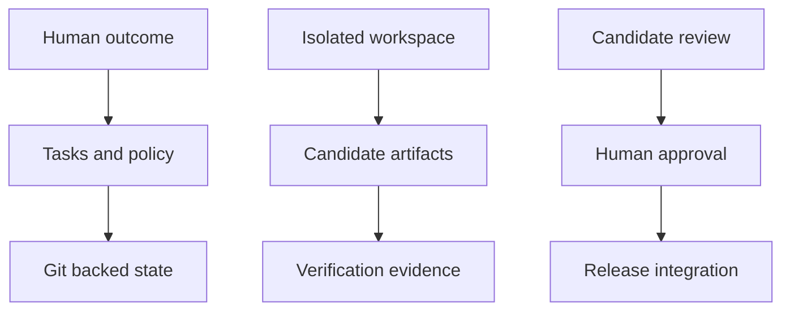
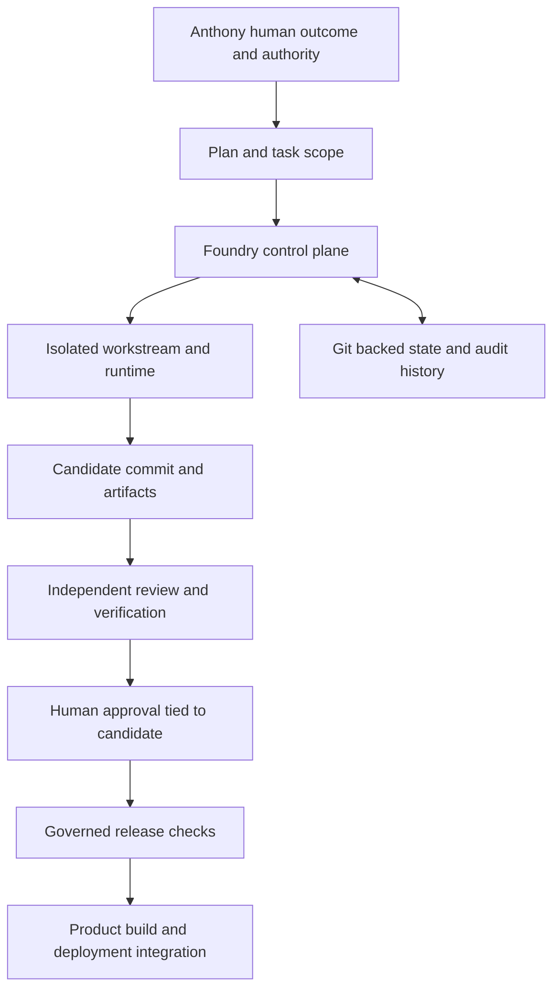

<!-- content/projects/foundry-project-design.md — Explain inspected project architecture and design boundaries. -->
---
title: "Foundry: engineering control plane"
slug: "foundry-project-design"
section: "projects"
summary: "Durable repository state, isolated workstreams, scoped agent capabilities, and evidence tied to a reviewed candidate."
order: 44
tags: ["projects", "architecture", "foundry"]
status: "established-pattern"
lastReviewed: "2026-10-13"
sources: ["reference_sources/projects-inspection.md", "reference_sources/foundry-tutorial-inspection.md"]
related: ["foundry-repository", "building-with-foundry", "gaming-platform-design"]
---

## The system that builds the other systems

Foundry belongs in this catalogue as an engineering platform. It operates during development and release coordination rather than on the normal browser-to-application request path. Its durable unit is repository state: assignments, decisions, audit events, handoffs and evidence that survive a model session.

The current source review checked revision `713e176`. The existing setup tutorial records an earlier revision and its isolated initialization smoke check; those results do not automatically certify newer release paths.

## Control plane and delivery

## Project architecture

**Text alternative:** Human outcome → Tasks and policy → Git backed state. Isolated workspace → Candidate artifacts → Verification evidence. Candidate review → Human approval → Release integration. These are responsibility lanes; the detailed diagram below describes the connected workflow.

## Detailed flow

**Text alternative:** A human defines an outcome and scope. Foundry coordinates isolated work, collects candidate artifacts, and tracks independent review and human approval. Durable Git-backed state supports recovery. Product build and deployment integration follows its own configured release contract.

## Components and ownership

| Component | Owns | Boundary |
| --- | --- | --- |
| Core and state | Tasks, workstreams, events, checkpoints | Chat memory is not durable state |
| Authority and policies | Principals, capability checks and approvals | Role labels alone do not grant authority |
| Workspaces and runtimes | Isolated execution and scoped work | A worker does not accept its own candidate |
| Providers | Model/runtime integration | Provider-neutral design does not imply equal adapter support |
| Evidence and observation | Artifacts, verification and recorded results | A recorded claim is not an executed check |
| Release | Candidate checks and governed integration | CI and deployment need actual configured contracts |
| Secret guard | Protected paths and execution boundaries | Prompts cannot substitute for deterministic enforcement |

## Native and legacy enforcement differ

The README distinguishes native projects with registered principals and SSH-signed approval from Foundry's older repository layout. Design descriptions must name that boundary. Do not present every recorded approval line as a cryptographic authorization or every possible provider as a supervised adapter.

A useful artifact binds a result to a concrete commit/tree, test command and output. If the candidate changes after review, the old review does not describe the new tree. Recovery should re-read state, ownership and evidence before continuing work.

## Foundry connects to projects through development

Foundry can coordinate changes to a frontend, SDK or backend repository without becoming part of their user-authentication stack. The gaming platform's game consumer, Gait's account/session service and EstateIQ's domain services still own their respective runtime decisions.

Containerized execution and broker-mediated external actions belong to the governed design; the available enforcement depends on the actual runtime and policy path in use. This handbook's manual Netlify publication is not evidence that it completed Foundry's governed release flow.

## Start with a concrete repository

Use [the eight-step Foundry tutorial](/guide/foundry-repository) for GitHub repository creation, installation, initialization, human authority, sessions, tasks, review and recovery. The tutorial already distinguishes what its smoke check executed from what remains a guided exercise.

## Session lifecycle and runtime observations

The refreshed source adds runtime-bound activity observations. A session record can say it is active while a runtime sample cannot establish a current supervisor identity. The activity projection checks a unique runtime/session backlink, task assignment, lifecycle, runtime metadata and the sampled identity; ambiguous or unavailable observations stay labeled as such.

An observed-live supervisor is not proof that a model is making progress, produced a correct artifact, or has release authority. Recorded usage, process observation, task completion and candidate acceptance remain different facts. This review inspected the code; it did not launch a runtime or replay real session records.
