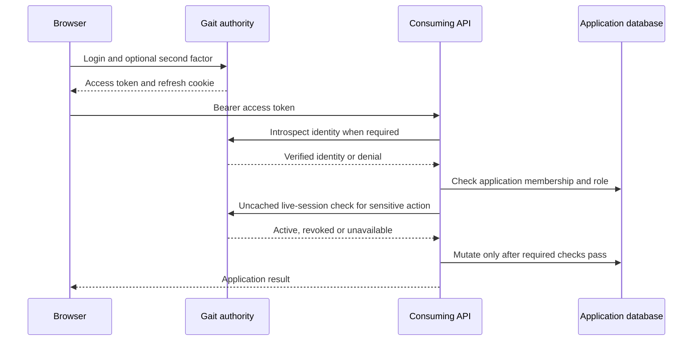

<!-- content/projects/gait-auth-walkthrough.md — Curated engineering guidance and reference examples. -->
---
title: "Gait: follow authentication across three projects"
slug: "gait-auth-walkthrough"
section: "projects"
summary: "Connect the browser, session authority and consuming API without confusing their responsibilities."
order: 48
tags: ["projects", "architecture", "practical guide"]
status: "established-pattern"
lastReviewed: "2026-10-13"
sources: ["reference_sources/projects-inspection.md"]
related: ["gait-login-session", "gait-backend-design", "gait-sdk-design"]
---

## Three projects, three responsibilities

AuthFlow implements the inspected browser account and console experience. django_auth owns Gait identity, sessions and security state. gait-sdk verifies identity inside a consuming API; it does not replace that API's domain permissions.

This walkthrough explains inspected source paths. It is not an OAuth authorization-code tutorial or proof that a product has completed integration. A product origin and audience must be explicitly configured; an AuthFlow console token is not automatically valid for every application.

## Follow the path

1. [Login and session establishment](/guide/gait-login-session).
2. [Refresh, concurrency and logout](/guide/gait-refresh-revocation).
3. [API identity verification](/guide/gait-api-verification).
4. [Application authorization](/guide/gait-app-authorization).
5. [Failure and integration checks](/guide/gait-auth-failure-checks).

For source ownership and deployment limits, read the [AuthFlow](/guide/authflow-design), [Gait backend](/guide/gait-backend-design) and [SDK](/guide/gait-sdk-design) case studies. No tokens, credentials or live identity calls are collected by this handbook.
