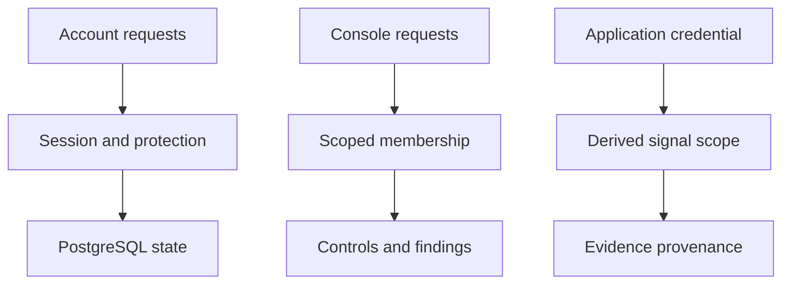
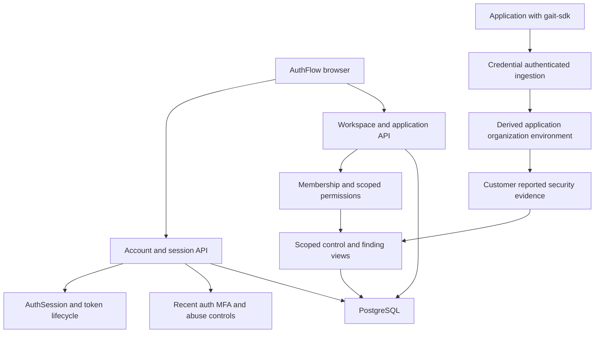

<!-- content/projects/gait-backend-design.md — Explain inspected project architecture and design boundaries. -->
---
title: "django_auth: Gait service design"
slug: "gait-backend-design"
section: "projects"
summary: "Server-controlled sessions, account security, workspace isolation, and evidence-backed security findings."
order: 43
tags: ["projects", "architecture", "gait"]
status: "established-pattern"
lastReviewed: "2026-10-13"
sources: ["reference_sources/projects-inspection.md"]
related: ["authflow-design", "gait-sdk-design", "foundry-project-design"]
---

## The authority behind the console

The `django_auth` repository is Gait's identity and security backend. It owns authentication and server session state, account-security workflows, workspace/application records and security evidence. AuthFlow presents this data; gait-sdk verifies users or reports application signals from consuming backends.

This overview uses public-safe source and code summaries. Confidential security triage, plans and internal findings are excluded.

## Service boundaries

## Project architecture

**Text alternative:** Account requests → Session and protection → PostgreSQL state. Console requests → Scoped membership → Controls and findings. Application credential → Derived signal scope → Evidence provenance. These are responsibility lanes; the detailed diagram below describes the connected workflow.

## Detailed flow

**Text alternative:** The console uses account/session APIs and workspace APIs. The backend enforces session, recent-authentication and membership boundaries. Applications submit signals through a separate credential-authenticated endpoint; scope comes from the application credential and evidence remains customer-reported. PostgreSQL persists state.

## Browser session authority

`user/refresh_cookie.py` defines a host-only HttpOnly refresh cookie scoped to `/api/auth/`. Cookie-authenticated requests require an allowed Origin and the custom auth header before reading or rotating that cookie. Secure and SameSite settings depend on deployment configuration; HttpOnly alone is not CSRF protection.

JavaScript uses a memory access token. The server controls refresh state and logout. Recent-password or recent-MFA policies protect sensitive account actions independently of merely holding an access token.

## Workspace isolation

People, organizations, memberships, applications and environments are distinct records. Workspace pages select a scope; backend permissions decide access. A server-to-server application credential represents an application, not an organization administrator or a human user.

`security/tenant_ingestion.py` derives scope, organization and environment from the verified application. The caller's payload cannot select those boundaries. This keeps reported evidence attached to the credential's actual workspace and environment.

## Evidence has provenance

Customer signals feed evidence, control and finding state while retaining their customer-reported trust level. Internal evidence and customer assertions must remain distinguishable. A finding's existence, acknowledgment or accepted-risk state each mean something different; none should be presented as a completed independent fix.

The SDK does not provide a generic privileged Observatory client. Console reading and application signal reporting are different API surfaces and identities.

## Bounded automation

The source overview describes capability-bound security agents and execution flags. Treat analysis, recommendation, execution and deployment approval as distinct stages. An AI conclusion cannot grant itself a production capability. This handbook does not assert that a security fleet is currently enabled or that any agent executed a production change.

## Operational design

The repository describes Heroku application hosting, PostgreSQL, SMTP and RabbitMQ event integration. These are source-described dependencies, not a checked live deployment inventory. Verify session denial, workspace isolation, application-credential revocation, signal replay and evidence provenance against the deployed configuration before making operational assurance claims.

## Audience belongs to the session

The inspected token implementation supports legacy HS256 and configured RS256 issuance. In the RS256 path, a registered relying-party audience is selected from the sign-in Origin and stored on the session; refresh preserves that audience. A caller does not choose authority by adding an audience field to its request body.

Gait restricts relying-party audiences to the session/identity endpoints they need. A product token is not automatically a console-admin credential. Consuming applications still own their organization membership and domain roles. See [the verification chapter](/guide/gait-api-verification) and [application authorization](/guide/gait-app-authorization).
