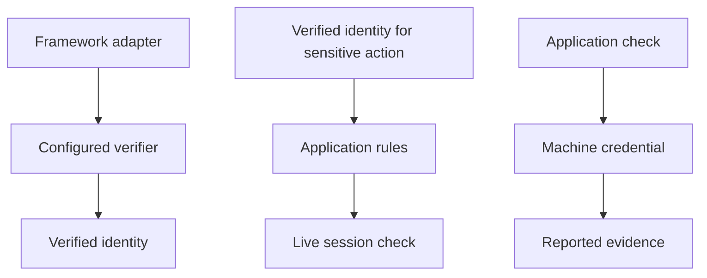
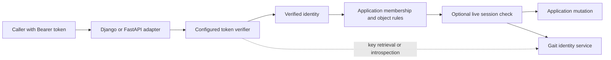
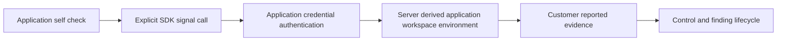

<!-- content/projects/gait-sdk-design.md — Explain inspected project architecture and design boundaries. -->
---
title: "gait-sdk: verification & signal design"
slug: "gait-sdk-design"
section: "projects"
summary: "A Python library inside your API: verify identity, check live sessions, and report application security signals."
order: 42
tags: ["projects", "architecture", "gait"]
status: "established-pattern"
lastReviewed: "2026-10-13"
sources: ["reference_sources/projects-inspection.md"]
related: ["authflow-design", "gait-backend-design", "foundry-project-design"]
---

## A library inside the application process

The SDK is not another hosted service. Framework adapters run inside a Django REST Framework or FastAPI application and translate a presented token into a verified identity. The consuming application still owns organization membership, roles and object access.

## Identity and authority

## Project architecture

**Text alternative:** Framework adapter → Configured verifier → Verified identity. Verified identity for sensitive action → Application rules → Live session check. Application check → Machine credential → Reported evidence. These are responsibility lanes; the detailed diagram below describes the connected workflow.

## Detailed flow

**Text alternative:** A framework adapter invokes the configured verifier and returns a verified identity. Application rules authorize the requested object. Sensitive operations then check the live session before mutation. Verification may use local cached public keys or remote introspection.

## Two deliberate verification modes

The README defaults to introspection, which asks Gait's `whoami` endpoint. The inspected Django adapter caches successful Bearer introspection results for 45 seconds; it does not make an upstream request for every ordinary call. Its uncached sensitive-action check is a separate contract. Explicit JWKS mode verifies RS256 access tokens locally against configured issuer, audience and public keys. Do not depict every mode as network-free. JWKS mode still fetches keys initially and on cache refresh.

The documented JWKS contract checks signature, key ID, issuer, audience, expiry, issue time, access-token use and required identity/session identifiers. Key-set refresh and bounded stale-key behavior are explicit. Verification failure does not silently switch to introspection.

## Revocation and sensitive actions

Local signature validity cannot reveal a newly revoked session by itself. `require_live_session` performs an uncached live check for sensitive operations. The documented order is identity, application authorization, live-session check, then mutation. Provider unavailability denies a sensitive operation rather than approving it from an old answer.

Key users by verified issuer and opaque subject. Avoid parsing subjects or deriving application roles from unverified token fields.

## Machine identity is a separate flow

**Text alternative:** A backend explicitly reports a self-check using an application credential. Gait derives scope from that credential and persists customer-reported evidence that feeds control and finding state.

The SDK does not automatically observe every request. `send_security_signal` is an explicit call site. Its public parameters do not let the caller choose an organization, environment or trust level. The credential must stay on the backend, never in a frontend build.

An application-reported PASS is an assertion by that application, not proof independently collected by Gait. Exact signal retries are deduplicated by application, signal type and source reference in the documented contract.

## What the consuming service must still build

The service must map identity to its own memberships, enforce permissions, decide which operations require a live check, handle provider failures, and produce accurate bounded self-checks. The SDK supplies verification and transport; it cannot make those domain decisions.

## Connect the three repositories

Follow [the complete authentication walkthrough](/guide/gait-auth-walkthrough) to connect browser login, refresh rotation, identity verification and application authorization. Product sign-in remains an early-access capability in the inspected source status; configured JWKS verification requires a compatible issuer and published signing keys.
