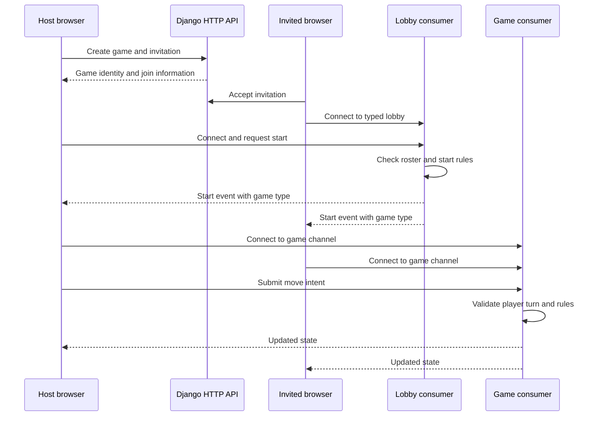

<!-- content/projects/gaming-multiplayer-flow.md — Explain inspected project architecture and design boundaries. -->
---
title: "Gaming platform: multiplayer flow"
slug: "gaming-multiplayer-flow"
section: "projects"
summary: "Trace create, invite, accept, lobby, start, move, and reconnect across HTTP and WebSockets."
order: 38
tags: ["projects", "architecture", "gaming"]
status: "established-pattern"
lastReviewed: "2026-10-13"
sources: ["reference_sources/projects-inspection.md"]
related: ["gaming-platform-design", "gaming-poker-tournaments", "gaming-security-ai"]
---

## One shared entry path

A generic lobby workflow lets several games share invites without sharing their rules. The inspected registry covers Tic-Tac-Toe, Connect Four, Checkers and Poker. Each registry entry resolves a model, factory and seat mapping. The lobby receives a game type and game ID rather than assuming every ID belongs to Tic-Tac-Toe.

## From invitation to play

**Text alternative:** The host creates a game and invite over HTTP. The guest accepts, both connect to the typed lobby, and the server checks the start transition. Both then connect to the appropriate game consumer. Move intentions are validated server-side before updated state is sent.

## Namespacing prevents cross-game collisions

Different game tables can each have row ID `4`. A bare room ID cannot distinguish them. `scoped_lobby_id(game_type, lobby_id)` produces a game-type-qualified identifier for lobby coordination. Invite guards also compare the expected game type. This is an object-boundary problem analogous to tenant isolation, even though a gaming room is not an organization tenant.

Lobby WebSocket routes use `ws/lobby/<game_type>/<lobby_id>/`. Poker table routes use `ws/poker/<game_id>/`; other game consumers have their own routes. Namespacing a channel group prevents accidental broadcast collisions; it does not replace participant authorization.

## Transport roles are specific to an operation

HTTP covers account operations, game creation and invite acceptance. WebSockets support live lobby coordination and gameplay commands as well as notifications. Do not claim that WebSockets only announce changes: game consumers also receive actions and persist resulting game state.

A successful socket send means bytes were sent, not that a move was accepted. Render server responses, expose rejected moves clearly, and recover from a fresh authorized snapshot after connection loss.

## Connection ownership in React

Account-level sockets should follow authenticated provider lifetime. Lobby sockets follow lobby route lifetime; table sockets follow active table membership. Tear down old subscriptions when the user changes game, logs out or moves tables. Otherwise old event handlers can update the wrong board or double-count badges.

## Verification scenarios

| Scenario | Expected property to verify |
| --- | --- |
| Two games have the same numeric ID | Lobby groups remain distinct |
| Invite has the wrong game type | Join is refused |
| Nonparticipant requests a move | No game-state mutation |
| Same player sends two overlapping actions | Server turn/rule checks determine the result |
| Reconnect after a missed update | Fresh authorized state replaces stale browser state |
| Leave one lobby and open another | Old socket callbacks cannot mutate the new lobby |

These are proposed verification cases. This handbook did not run the gaming backend or a two-player session.
