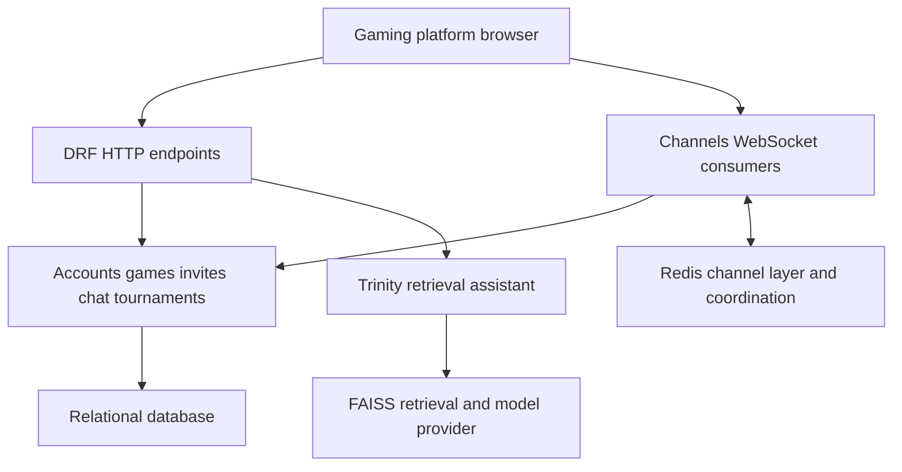

<!-- content/projects/gaming-platform-design.md — Explain inspected project architecture and design boundaries. -->
---
title: "Gaming platform: system design"
slug: "gaming-platform-design"
section: "projects"
summary: "A five-game platform with shared social features, authoritative multiplayer state, poker tournaments, and a separate AI assistant."
order: 37
tags: ["projects", "architecture", "gaming"]
status: "established-pattern"
lastReviewed: "2026-10-13"
sources: ["reference_sources/projects-inspection.md"]
related: ["gaming-multiplayer-flow", "gaming-poker-tournaments", "gaming-security-ai"]
---

## More than a game board

This repository has grown into a gaming platform: Tic-Tac-Toe, Connect Four, Checkers, Sudoku, and Poker share an account and social experience. React presents the interface; Django owns persisted domain state; Channels carries live commands and updates. Redis supports channel delivery and ephemeral coordination. Poker adds table-specific rules and a multi-table tournament domain.

The architecture below summarizes the inspected source. It is a source review, not a production audit or a new backend test run.

## Platform architecture

**Text alternative:** The React browser uses HTTP for API operations and WebSockets for real-time interactions. Both enter a Django application with game and social domains backed by a relational database. Channels uses Redis for delivery and coordination. Trinity has a separate retrieval/model path.

## Ownership map

| Area | Responsibility | Boundary |
| --- | --- | --- |
| Browser | Routes, boards, animations, controls, responsive shell, server snapshots | A displayed legal action is not permission to execute it |
| Accounts | Identity, tokens, user records | Identity must be followed by room/table authorization |
| Invites and lobby | Creation, acceptance, roster, start coordination | Scope by game type and game ID |
| Game domains | Moves, turn order, rules and results | A client submits intent; the server decides validity |
| Poker | Seats, stacks, cards, betting rounds, timers and hand results | Produce a separate safe payload for each viewer |
| Tournament services | Registration, seating, blind levels, elimination and balancing | A tournament outlives any one table connection |
| Social features | Friends, presence, direct/group chat and notifications | Room membership and message visibility need their own checks |
| Trinity | Retrieval-backed answers | Assistant output cannot decide game state or authorization |

## Shared shell, distinct game engines

The React application uses contexts for account, UI, notifications, friends and direct messaging. Game pages add their own state and board components. A common shell reduces duplicated navigation, while different game engines keep Sudoku rules separate from poker betting.

The backend registry in `utils/game_registry.py` currently maps Tic-Tac-Toe, Connect Four, Checkers and Poker to their model and game factory. Sudoku is a separate domain; it is not listed as an invite-capable multiplayer registry entry. Extending the platform means deliberately choosing which common workflow a new game participates in.

## Deployment topology

The inspected `Procfile` runs migrations in a release command and serves the backend with Daphne against `ttt_core.asgi:application`. That ASGI application routes HTTP through a WSGI adapter and WebSockets through origin validation, JWT middleware and Channels routing. A WSGI-only development server does not provide this socket path.

The database configuration uses `DATABASE_URL` when supplied, with a SQLite fallback. PostgreSQL is necessary when relying on actual row-lock behavior in concurrent poker workflows. Redis is a separate dependency; it is not the durable game database. The frontend is a separate CRA build. This handbook does not verify the gaming project's currently deployed hosts or worker count.

## Design decisions to carry forward

Keep gameplay ownership on the server, room identifiers namespaced, and per-viewer state serialization explicit. Separate durable state from broadcast delivery. Separate tournament continuity from the lifetime of a table socket. Keep visual animation a representation of state rather than the mechanism that advances it.

Read [the multiplayer flow](/guide/gaming-multiplayer-flow), [poker and tournament design](/guide/gaming-poker-tournaments), and [security and AI boundaries](/guide/gaming-security-ai) next.
