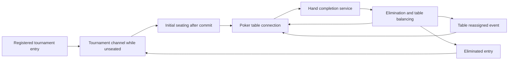

<!-- content/projects/gaming-poker-tournaments.md — Explain inspected project architecture and design boundaries. -->
---
title: "Gaming platform: poker & tournaments"
slug: "gaming-poker-tournaments"
section: "projects"
summary: "Design for private cards, locked state transitions, tournament continuity, and table reassignment."
order: 39
tags: ["projects", "architecture", "gaming"]
status: "established-pattern"
lastReviewed: "2026-10-13"
sources: ["reference_sources/projects-inspection.md"]
related: ["gaming-platform-design", "gaming-multiplayer-flow", "gaming-security-ai"]
---

## A table and a tournament are different aggregates

`PokerGame` owns a table's hand, seats, stacks, betting and community cards. The multi-table tournament domain owns the wider competition: entries, tables, registration, blind progression and elimination. The older scheduled single-table match workflow remains separate from the MTT routes; similar names do not make them interchangeable.

## Tournament continuity

**Text alternative:** A registered entrant can receive tournament events before seating through a tournament channel. Once assigned, they connect to a poker table. Completed hands feed elimination and balancing, which may move the entrant or eliminate them. An eliminated entrant can still qualify for the tournament channel.

## Lock, validate, persist, publish

Poker consumer paths use `transaction.atomic()` and `select_for_update()` to serialize competing changes to a game row. PostgreSQL actually enforces these row locks; SQLite does not provide an equivalent test of this behavior. Locking reduces concurrency races, while domain validation still decides whether an action is legal.

Tournament start wraps initial seating in a transaction and schedules reassignment broadcasts with `transaction.on_commit()`. Subscribers should not be told they have a seat before the seating record exists. Post-commit delivery still has a failure window if the process dies before dispatch; an outbox would be a future reliability improvement, not an implemented component claimed here.

## Private cards need a per-viewer payload

`poker_payload(game, user)` produces the payload used by REST and WebSocket paths. It replaces another player's unrevealed cards with placeholders before delivery and derives legal actions for the requesting user. Showdown and voluntarily shown cards have explicit reveal behavior.

The shared event should cause each connection to construct its own safe view. Broadcasting one player's already-serialized snapshot to everyone would bypass this boundary. Hidden CSS and blurred cards provide no protection for information already delivered to the browser.

## Two connections solve two different gaps

| Connection | Use | What it does not own |
| --- | --- | --- |
| `ws/poker/<game_id>/` | Table state and gameplay; also tournament events while seated | Identity of the tournament independent of its current table |
| `ws/poker/mtt/<tournament_id>/` | Tournament snapshot and events for a registered entry, including unseated or eliminated entries | Table actions, cards and turn timers |

The table consumer can redirect a reconnect aimed at a stale table to the entrant's current table. The tournament channel handles the separate case where the entrant has no table at all. The source describes closing the tournament-only connection once a table connection takes over; keeping both can double-deliver tournament events.

## Timers are the scaling boundary

Turn and next-hand timers are held in process-local dictionaries and use in-process scheduling. A restart loses those schedules, and multiple ASGI workers do not share those dictionaries. The documented bot harness requires a single ASGI worker. Do not draw a distributed timer service into the current-state architecture.

A future design could persist deadlines and use a recoverable dispatcher, with each execution rechecking the current hand and turn under a lock. Until implemented and exercised, that is a proposal.

## Meaningful invariants

Verify chip conservation at appropriate hand boundaries, valid seat occupancy, legal phase progression, elimination rank consistency, and correct table reassignment. The repository documents multi-client bot runs, but this handbook did not repeat them. Historical clean runs do not certify every current route, deployment topology or reconnect path.
