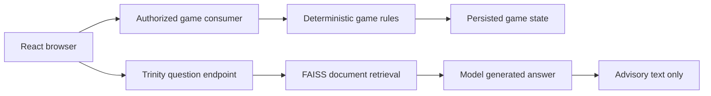

<!-- content/projects/gaming-security-ai.md — Explain inspected project architecture and design boundaries. -->
---
title: "Gaming platform: security & AI"
slug: "gaming-security-ai"
section: "projects"
summary: "Separate user identity, participant authority, private game state, and retrieval-backed assistance."
order: 40
tags: ["projects", "architecture", "gaming"]
status: "established-pattern"
lastReviewed: "2026-10-13"
sources: ["reference_sources/projects-inspection.md"]
related: ["gaming-platform-design", "gaming-multiplayer-flow", "gaming-poker-tournaments"]
---

## Identity is only the first gate

The platform uses SimpleJWT for HTTP authentication and a JWT WebSocket middleware for socket identity. The ASGI router wraps sockets in `AllowedHostsOriginValidator`. Consumers must still check the authenticated user's right to join a room or act at a table.

An origin check restricts where a browser connection may originate; it does not establish table membership. A signed token proves identity; it does not establish whose turn it is.

## Separate the assistant from gameplay authority

**Text alternative:** Gameplay goes through an authorized consumer and deterministic rules to persisted state. Trinity questions use a separate retrieval and model pipeline that produces advisory answers. There is no depicted model-to-game-state mutation path.

The inspected Trinity chain uses LangChain RetrievalQA with FAISS and an OpenAI model. That is distinct from game-playing opponents implemented in game logic. The assistant should explain rules; authoritative winners, card visibility and legal moves stay in deterministic game code.

## Security review scope

Public architecture notes describe trust boundaries and verification priorities. Location-specific findings and private remediation details are retained outside the published handbook. This chapter does not assert that all security work is complete or that the application is production-certified.

Review identity transport, room/action authorization, sensitive logging, assistant abuse controls and restart-safe scheduling in the actual application. Record detailed results in its restricted engineering evidence rather than a promotional page.

## Assistant boundaries to document

Treat retrieved documents as untrusted content. Keep secrets out of the index and prompts. Bound input length, retrieval size, request rate and provider spending. Provide a clear unavailable state when the provider fails. A polished assistant drawer does not demonstrate any of these controls; inspect the endpoint and its data sources.

## Verification priorities

Test anonymous and nonparticipant denial, private-card payloads for different viewers, invite game-type mismatch, revoked or expired identities at connection boundaries, and MTT start authority. For AI, test provider failure, oversized questions and sensitive error redaction. Use dummy identities and synthetic questions. The handbook records these as work to verify, not checks already executed.
