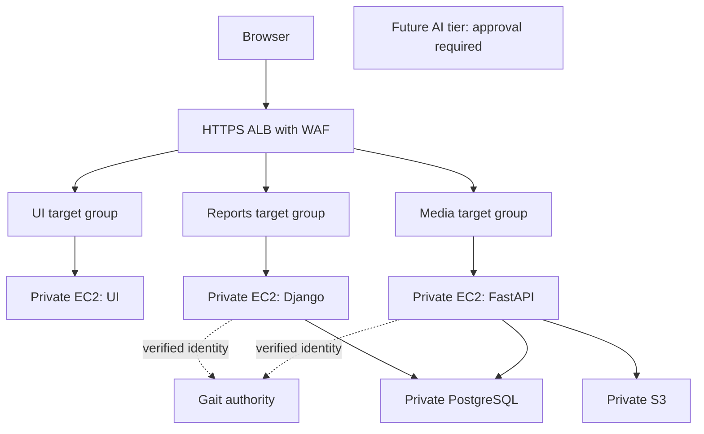

<!-- content/projects/lumen-aws-architecture.md — Lumen source context and explicitly proposed AWS design. -->
---
title: "Lumen on AWS: ALB and dedicated EC2 services"
slug: "lumen-aws-architecture"
summary: "A proposed AWS topology with public ingress, private service instances and explicit data boundaries."
section: "projects"
order: 77
tags: ["lumen", "aws", "ec2", "gait", "security", "planned architecture"]
status: "proposed-design"
lastReviewed: "2026-10-13"
sources: ["reference_sources/lumen-inspection.md", "reference_sources/aws-design.md"]
related: ["lumen-platform-design", "lumen-aws-security", "lumen-aws-release"]
---

## Proposed topology, not deployed infrastructure

The owner's baseline is **one dedicated EC2 instance per application server, behind an ALB**. Use separate target groups for distinct services. This keeps service deployment boundaries explicit. A single instance per service is still a single point of failure; the resilient target repeats each critical tier across Availability Zones.

## Route services deliberately

Proposed names below are placeholders, not provisioned domains. Prefer host-based routing to avoid silently assuming ALB strips a path prefix.

| Listener rule | Target group | Dedicated private EC2 service |
| --- | --- | --- |
| `app.lumen.example` | UI | Nginx serving the React build and selected same-origin proxies |
| `reports.lumen.example` | Reports | Production Django/DRF process |
| `media.lumen.example` | Media | Production FastAPI process |
| Future AI host, disabled initially | AI, only after approval | Future isolated service; absent from this checkout |
| Unknown host | Fixed denial response | No arbitrary default forwarding |

An HTTPS listener uses a managed certificate covering the chosen names. Publish only the intended application endpoints; restrict administration and internal docs separately. [AWS listeners](https://docs.aws.amazon.com/elasticloadbalancing/latest/application/load-balancer-listeners.html) evaluate configured rules and route to [target groups](https://docs.aws.amazon.com/elasticloadbalancing/latest/application/load-balancer-target-groups.html).

The current Nginx config rewrites `/media-api/` to Media's `/api/` and proxies `/auth/` to Gait. Preserve or deliberately replace that behavior. A path-forwarding rule is not equivalent to a rewrite. Public Reports/Media hosts need exact browser CORS/CSRF decisions; a same-origin UI proxy needs correct upstream authentication and forwarding-header handling. Select one documented browser contract before deployment.

## Subnets and service placement

Place the internet-facing ALB in public subnets spanning at least two supported Availability Zones. Place EC2 services in private application subnets with no public IPs or direct internet ingress. Use separate private database subnets for the recommended RDS PostgreSQL tier. Object storage is S3, reached through a constrained endpoint policy where suitable; it is not an instance inside the VPC.

Use one target group and deployment policy per service. Start with a single registered instance only for an explicitly limited initial environment. The production target uses independently replaceable instances in multiple AZs, registered through service-specific Auto Scaling groups. The ALB spanning zones does not make a singleton Reports or Media instance redundant. See [ALB zone behavior](https://docs.aws.amazon.com/elasticloadbalancing/latest/application/load-balancer-subnets.html).

## Gait is an authority, not an ALB shortcut

Gait verifies identity; Lumen still owns organization, facility, exam and operation permissions. Keep Gait as a separately operated dependency with a defined TLS endpoint and bounded egress. Moving it to AWS is a separate project decision. Do not claim ALB's built-in authentication automatically integrates with the current Gait API.

The UI login/refresh transport, Reports SDK version and Media adapter must pass one end-to-end production-shaped contract. An outage must not cause protected operations to bypass verification. Sensitive actions need the installed integration's explicit freshness/revocation policy; do not assume a cached identity check is live session validation.

## State and non-HTTP integrations

Recommended managed tiers are private RDS PostgreSQL and private S3 with service-specific access. Preserve Reports-owned clinical truth and Media's narrow authorization-fact reads; separate roles and ownership even if sharing a database. Redis/cache and durable workers are optional tiers whose delivery and recovery policy must be defined before enabling them.

HTTP APIs and WebSocket upgrades fit an ALB. A raw HL7/MLLP TCP listener does not become an HTTP service by putting it in a target group. Keep such integrations on a separate private/VPN-connected interface and assess an NLB only if required; see [NLB protocol support](https://docs.aws.amazon.com/elasticloadbalancing/latest/network/introduction.html). Clinical integration readiness is not established by this diagram.

## Connections, health and resilience

Encrypt browser-to-ALB and ALB-to-service traffic. HTTPS target groups encrypt the second hop, but ALB does not validate target certificates; that is not mutual TLS identity proof. If authenticated end-to-end service identity is required, design and verify an appropriate additional control.

Reports source distinguishes shallow liveness from a deeper database/Redis probe. Choose per-service readiness endpoints and timeouts based on actual dependencies, with no sensitive response data. ALB health routing is not authorization: AWS documents fail-open routing if every registered target is unhealthy. Services must deny unauthorized operations regardless of target health. See [health-check behavior](https://docs.aws.amazon.com/elasticloadbalancing/latest/application/target-group-health-checks.html).

Configure deregistration/draining around in-flight clinical writes, uploads and any supported live connections. A reconnect or retry needs domain idempotency and a fresh authorized snapshot. The [security plan](/guide/lumen-aws-security) makes the network and runtime controls concrete.
