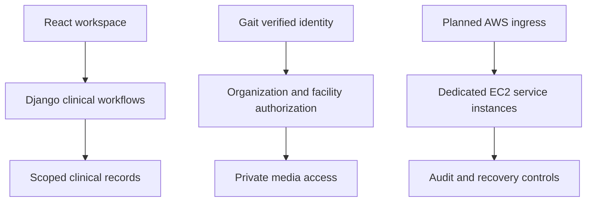

<!-- content/projects/lumen-platform-design.md — Lumen source context and explicitly proposed AWS design. -->
---
title: "Lumen: the flagship clinical platform"
slug: "lumen-platform-design"
summary: "Source-backed service boundaries and a planned Gait-secured AWS deployment."
section: "projects"
order: 76
tags: ["lumen", "aws", "ec2", "gait", "security", "planned architecture"]
status: "proposed-design"
lastReviewed: "2026-10-13"
sources: ["reference_sources/lumen-inspection.md", "reference_sources/aws-design.md"]
related: ["lumen-aws-architecture", "lumen-aws-security", "lumen-aws-release"]
---

## The flagship

Lumen is Anthony's flagship vascular ultrasound reporting platform. The owner intends to deploy its HTTP services to dedicated EC2 instances behind an Application Load Balancer and secure application identity through Gait. **The AWS architecture is proposed, not deployed or verified.**

## What the source establishes

| Boundary | Inspected responsibility | Design implication |
| --- | --- | --- |
| `lumen_ui` | React/Vite, Axios and organization-aware request context | Serve a static build; never put server secrets in it |
| `lumen_reports` | Django/DRF, reporting domains, organizations and facilities | Clinical workflow and permission authority |
| `lumen_media` | FastAPI, verified identity, exam authorization and object storage | File access needs the same tenant/facility boundary |
| `lumen_policy` | Shared deterministic authorization policy | Reuse policy without granting broad database privileges |
| Deployment wiring | Reverse proxy, health probes and staged database initialization | Container wiring is not an AWS deployment |
| Gait integration | Django SDK wiring and a Media verification adapter | Test each integration; do not assume identical cache/error behavior |

Older README diagrams name `lumen_ai`, but that directory is absent in the inspected checkout. AI is a future, separately gated tier in this design. Existing integration and production-build readiness still require a fresh application audit; this handbook did not run Lumen tests.

## Project architecture

## Follow a clinical workflow

Resolve the authenticated identity, select the organization, prove active membership and apply facility/exam policy before reading or changing clinical records. Report calculations and workflow transitions remain server-owned. A browser form or AI suggestion cannot grant a role, finalize a report or bypass a locked state.

The Reports permission code sets transaction-local PostgreSQL tenant context only after membership succeeds. Media reads Reports-owned authorization facts and applies the shared policy before storage access. Those source boundaries complement each other; neither private networking nor a Gait token replaces them.

## Infrastructure is the next design layer

The [AWS topology](/guide/lumen-aws-architecture) maps ALB listeners and per-service target groups to private EC2 instances. The [security plan](/guide/lumen-aws-security) defines account, network, identity, data and operational controls. The [release gates](/guide/lumen-aws-release) describe the evidence required before real use.

This case study contains no patient data, production identifiers, internal security findings or cloud credentials.
