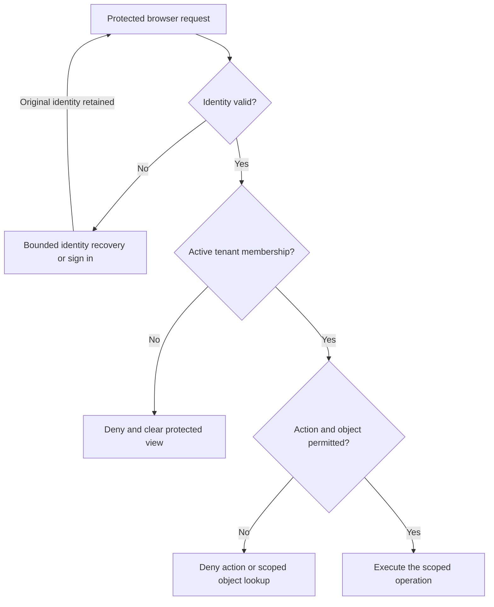

<!-- content/security/auth-and-document-drills.md — Teach proposed incident exercises and evidence boundaries. -->
---
title: "Security drills: sessions, JWTs, and private files"
slug: auth-and-document-drills
section: security
summary: "Trace expired identity, CSRF rejection, and document revocation without confusing their boundaries."
order: 25
tags: [drills, resilience, security, operations, ai, foundry]
status: proposed-design
lastReviewed: "2026-10-13"
sources: [reference_sources/resilience-drills.md, reference_sources/estateiq-inspection.md, reference_sources/stack-context.md]
related: [authentication-options, estateiq-tenant-boundary, private-document-lifecycle, reports-verification]
---

## Use the authentication mechanism you actually selected

The Reports reference slice assumes JWT authentication. Your applications may use Django sessions, Simple JWT, Clerk, or Gait. Those mechanisms establish identity through different contracts; the same tenant and action policies still need enforcement after identity succeeds.

Start a drill with the selected mechanism, endpoint, origin, browser credential behavior, and expected failure response. A frontend button or stored workspace slug cannot prove membership. These are proposed exercises, not a review of your production settings.

## Separate three rejected requests

| Signal | Boundary to inspect | Recovery behavior |
| --- | --- | --- |
| JWT endpoint returns 401 for expired access token | Token verification and bounded session recovery | Coordinate refresh; stop on failed refresh; preserve uncertain command identity |
| Authenticated API returns 403 for membership | Tenant/action authority | Recheck access, clear forbidden content, and avoid a refresh loop |
| Session write returns a CSRF 403 | Browser credential and unsafe-request protection | Correct token delivery/origin configuration; retain CSRF checks |

Status codes depend on the configured authenticator. The JWT row assumes the tutorial's JWT contract; Django sessions can produce different unauthenticated API responses. Log a structured failure reason server-side rather than deriving every cause from a bare status number.



## Exercise token expiry and logout

Use synthetic actors in the separate application's test environment. Expire an access token, send it to a protected endpoint, and inspect the actual response. Then reject refresh and confirm the client ends the session instead of looping. Run two failing requests concurrently to test refresh coordination. Keep tokens out of logs and public evidence.

Simple JWT supports configurable lifetimes, refresh rotation, and blacklisting after rotation when its blacklist app and required settings are enabled. Verify the installed configuration rather than assuming rotation is active. Blacklisting a refresh token does not automatically invalidate every already-issued access token. [Simple JWT settings](https://django-rest-framework-simplejwt.readthedocs.io/en/latest/settings.html).

Check that logout clears protected query caches, local selections, and pending commands. A command whose response was lost needs reconciliation under its original actor and tenant. A newly signed-in actor must not silently replay the previous actor's command.

## Exercise session CSRF deliberately

For a Django session application, confirm how the React client receives a CSRF token and sends it on unsafe requests. Django documents the `X-CSRFToken` header and notes that token acquisition depends on the configured cookie/session settings. Its default test client relaxes CSRF checks; use enforcement explicitly for this drill. [Django CSRF guide](https://docs.djangoproject.com/en/5.2/howto/csrf/).

```python
# Reference harness only — configure the application's real login and write routes.
from rest_framework.test import APIClient

client = APIClient(enforce_csrf_checks=True)
# Establish a real session through the configured login flow.
# Missing-token write: assert rejection and no durable mutation.
# Valid-token write: assert success in the permitted tenant.
# Untrusted-origin write: assert rejection under the selected origin policy.
```

This harness is incomplete by design: your login route and CSRF bootstrap belong to the application. `force_authenticate` cannot prove the session/login/CSRF flow. Cookies used to carry JWTs also require an explicit browser-credential and CSRF design; putting a JWT in a cookie does not remove that concern.

## Exercise private-file revocation

Create a private synthetic artifact for North, then attempt its ID from South. A permitted object must first be resolved through the verified scope. Next remove North membership and repeat the request.

For an authenticated streaming path, verify the new request is denied after revocation. For presigned S3 delivery, distinguish the application endpoint that issues the URL from the already issued URL. S3 documents presigned URLs as bearer capabilities whose validity depends on expiration, signing credentials, and applicable policy. Application membership alone is not consulted by that storage request. [S3 presigned URL documentation](https://docs.aws.amazon.com/AmazonS3/latest/userguide/using-presigned-url.html).

Write down the accepted capability window. If the product requires immediate application-level revocation for each new download, choose a delivery boundary that rechecks application authority. Also inspect cache behavior, content disposition, MIME handling, and permitted ranges; stopping new downloads does not recall bytes already received.

## Attach evidence through Foundry

Record the chosen auth mechanism, application revision, synthetic fixture identities, response/assertion output, and any unresolved token or download window. Attach no secrets or live customer documents. A completed [decision drill](/lab/resilience) is learning evidence; real endpoint results are implementation evidence.
