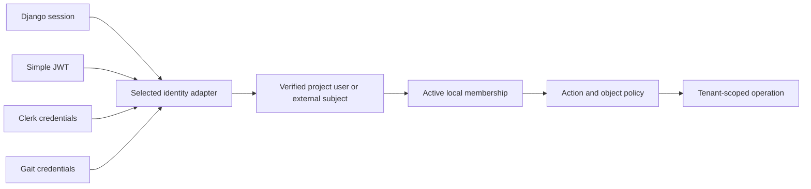

<!-- content/security/authentication-options.md — Compare Anthony's identity approaches without conflating them with authorization. -->
---
title: "Django auth, Simple JWT, Clerk, and Gait"
slug: authentication-options
section: security
summary: "Choose and verify an identity mechanism while keeping application permission rules explicit."
order: 7
tags: [auth, security, django auth, simple jwt, clerk, gait, sessions]
status: established-pattern
lastReviewed: "2026-10-12"
sources: [reference_sources/stack-context.md]
related: [security-boundaries, tenant-isolation, deployment-platforms]
---

## One authorization boundary, several identity approaches

I have used Django authentication, Simple JWT, Clerk, and Gait across projects. They are options selected per application, not four services that every request must pass through. The runtime map uses an identity boundary that can be implemented differently in each project.

Security extends beyond identity: tenant ownership, database invariants, private storage, secret handling, operator access, backup protection, and dependency policy still need their own controls.

## Compare ownership and verification

| Approach | Credential and identity ownership | Backend verification | Remaining application duty |
| --- | --- | --- | --- |
| Django auth and sessions | Project user accounts and server-managed session state | Session middleware and authentication backend | Tenant membership, action and object rules |
| Simple JWT with Django/DRF | Project user accounts with JWT issue/refresh policy | Configured DRF token authentication | Revocation policy, tenancy, roles and protected actions |
| Clerk | Managed identity and session service | Supported backend verification of Clerk session credentials | Map stable subject to local membership and enforce domain policy |
| Gait | Application identity/session platform | Inspected SDK and credential/session contract | Project membership and business authorization |

Inspect each application's actual settings and code before claiming that a mechanism, token rotation, or logout behavior is verified.

## Django session authentication

Django's authentication framework connects accounts, permissions, and sessions through middleware. A browser presents a session cookie; the server resolves the associated session and user. Use HTTPS and appropriate secure cookie settings. Cookie-authenticated writes need CSRF protection; do not disable it merely to make a cross-origin frontend request succeed.

Django model permissions can express actions such as viewing or changing a model. Organization-specific object access still needs an explicit scope policy. An authenticated user with a model-level permission should not automatically read every tenant's reports.

See [Django's authentication system](https://docs.djangoproject.com/en/5.2/topics/auth/default/). Verify anonymous denial, authenticated access, CSRF rejection, logout, and membership revocation in the actual deployment topology.

## Simple JWT for a Django API

JWT access credentials let the API verify signed claims under the configured token policy. Define access lifetime, refresh lifetime, signing/verification keys, allowed algorithms, issuer/audience expectations, and user resolution. Keep the frontend transport contract separate from the domain permission checks.

Simple JWT's optional blacklist app tracks outstanding and blacklisted refresh or sliding tokens. Install its app and migrations before expecting that policy to work. Do not assume blacklisting a refresh token immediately revokes a previously issued ordinary access token. Document the remaining access window and whether sensitive actions require additional state checks.

See [Simple JWT's blacklist documentation](https://django-rest-framework-simplejwt.readthedocs.io/en/stable/blacklist_app.html). Exercise refresh replay, logout, expired credentials, disabled users, and a revoked membership with an access token that has not yet expired. The observed outcome must match the configured version and policy.

## Clerk as managed identity

Clerk provides session credentials for authenticating backend requests. Use a supported verification path appropriate to the backend and validate the expected issuer and other required claims. A same-origin cookie path differs from an API hosted at another origin; inspect the transport instead of assuming an authorization header is always present.

Map a verified provider subject to a project-owned user or membership record. Avoid using mutable email as the only durable link. Even where provider organization features are used, define which data source controls business roles and how revocation reaches API decisions.

See [Clerk session tokens](https://clerk.com/docs/guides/sessions/session-tokens) and [request transport](https://clerk.com/docs/guides/development/making-requests). Verify wrong-issuer tokens, expired tokens, missing membership, and provider outages. No Clerk integration is installed in the handbook.

## Gait when the project uses it

Gait is another identity/session option in my ecosystem. Before implementing its adapter, inspect the real SDK, token fields, key discovery, refresh behavior, and session validation contract. The handbook has not audited those contracts.

Keep its identity/session truth separate from project-owned reports and memberships. Explicitly document how active-session requirements, logout, and membership revocation interact. A diagram should say “identity provider” when the application has not selected Gait specifically.

## Put a stable seam in the application

**Text alternative:** A project selects an identity adapter for its configured credential type. Verified identity resolves to active membership and then action/object policy before a tenant-scoped operation. The arrows illustrate alternative integrations, not automatic fallback between providers.

Do not try several issuers until one accepts a credential. Select a deliberate trust configuration and reject ambiguous or unsupported credentials. If multiple issuers are intentionally supported, define disjoint verification and account-linking rules.

## Record the per-project decision

For each application, record the chosen mechanism, account owner, trusted issuers, credential transport, session/revocation policy, local membership mapping, sensitive-action requirements, outage behavior, and negative tests. That adoption record is more useful than labeling the whole stack “JWT security.”
