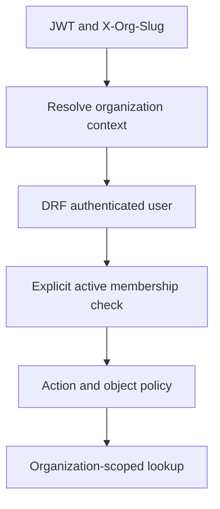

<!-- content/security/estateiq-tenant-boundary.md — Teach EstateIQ-derived engineering boundaries. -->
---
title: "Tenant isolation in the actual request path"
slug: estateiq-tenant-boundary
section: projects
summary: "Connect X-Org-Slug, membership permissions, scoped lookups, and frontend recovery."
order: 11
tags: [security, estateiq, architecture, implementation]
status: established-pattern
lastReviewed: "2026-10-13"
sources: [reference_sources/estateiq-inspection.md]
related: [tenant-isolation, estateiq-domain-map, frontend-state-contracts]
---

## Selection is not authority

EstateIQ's browser sends JWT authorization and `X-Org-Slug`. The slug nominates an organization. Backend code must establish active membership and then filter the requested records within that scope. A remembered workspace selection is a convenience, not a credential.

The inspected `backend/shared/tenancy/middleware.py` resolves organization context and attaches `request.org`, `request.organization`, and `request.org_member`. It also records whether resolution came from a valid membership, a header-only organization, a missing header, or another failure.

## The important middleware caveat

The middleware can resolve an organization when the user is not yet authenticated at that layer. Django middleware and DRF JWT authentication do not necessarily see the same established user at the same point in the request. Therefore the presence of `request.org` alone is not sufficient proof of membership.

The inspected `backend/shared/auth/permissions.py` implements `IsOrgMember`. It requires a resolved organization, an authenticated user, and a membership matching both `is_active=True` and active status. Endpoint-specific action/role permissions and object scoping still follow that check.



**Text alternative:** Request headers resolve context. DRF establishes the authenticated user. Explicit membership permission verifies current authority before action/object policy and organization-filtered lookup.

## Keep the tenant predicate in the query

Use organization-filtered selectors for list, detail, aggregation, and related-object resolution. A globally fetched record followed by an informal ownership check is easier to misuse. For writes that lock a record, retain the organization predicate in the locked lookup too.

**backend/apps/example/selectors.py · synthetic excerpt, model import omitted**

```python
# backend/apps/example/selectors.py — Scope a lookup before returning a record.
def get_scoped_record(*, organization, record_id):
    """Return an authorized organization's record or no match.

    Args:
        organization: Scope established by membership and permission checks.
        record_id: Requested identifier.

    Returns:
        Scoped record, or None.
    """
    # Step 1: Preserve organization scope in the database predicate.
    return Record.objects.filter(
        organization=organization, id=record_id
    ).first()
```

This is a teaching excerpt, not copied runnable EstateIQ code. The selected service still owns workflow constraints and related-object validation.

## Frontend workspace recovery

The inspected OrgProvider loads permitted organizations from an organization-list endpoint, prioritizes URL selection over stored selection, and synchronizes the selected slug. It invalidates query keys beginning with `org` when switching. It clears invalid context or selects the only remaining valid organization when recovering.

The implementation also auto-selects the earliest organization when no context exists, even though an introductory comment describes exactly-one behavior. Teach the implementation as observed and keep documentation reconciled; stale comments are not acceptance evidence.

## Test the complete boundary

Exercise missing headers, unknown organizations, foreign organization slugs, inactive membership, revoked membership with a still-valid token, foreign object IDs, and related-object assignments. Confirm the view uses a membership permission rather than merely checking that middleware attached context.

On the client, switch organizations while a request is in flight and log out before another user signs in. Inspect displayed data, request scope, and cache identity together. These are recommended verification cases; the source review did not run EstateIQ's backend tests.
