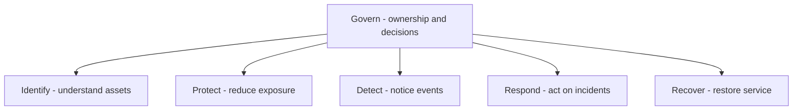

## What am I learning?

**NIST** is the National Institute of Standards and Technology. In this lesson, I am learning how two of its publications help organize security thinking: the Cybersecurity Framework, or CSF, and the Secure Software Development Framework, or SSDF. The organization publishes many documents; “NIST” is not the name of one checklist. [About NIST](https://www.nist.gov/about-nist).

## Why a framework helps

Suppose I have login, encrypted traffic, and backups. Those features do not tell me who owns security decisions, what data I hold, how I notice misuse, or whether restoration works. A framework helps make those missing questions visible. CSF 2.0 describes outcomes that organizations can use to understand and communicate cybersecurity risk. [CSF overview](https://www.nist.gov/cyberframework).

## The six CSF functions

CSF 2.0 uses **Govern, Identify, Protect, Detect, Respond, and Recover**. These are connected areas of work, not six deployment commands to run once. [NIST's CSF 2.0 explanation](https://www.nist.gov/news-events/news/2024/02/nist-releases-version-20-landmark-cybersecurity-framework).

The drawing keeps governance connected to the other functions rather than presenting security as a one-time sequence.

My own example: a Django application holding private customer documents.

| Function | The question I ask | Example evidence to seek |
| --- | --- | --- |
| Govern | Who owns the risk and the release decision? | Named owner and reviewed access policy |
| Identify | What assets, data, and dependencies exist? | Inventory of file stores, APIs, and readers |
| Protect | How do I reduce unauthorized access? | Scoped authorization and protected storage |
| Detect | How would I notice unexpected access? | A tested signal for suspicious download patterns |
| Respond | What happens after a suspected exposure? | An incident procedure with named responsibilities |
| Recover | How do I restore a useful service? | A recorded restoration exercise |

The examples illustrate my interpretation; they are not a complete CSF mapping or evidence that these controls are deployed.

## Current state versus target state

CSF Organizational Profiles can describe current and target outcomes. That makes a gap more useful than a vague claim of being “secure.” [CSF FAQ](https://www.nist.gov/cyberframework/faqs).

For my example: **current** — backups exist, but I have never restored them. **Target** — a responsible person can restore an isolated copy and check that the application's essential records are usable. The gap becomes an owned exercise with observable results. An inventory entry saying “backups enabled” does not close it.

## Where the SSDF fits

The SSDF addresses secure software development. The final SP 800-218 v1.1 organizes practices into preparing the organization, protecting software, producing well-secured software, and responding to vulnerabilities. It is intended to be integrated into development lifecycles rather than replace them. [Final SSDF publication](https://csrc.nist.gov/pubs/sp/800/218/final).

My learning translation: decide expectations before coding, protect source and release material, build with security checks, and have a process when a vulnerability is found. [CI/CD](/guide/ci-cd-fundamentals) can automate some evidence collection; it cannot decide every risk question for me.

## Read editions and status carefully

A publication number, edition, and status belong in a reference. A draft describes work under consideration; it is not automatically the final version I should claim to follow. The [SSDF project page](https://csrc.nist.gov/Projects/ssdf) distinguishes published material and revision activity. When revisiting this lesson, inspect the publication's current status before reusing a requirement identifier.

## Check your understanding

- Where would naming a security owner fit?
- What is missing if backups run but no restore has been attempted?
- Does a green pipeline establish that every CSF outcome is achieved?

## Answer key

Ownership belongs in Govern. Restoration evidence is still missing for the recovery goal. A pipeline establishes results for its configured checks; it does not establish a complete cybersecurity program.
