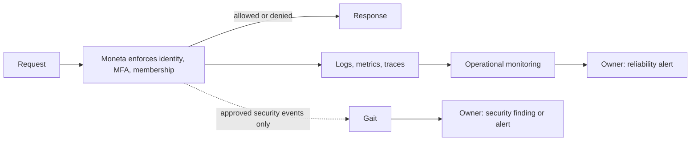

<!-- content/security/observability-and-security-monitoring.md — Separate operational observability from security monitoring and assign each alert an owner. -->
---
title: "Observability and security monitoring: ownership, evidence, and alerts"
slug: observability-and-security-monitoring
section: security
summary: "Decide what the application watches, what the security system evaluates, and who answers each alert."
order: 8
tags: [observability, monitoring, logging, metrics, tracing, alerts, security, opentelemetry, owasp, nist, gait, moneta]
status: proposed-design
lastReviewed: "2026-10-20"
sources: [reference_sources/observability-security-monitoring.md]
related: [security-boundaries, owasp-fundamentals, nist-fundamentals, authentication-options, operational-runbooks, backup-and-scheduled-tasks]
---

## Three questions, three owners

Observability is the broad practice of understanding what a system is doing. Security monitoring reuses some of that evidence to detect threats. They overlap, but they answer different questions and belong to different owners.

| Area | Question it answers | Moneta example | Responsible system |
| --- | --- | --- | --- |
| Application operations | Is the app working correctly? | A Plaid sync failed; an API is returning errors | Moneta's operational monitoring |
| Product and data health | Is the app delivering useful, accurate results? | Balances are stale; an account is missing transactions | Moneta |
| Security monitoring | Is access legitimate, and are protections working? | Unauthorized access attempts; MFA enforcement disabled | Gait, using evidence Moneta supplies |

Moneta is the worked example. The same split applies to any application that uses a separate security system.

## The rule that matters most: enforce here, observe there

**The application enforces security. The security system observes and evaluates it.**

Moneta decides on every request whether the identity, session, MFA requirement and household membership allow the action. Gait never sits in that decision path as a monitor. If Gait is slow, unreachable or rejecting signals, Moneta still denies what it should deny and still protects financial data. Reporting can fail without affecting enforcement. Enforcement never waits for reporting.

The dashed line is optional and one-way. Removing it must not change any response Moneta returns.

Identity checks that Moneta makes *to* Gait (token and session verification) are a separate matter. They are enforcement dependencies, and they fail closed: see [authentication options](/guide/authentication-options). This guide covers only the reporting path.

## Shared building blocks: logs, metrics, traces

An application produces three kinds of evidence:

- **Logs** record individual events: "Plaid sync failed for connection 41."
- **Metrics** record counts and measurements: "20% of syncs failed this hour."
- **Traces** record the path of one request: "the dashboard was slow because its database query took three seconds."

These are shared building blocks, not destinations. Operational tools get the evidence needed to diagnose reliability. Gait gets only the narrow subset needed to assess security. Nothing should go to both systems unchanged by default.

## What the application must instrument

Moneta owns its own reliability and data health. Instrument at least these:

| Concern | Evidence | Healthy signal |
| --- | --- | --- |
| Availability and errors | Request logs, error rate, health endpoint | Health returns 200; error rate within the agreed threshold |
| Latency and resources | Request duration, slow query traces, dyno memory | Key pages within budget; no sustained memory pressure |
| Plaid connections | Per-connection status, sync attempts, retries, last success time | Every active connection synced inside its freshness window |
| Data freshness | Age of the newest balance and transaction per account | No account silently older than its window |
| Scheduled jobs | Start, finish, outcome and duration per run | Every expected run recorded; failures alert |
| Backups | Backup completion and periodic restore checks | Recent backup exists; a restore has been exercised |
| AI features | Request failures, latency, token cost | Failures fall back cleanly; spend within budget |

Data freshness needs its own check. A sync job can "succeed" while an account quietly stops receiving transactions. Measure the age of the data itself, not just whether the job finished. [Scheduled task reliability](/guide/backup-and-scheduled-tasks) covers the job side.

## What goes to the security system

Gait's scope stays narrow and deliberate:

- Authentication, MFA, sessions and access-control violations.
- Changes to credentials, privileges and security configuration.
- Security-relevant suspicious behavior, such as one session probing many households.
- Security self-checks, findings, evidence freshness and security alerts.

The Gait SDK submits these through one write-only call. These properties come from its contract:

| Property | What it means for the application |
| --- | --- |
| Approved `signal_type` only | Gait keeps the registry. An unapproved type is rejected, not stored. |
| Gait derives the scope | Organization, environment, application and control mapping come from the application credential, never from the payload. |
| Customer-reported evidence | Gait records the signal as the application's own claim, never as independent verification. |
| Required `source_reference` | A stable key per logical event, such as a job run ID. Retries with the same key do not create duplicates. |
| Bounded payload | Minimal, non-sensitive context. Gait treats it as opaque data, not authority. |
| Every failure raises | Catch the error, log it locally, and continue. Never turn a reporting failure into an enforcement failure. |

## What never goes to the security system

Gait is not a log sink or a debugging platform. Do not send:

- Ordinary application logs, stack traces or request bodies.
- Financial data: balances, transactions, account numbers, Plaid tokens.
- Passwords, tokens, session cookies, MFA secrets or connection keys.
- Raw AI prompts or responses.
- Reliability metrics such as latency, sync volume or cost.

If a security event needs context, send a reference Moneta can resolve internally, such as an audit event ID. Do not copy the record itself.

## One event, two readers

The same underlying event can matter to both owners.

A single failed login is probably a mistyped password. Moneta records it safely in its own logs: user reference, outcome, time, correlation ID, and never the attempted password. A burst of failures across many accounts may be credential stuffing. That pattern is a security question, so Gait assesses it from the defined security events Moneta reports.

AI splits the same way. A model call that times out, runs slowly or costs too much is an operations concern. A prompt or tool call that tries to read another household's data is a security event. Moneta still blocks it, and the attempt is reported.

## Who receives each alert

Every alert needs a named receiver and a first response. An alert with no owner turns into noise.

| Alert | Raised by | Received by | First response |
| --- | --- | --- | --- |
| API error rate or health check failing | Operational monitoring | Moneta owner | [Operational runbook](/guide/operational-runbooks): check the deploy, then roll back or fix |
| Plaid sync failing or data stale | Moneta | Moneta owner | Check connection status; ask the user to re-link if the provider requires it |
| Scheduled job or backup missed | Moneta | Moneta owner | Re-run safely; confirm the next run; check a restore if backups are affected |
| AI failures or cost over budget | Moneta | Moneta owner | Confirm the fallback is working; throttle or disable the feature |
| Unusual failed-login or access-denial pattern | Gait | Security owner | Review the pattern; lock affected accounts or rotate credentials if confirmed |
| MFA or security configuration disabled | Gait, from a Moneta self-check | Security owner | Restore the setting; find out how it changed |
| Security evidence stale (no recent self-check) | Gait | Security owner | Check Moneta's reporting job before trusting the posture |
| Gait reporting failing | Moneta | Moneta owner | Fix reporting; enforcement is unaffected but security evidence is going stale |

In a one-person project, the Moneta owner and the security owner are the same person. Keep them as separate rows anyway. The responsibilities differ, and they separate once the team grows.

## Standards this follows

There is no single regulator for application observability. Several standards bodies publish what practitioners follow. This design takes each one for the part it actually governs.

| Body | Standard | What it governs here | How this design applies it |
| --- | --- | --- | --- |
| OWASP | [Top 10:2025 A09 Security Logging and Alerting Failures](https://owasp.org/Top10/2025/A09_2025-Security_Logging_and_Alerting_Failures) | The risk of missing, unsafe or unread security logs. Its CWEs: log injection (CWE-117), sensitive data in logs (CWE-532), insufficient logging (CWE-778). | Encode untrusted values before logging, keep secrets and financial data out, and give every security event an alert owner. |
| OWASP | [ASVS 5.0.0 V16 Security Logging and Error Handling](https://github.com/OWASP/ASVS/tree/v5.0.0) | Verifiable requirements: logging documentation (V16.1), general logging (V16.2), security events (V16.3), log protection (V16.4), error handling (V16.5). | Keep a written log inventory, log the defined security events, protect logs, and return safe errors. Pick the exact requirement IDs and level from the release text. |
| OWASP | [Logging Cheat Sheet](https://cheatsheetseries.owasp.org/cheatsheets/Logging_Cheat_Sheet.html) and [Logging Vocabulary Cheat Sheet](https://cheatsheetseries.owasp.org/cheatsheets/Logging_Vocabulary_Cheat_Sheet.html) | Practical guidance on what to log, and shared names for security events. | Name security events consistently, for example `authn_login_fail` and `authz_fail`, before mapping them to Gait's `signal_type` registry. |
| NIST | [Cybersecurity Framework 2.0](https://www.nist.gov/cyberframework) | Outcomes. Detect covers Continuous Monitoring (DE.CM) and Adverse Event Analysis (DE.AE); Respond covers incident handling. | Operational and security monitoring are DE.CM. Gait's pattern assessment is DE.AE. The alert table is the Respond hand-off. |
| NIST | [SP 800-61 Rev. 3](https://csrc.nist.gov/pubs/sp/800/61/r3/final) (April 2025) | Incident response aligned to CSF 2.0. | Each security alert has a named receiver and a first response. Lessons from incidents feed back into the event list. |
| NIST | [SP 800-92](https://csrc.nist.gov/pubs/sp/800/92/final) (2006); [Rev. 1](https://csrc.nist.gov/pubs/sp/800/92/r1/ipd) is still a draft | Log management planning: generation, transmission, storage, retention and disposal. | Decide retention and access for each log store in the inventory. Cite Rev. 1 as a draft until NIST finalizes it. |
| NIST | [SP 800-53 Rev. 5](https://csrc.nist.gov/pubs/sp/800/53/r5/upd1/final), AU family and SI-4 | A control catalog for audit records and system monitoring. | A reference vocabulary only. Moneta is not claiming an 800-53 baseline. |
| CNCF | [OpenTelemetry](https://opentelemetry.io/docs/) (graduated May 2026) | A vendor-neutral API, SDK and protocol for traces, metrics and logs, plus semantic conventions for naming. | Instrument through OpenTelemetry so the operational backend can change without re-instrumenting. Check each semantic convention's stability before relying on it. |
| W3C | [Trace Context](https://www.w3.org/TR/trace-context/) (Recommendation) | The `traceparent` and `tracestate` headers that carry a trace across services. | Use the trace ID as the correlation ID from browser to API to job. Do not invent a separate format. |

Laws and industry rules, such as PCI DSS for cardholder data or financial-privacy regulations, depend on what data the application holds and who operates it. This guide has not assessed them for Moneta. Get that decision explicitly before claiming compliance with any of them.

## Instrument safely

- **Log identifiers and outcomes, not contents.** Redact secrets and financial values before the log call, not afterward (CWE-532).
- **Neutralize untrusted input.** Encode newlines and control characters in user-supplied values, or use structured JSON fields, so nobody can forge a log line (CWE-117).
- **Correlate with W3C Trace Context.** Carry the `traceparent` trace ID from each request into jobs and audit events, so a log line, a trace and an audit event can be joined.
- **Write the log inventory down (ASVS V16.1).** For each store, record what is logged, where it goes, who can read it, how long it is kept, and which events are security events.
- **Protect the logs (ASVS V16.4).** Restrict read access, keep security audit records separate from debug output and harder to tamper with, and use UTC timestamps from a synchronized clock.
- **Return safe errors (ASVS V16.5).** Users get a generic message with a reference ID. Details stay in the protected log.
- **Keep the security-event schema small and explicit.** Adding a new kind of event is a reviewed change on both sides.
- **Make reporting idempotent and retryable.** A stable `source_reference` lets a retry report the same event without creating a duplicate.
- **Separate "the check ran and passed" from "the check did not run."** Missing evidence is its own alert.

## Verify the boundary

These are proposed checks. Run them in the real integration with synthetic data:

| Scenario | Expected result |
| --- | --- |
| Gait unreachable during a protected request | Moneta's permission decision is unchanged; no data is exposed |
| Gait rejects a security signal | Error is logged locally; the user-facing request is unaffected |
| Same self-check retried with the same `source_reference` | One signal recorded, same receipt returned |
| Payload contains a financial value or secret | Caught by review or tests before sending; Gait-side redaction is a backstop, not the control |
| Sync job finishes but one account stops updating | Freshness alert fires for that account |
| AI request for another household's data | Request denied and a security event reported; no data returned |
| User input containing a newline or fake log prefix | Stored as one encoded field; no forged log entry |
| Unhandled server error | Generic message with a reference ID; stack trace only in the protected log |
| Trace across browser, API and job | The same `traceparent` trace ID appears in all three |

## Current state

This is a proposed design, not a verified deployment. Moneta has a Gait configuration self-check reporter that runs dry-run by default, with sending disabled until credentials are confirmed. No live Gait evidence or continuous security monitoring is claimed. The Gait SDK's signal API is write-only: it does not instrument anything automatically and does not retrieve findings. Moneta's operational alerting tools and thresholds have not been selected or audited here. Aligning with the standards above is a design intent. No ASVS level or NIST control baseline has been assessed.
