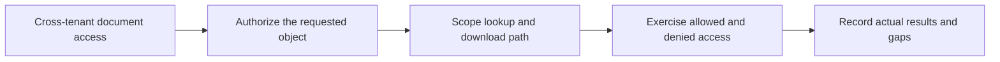

## What am I learning?

**OWASP** means the Open Worldwide Application Security Project. Its nonprofit foundation supports community work on software security. I should think of OWASP as a family of projects, not one product, regulator, or automatic certificate. [About OWASP](https://owasp.org/about).

For learning application security, three resources do different jobs.

## The Top 10: know what can go wrong

The OWASP Top 10 is an awareness document about significant web-application security risks. It gives developers shared language for discussing recurring problems. The reviewed edition is **Top 10:2025**; older articles may refer to different categories or rankings. [Official Top 10 project](https://owasp.org/projects/top-ten).

Read a category as a prompt for investigation. A list of ten risks cannot describe every requirement for every application, and copying the names into a README does not demonstrate that a system handles them.

## ASVS: decide what to verify

The **Application Security Verification Standard**, or ASVS, provides application-security requirements that can guide design and testing. Its purpose is more directly verifiable than the Top 10's awareness role. [ASVS project](https://owasp.org/projects/asvs).

The reviewed stable release is **ASVS 5.0.0**. ASVS uses requirement identifiers and verification levels; record the edition and the requirements in scope when referring to them. A level is not a score automatically awarded by a scanner. Use the actual release text when selecting requirements rather than borrowing an identifier from a different version. [ASVS 5.0.0 release](https://github.com/OWASP/ASVS/tree/v5.0.0).

## Cheat sheets: understand implementation choices

Cheat sheets explain focused topics. For example, OWASP's Authorization Cheat Sheet discusses denying by default and checking permissions on every request. It also distinguishes authentication from authorization. [Authorization Cheat Sheet](https://cheatsheetseries.owasp.org/cheatsheets/Authorization_Cheat_Sheet.html).

My translation: a valid login identifies a user. It does not prove the user may read another organization's report. Hiding a button in React does not enforce the API's permission rule.

## Work through one concern

Teaching scenario: a user from Organization A changes a document identifier to one belonging to Organization B.

I would ask:

1. Which server path resolves the document?
2. Where does trusted organization membership come from?
3. Does the download path enforce the same boundary?
4. Can an old signed URL remain usable after permission changes?
5. Which result would prove a denied request revealed no document bytes?

These are original learning questions, not a claim that this scenario exhausts an ASVS requirement. See [tenant-boundary design](/guide/estateiq-tenant-boundary) for the application's concrete paths.

## Keep the three resources in their roles

| I need to… | Start with… | Then do… |
| --- | --- | --- |
| Recognize a risk category | Top 10 | Inspect whether that failure could occur here |
| Define application verification scope | ASVS | Select versioned requirements and evidence |
| Understand a focused practice | Cheat sheets | Apply it to the actual framework and paths |

OWASP explicitly recommends ASVS when adopting a verifiable application-security standard rather than treating the Top 10 as that standard. [OWASP's application-security program guidance](https://top10.owasp.org/2025/0x03_2025-Establishing_a_Modern_Application_Security_Program/).

## Check your understanding

- Is learning the Top 10 the same as verifying the whole application?
- Can successful authentication replace object-level authorization?
- Why record an ASVS edition alongside a requirement identifier?

## Answer key

Awareness is not a complete verification exercise. A known user can still lack permission for a particular object. Editions matter because requirement organization and wording can change; evidence must refer to a definite expectation.
