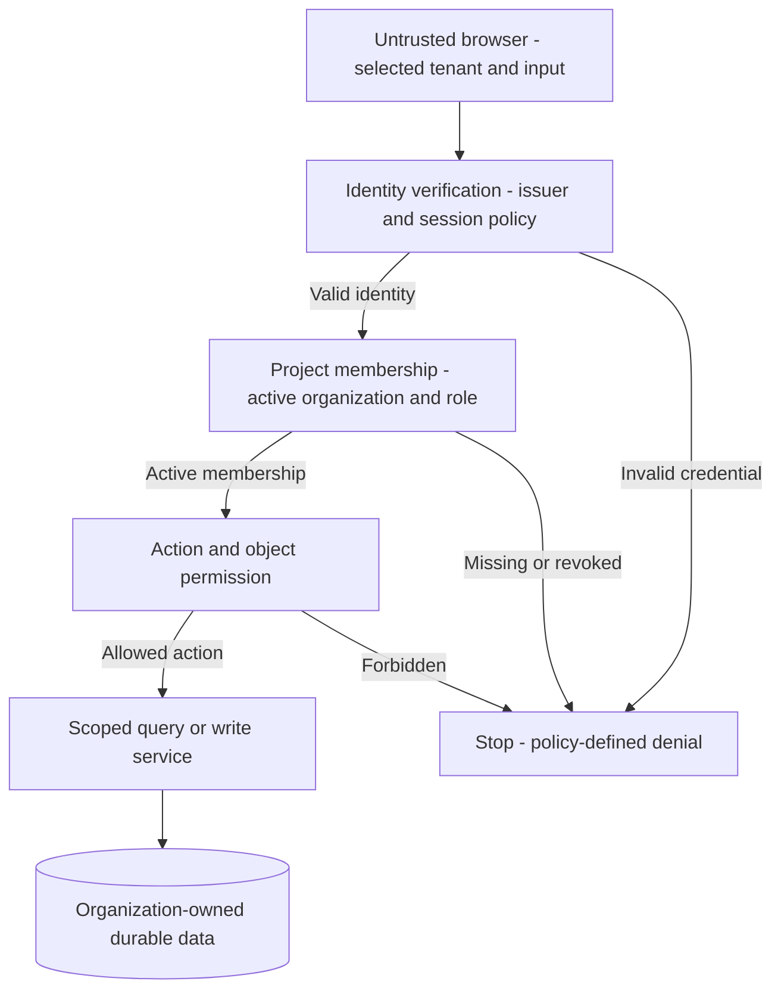

<!-- content/security/security-boundaries.md — Explain application trust boundaries and enforceable controls. -->
---
title: "Security starts at the boundaries"
slug: security-boundaries
section: security
summary: "Trace identity, tenant authority, private files, and operational access through the system."
order: 5
tags: [security, authentication, authorization, tenant, permissions, secrets]
status: proposed-design
lastReviewed: "2026-10-12"
sources: [reference_sources/MOONLIGHT_ENGINEERING_HANDBOOK_BUILD_PLAN.original.md]
related: [system-overview, tenant-isolation, services-and-selectors]
---

## What this design protects

The reports application needs to protect organization-owned records, generated files, session credentials, and operational secrets. Its attacker model includes an anonymous caller, a valid user from another organization, a revoked member with an unexpired token, and a compromised provider or worker credential.

The handbook is public static documentation. Its deployment has no patient records, application session, or project database. Controls described here belong to the application architecture being taught. They have not been tested against a real Gait integration or running reports backend.

## Draw the trust boundaries

**Text alternative:** Every request crosses identity verification, active project membership, action and object permissions, and tenant-scoped data access. Failure at any gate stops the request. A client-selected organization never bypasses these gates.

## Identity does not grant authority

Verify the signature with an allowed algorithm and trusted key source. Validate issuer, intended audience, expiry, and any required token claims. Never accept a token because its payload can be decoded. Cache keys according to the identity provider's actual key-rotation contract and define what happens when an unknown key appears.

The selected identity mechanism owns identity/session behavior; the project owns organization memberships and business roles. Compare [Django auth, Simple JWT, Clerk, and Gait](/guide/authentication-options) before selecting an integration. Local signature verification establishes the signed claims within their validity period. It does not prove that a session remains active. For actions requiring fresh session validation, define a fail-closed policy and use an inspected session contract. Do not invent a Gait session endpoint.

Refresh cookies, browser access tokens, logout, multi-tab refresh, and revocation need explicit integration decisions. Cookie-authenticated writes need a CSRF defense. CORS determines which browser origins can read responses; it does not replace authentication or authorization, and non-browser clients are not constrained by it.

## Deny by default and check every path

Authorize the action and resource at the API boundary and preserve trusted scope through services, selectors, jobs, and downloads. Hiding a React button helps usability but grants no protection. Random identifiers reduce guessing; they do not establish ownership.

| Threat | Control location | Evidence to require |
| --- | --- | --- |
| Foreign report identifier | Scoped API query and related-object validation | Cross-organization read and write denial |
| Revoked member with live token | Project membership check | Denial before token expiry |
| Unauthorized generation | Service action permission | Viewer cannot queue generation |
| Job with forged tenant | Worker lookup and validated durable context | Job cannot load a foreign report |
| Shared private file URL | Download authorization and short lifetime | Unauthorized caller cannot mint URL |
| Leaked secret in bundle | Build/source review | No secret values in public assets |
| Sensitive logs | Redaction at event emission | Synthetic credential does not appear in logs |

OWASP recommends default denial and permission checks on every request. See its [Authorization Cheat Sheet](https://cheatsheetseries.owasp.org/cheatsheets/Authorization_Cheat_Sheet.html) for the underlying principles.

## Private files need a second authorization path

Keep generated reports in private object storage. An authorized download endpoint verifies current membership, report ownership, and the action before issuing a short-lived signed URL. The storage object key is an internal reference, not proof that the requester may download it.

A signed URL is a temporary bearer capability. Anyone holding it can usually use it until expiry; removing a membership does not necessarily invalidate an already issued URL. Keep lifetimes appropriate to the sensitivity and document revocation limits. For immediate revocation requirements, evaluate an authenticated proxy download and its operational cost.

Validate upload size, type, and content according to the workload. User-provided MIME strings and filenames are insufficient. Quarantine and scanning policies depend on the actual file types and threat model; do not assert they exist without implementation evidence.

## Secrets and operator access

Frontend environment values compiled into a bundle are public. Keep provider credentials, database passwords, signing keys, and infrastructure secrets in server-side secret storage. Use separate local, staging, and production credentials and data. Rotate a credential by introducing the replacement, checking consumers, revoking the old value, and verifying that obsolete access fails.

Infrastructure permissions differ from application roles. Workers should access only the queues, objects, and secrets they need. Support access should be time-bounded, scoped, approved according to an explicit policy, and auditable. Logs should contain correlation identifiers and policy outcomes without passwords, refresh tokens, signed download URLs, or sensitive record bodies.

## Harden the public handbook

The static handbook delivers bundled scripts from its own origin. Content Security Policy constrains scripts to that origin and prevents framing. Additional headers disable MIME sniffing and browser features the handbook does not use. Mermaid uses strict rendering with sanitized labels; only repository-controlled Markdown is rendered. Raw HTML is not enabled in the Markdown renderer.

Styles allow inline declarations because the diagram renderer emits SVG styling. The policy permits Google Fonts stylesheet and font origins used by the current design. These are deliberate exceptions, not a claim that every attack class is eliminated. See the [MDN CSP guide](https://developer.mozilla.org/en-US/docs/Web/HTTP/Guides/CSP) for directive behavior.

## Verify with adversarial cases

Create synthetic organizations A and B, users with different roles, and a report owned by each. Attempt every read, mutation, generation, job-status, and download operation using a foreign identifier. Repeat after membership revocation without replacing the access token. Confirm policy-defined denial and absence of unauthorized database changes, queued jobs, or minted URLs.

Exercise unavailable identity validation, expired tokens, unknown signing keys, a retried generation request, and a worker restart. Record observed outcomes separately from proposed controls. A security checklist or architecture diagram alone is not proof of production readiness or regulatory compliance.

## Planned AWS flagship controls

The [Lumen AWS security plan](/guide/lumen-aws-security) applies these boundaries to private EC2 services behind an ALB, Gait identity, clinical permissions, encrypted data, managed secrets and recovery. It is a proposed architecture with explicit [release gates](/guide/lumen-aws-release), not a verified deployment.
