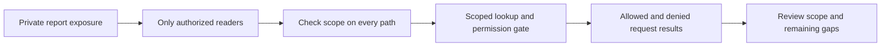

## What am I learning?

When someone says “follow security standards,” my first question should be: **which publication, for which system, and what evidence would show it is followed?** NIST and OWASP are important names, but they produce different kinds of material. They are not one global authority approving every application.

## Who are these organizations?

| Organization | What it is | Why I encounter it |
| --- | --- | --- |
| NIST | The U.S. National Institute of Standards and Technology, part of the Department of Commerce | Cybersecurity frameworks, technical standards, and guidance |
| OWASP | The Open Worldwide Application Security Project, a nonprofit foundation supporting community projects | Application-security awareness, verification requirements, and practical guidance |
| ISO and IEC | International standards organizations | Standards such as ISO/IEC 27001 for information security management systems |

These roles are described by [NIST](https://www.nist.gov/about-nist), [OWASP](https://owasp.org/about), and [ISO's ISO/IEC 27001 overview](https://www.iso.org/standard/27001). A publisher's name alone does not tell me the scope or status of a particular document.

## Separate the vocabulary

My learning vocabulary:

| Term | Question I ask |
| --- | --- |
| Framework | How do I organize outcomes, responsibilities, and gaps? |
| Standard or requirement set | What specific expectations am I using? |
| Control | What measure reduces a particular risk? |
| Guidance | What practices help me implement the idea? |
| Evidence | What observed result supports my claim? |
| Assessment | Who evaluated which scope against which criteria? |

For example, “protect private reports” is an outcome. “Enforce organization scope on every report lookup” is a control choice. A negative API test is one piece of evidence. These are related, but they are not interchangeable.

## Read the scope before the checklist

The NIST Cybersecurity Framework organizes cybersecurity outcomes. OWASP's Top 10 builds awareness of application risks, while ASVS supplies application-security verification requirements. ISO/IEC 27001 concerns an information security management system, not a seal proving every line of code is safe. See the [CSF FAQ](https://www.nist.gov/cyberframework/faqs), [OWASP's comparison](https://top10.owasp.org/2025/0x03_2025-Establishing_a_Modern_Application_Security_Program/), and [ISO's scope](https://www.iso.org/standard/27001).

A framework can inform a policy without itself being a law. A requirement can also be adopted through an organization's obligations or agreements. For engineering work, record which requirements actually apply rather than assuming that every published document is mandatory for every app.

## Turn a concern into something testable

This is my own teaching example. A practical evidence record could name the endpoint, test fixture, candidate revision, expected denial, actual result, and unresolved paths. A screenshot of a shield icon would not demonstrate authorization.

## How I would use these references together

Start with [NIST concepts](/guide/nist-fundamentals) to connect security work to outcomes and responsibilities. Read [OWASP concepts](/guide/owasp-fundamentals) to move from application risks toward verifiable requirements. Then apply the ideas to [the handbook's security boundaries](/guide/security-boundaries).

Reading these lessons does not assess an application or certify an organization. The useful learning outcome is being able to explain a risk, choose an appropriate requirement, and ask for meaningful evidence.

## Check your understanding

- Is OWASP a government regulator?
- Is a framework outcome the same as an implemented control?
- Does citing a standard establish that my application meets it?

## Answer key

OWASP is a nonprofit foundation. An outcome describes what I want; a control is a measure intended to achieve it. A citation identifies a reference, while an assessment needs defined scope and evidence.
