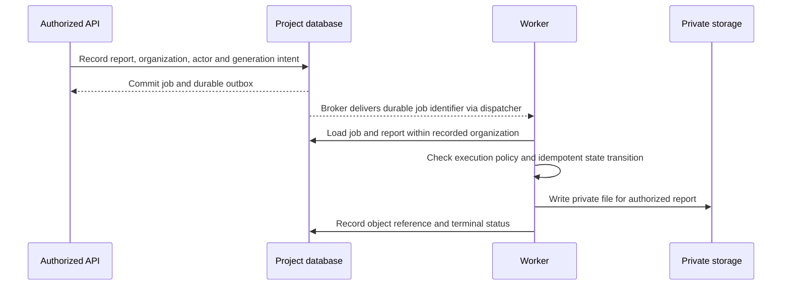

<!-- content/security/tenant-isolation.md — Teach organization scope and cross-tenant denial testing. -->
---
title: "Tenant isolation, from request to file"
slug: tenant-isolation
section: security
summary: "Carry trusted organization scope through reads, writes, queued jobs, caches, and downloads."
order: 6
tags: [tenant, authorization, permissions, isolation, jobs, downloads]
status: proposed-design
lastReviewed: "2026-10-12"
sources: [reference_sources/MOONLIGHT_ENGINEERING_HANDBOOK_BUILD_PLAN.original.md]
related: [security-boundaries, services-and-selectors, frontend-architecture]
---

## Resolve scope once, preserve it everywhere

An organization is the tenant boundary for the synthetic reports domain. Membership connects a user to an organization with an active status and role. A facility may narrow access inside an organization; it does not substitute for the organization boundary.

A client sends a selected organization identifier. The API resolves that selection through the authenticated user's active memberships. Views pass the resulting trusted scope into selectors and services. Never accept an organization field from the request body as authority.

## Establish an explicit permission matrix

This matrix is a proposed teaching policy, not an inspected production contract. Application owners must approve the actual role model.

| Action | Viewer | Editor | Organization administrator |
| --- | --- | --- | --- |
| List and read in-scope reports | Allow | Allow | Allow |
| Create or edit in-scope reports | Deny | Allow | Allow |
| Request generation | Deny | Allow | Allow |
| Download an in-scope completed file | Allow | Allow | Allow |
| Manage memberships | Deny | Deny | Allow |
| Any cross-organization operation | Deny | Deny | Deny |

Check both the role's action permission and the object's scope. A global administrator capability, if needed, must be a separate audited policy; do not quietly make an organization administrator global.

## Reads and related-object writes

Start every report query with organization scope. Pagination, counts, search, and exports must apply that same scope before computing results. An unscoped aggregate can leak business information even when the displayed list is correct.

For a report referencing a facility or template, resolve those related objects within the trusted organization too. A scoped report write that accepts a foreign facility still creates a cross-tenant relationship. Use database constraints where the schema can express an invariant; retain service checks for rules spanning workflow or membership state.

**backend/apps/reports/selectors.py · excerpt; Report import omitted**

```python
# backend/apps/reports/selectors.py — Retrieve a report only in trusted scope.
def report_get(*, organization, report_id):
    """Find a report belonging to the authorized organization.

    Args:
        organization: Scope resolved from active membership.
        report_id: Requested stable report identifier.

    Returns:
        Matching report, or None when it is outside the scope.
    """
    # Step 1: Combine identity and tenant predicates in the same lookup.
    return Report.objects.filter(
        organization=organization,
        id=report_id,
    ).first()
```

The API maps no scoped match to a consistent denial or not-found response according to its information-disclosure policy. Do not fetch globally first and accidentally serialize before the ownership check.

## Jobs carry durable context



**Text alternative:** The API records trusted organization and actor context with durable generation intent. An outbox dispatcher publishes a job identifier through the broker. The worker loads the job and report within the recorded organization, applies its execution policy, writes a private file, and records the outcome.

Decide whether authorization is checked only when work is accepted or again at execution. For sensitive user-driven exports, rechecking active membership before execution may be required. Record cancellation or denial when that policy fails. Membership revocation after acceptance must have a documented outcome.

## Downloads and frontend caches

Job-status and download endpoints need the same tenant boundary as report detail. Resolve the file through an authorized report, then mint access. Do not let callers nominate an arbitrary storage key.

Partition frontend query keys by organization and clear user-specific state on logout. Cancel obsolete requests when switching scope and avoid showing an old response as current data. Cache partitioning prevents accidental UI leakage; backend scope checks remain the enforcement boundary.

## Test negative paths, not only success

| Exercise | Expected outcome |
| --- | --- |
| User A requests report B | No report representation |
| Editor A assigns facility B | Rejected without mutation |
| Viewer A queues generation | Denied without job or outbox entry |
| Revoked A polls old job | Denied according to current membership policy |
| Worker job pairs organization A with report B | Fails without creating a file |
| User A requests file B | No signed URL |
| Switch frontend from A to B | No A data rendered as B's current view |

Include list, detail, update, delete, aggregate, export, queued job, and download paths in the coverage. Test database outcomes as well as response codes. These exercises are acceptance requirements; they have not been executed against a backend in this frontend-only repository.

Use [OWASP's authorization testing guidance](https://cheatsheetseries.owasp.org/cheatsheets/Authorization_Testing_Automation_Cheat_Sheet.html) to turn the permission matrix into repeatable tests.
