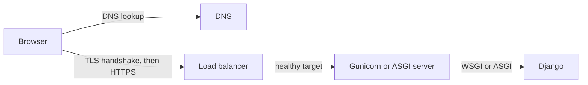

<!-- content/skills/networking-and-load-balancers.md — Trace a request through DNS, TLS, load balancers and proxies to Django. -->
---
title: "Networking and load balancers: from domain name to Django"
slug: networking-and-load-balancers
section: skills
summary: "Follow one request through DNS, TLS, a load balancer and a reverse proxy, and know which layer fails how."
order: 3
tags: [skills, networking, dns, tls, https, load balancer, alb, nlb, proxy, websockets, concepts, education]
status: established-pattern
lastReviewed: "2026-10-20"
sources: [reference_sources/skills-gap-review.md]
related: [skills-gap-map, containers-fundamentals, troubleshoot-alb, lumen-aws-architecture, django-channels]
---

## What am I learning?

Before Django sees a request, it has already passed through several systems: DNS turns the name into an address, TLS encrypts the connection, a load balancer picks a healthy server, and a proxy or app server hands the request to Django. Each layer has its own failures. When something breaks, knowing the path tells me where to look.

## The request path



On Heroku, the [router](https://devcenter.heroku.com/articles/http-routing) plays the load balancer's role and terminates TLS. On AWS, an Application Load Balancer does it. The concepts are the same.

## 1. DNS

[DNS](https://developer.mozilla.org/en-US/docs/Glossary/DNS) maps names to addresses. The records I will actually use:

| Record | Points to | Typical use |
| --- | --- | --- |
| A / AAAA | IPv4 / IPv6 address | A server with a fixed address |
| CNAME | Another name | `www` → a platform hostname |
| ALIAS / ANAME | Another name, at the zone apex | `example.com` → a load balancer (provider-specific) |
| TXT | Text | Domain verification, email policy |

Every record has a TTL: how long resolvers may cache it. Lower the TTL before a migration so the change spreads quickly, then raise it afterward.

## 2. TLS and HTTPS

TLS proves the server's identity with a certificate and encrypts the connection. **TLS termination** means one layer decrypts the traffic, usually the load balancer, and forwards it on a private network. Certificates expire, so automate renewal: AWS Certificate Manager, Heroku ACM or Let's Encrypt.

## 3. Load balancers: layer 4 versus layer 7

| | Layer 4 (e.g., AWS NLB) | Layer 7 (e.g., AWS ALB) |
| --- | --- | --- |
| Sees | TCP/UDP connections | HTTP requests: host, path, headers |
| Can route by | Port | Path, host, header, method |
| Terminates TLS | Optional | Yes, typically |
| Use for | Non-HTTP protocols, fixed IPs, extreme throughput | Web apps and APIs |

An [Application Load Balancer](https://docs.aws.amazon.com/elasticloadbalancing/latest/application/introduction.html) routes HTTP requests to **target groups** and sends traffic only to targets passing **health checks**. A [Network Load Balancer](https://docs.aws.amazon.com/elasticloadbalancing/latest/network/introduction.html) forwards connections without reading HTTP.

Design the health check deliberately. A health endpoint that queries the database can take every target out of service during a database blip. Prefer a cheap check of "this process can serve," and monitor dependencies separately.

## 4. The proxy headers Django must trust

Behind a load balancer, Django sees the balancer's connection, not the browser's. The original details arrive in headers:

- `X-Forwarded-For`: the client IP chain.
- `X-Forwarded-Proto`: whether the browser used HTTPS.
- `Host`: the domain the browser asked for.

Configure Django to match the real topology:

```python
SECURE_PROXY_SSL_HEADER = ("HTTP_X_FORWARDED_PROTO", "https")
ALLOWED_HOSTS = ["app.example.com"]
```

Only set [`SECURE_PROXY_SSL_HEADER`](https://docs.djangoproject.com/en/5.2/ref/settings/#secure-proxy-ssl-header) when a proxy you control sets that header and strips any value sent by the client. Otherwise a client can claim HTTPS. The same rule applies to client IPs used for rate limiting: trust `X-Forwarded-For` only as far as your own proxies.

## Timeouts and WebSockets

Every layer has a timeout, and the shortest one wins. Heroku's router ends requests that send no response within 30 seconds. An ALB closes connections idle longer than its idle timeout, 60 seconds by default. Long work belongs in [background jobs](/guide/reliable-job-lifecycle), not in the request.

WebSockets for [Django Channels](/guide/django-channels) start as HTTP and upgrade to a long-lived connection. ALBs support this, but idle connections still hit the idle timeout, so send heartbeats. Run an ASGI server, not plain Gunicorn with WSGI workers.

## Common failures by layer

| Symptom | Likely layer |
| --- | --- |
| Domain does not resolve | DNS record or TTL |
| Certificate warning | TLS: expired, wrong name, missing chain |
| 502 / 503 from the balancer | No healthy targets, or targets crashing (see [ALB troubleshooting](/guide/troubleshoot-alb)) |
| 504 | App too slow; a timeout upstream fired |
| Redirect loop to HTTPS | Django does not know the request was already HTTPS |
| `DisallowedHost` | `ALLOWED_HOSTS` missing the domain |

## Exercise

For a deployed app, trace a real request. Run `dig` on the domain, inspect the certificate in the browser, find the balancer or router in the platform dashboard, and confirm Django logs the correct scheme and client IP. Done means I can name every hop and its timeout.

## Check your understanding

- Why can an ALB route `/api` and `/admin` differently, but an NLB cannot?
- What breaks if `SECURE_PROXY_SSL_HEADER` is set without a proxy that strips the header?
- Why can a database-checking health endpoint cause a full outage?
- Which timeout ends a 45-second request on Heroku?

## Answer key

An ALB reads HTTP requests, including paths; an NLB forwards connections without reading HTTP. A client can send the header and convince Django an insecure request was HTTPS. When the database blips, every target fails its health check at once and the balancer removes them all. Heroku's 30-second router timeout ends it first, so long work belongs in a background job.
