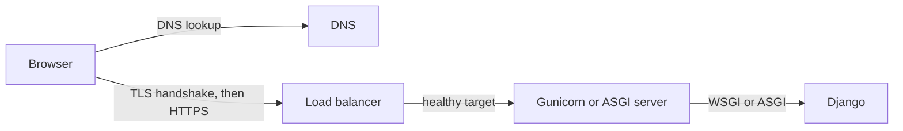

<!-- content/skills/networking-and-load-balancers.md — Trace a request through DNS, TLS, load balancers and proxies to Django. -->
---
title: "Networking and load balancers: from domain name to Django"
slug: networking-and-load-balancers
section: skills
summary: "Follow one request through DNS, TLS, a load balancer and a proxy, and design each hop to fail safely."
order: 3
tags: [skills, networking, dns, tls, https, load balancer, alb, nlb, proxy, websockets, retries, deployments, concepts, education]
status: established-pattern
lastReviewed: "2026-10-20"
sources: [reference_sources/skills-gap-review.md]
related: [skills-gap-map, containers-fundamentals, troubleshoot-alb, lumen-aws-architecture, django-channels]
lesson:
  level: Foundation
  duration: 60 minutes
  prerequisites: [containers-fundamentals]
  objectives:
    - Trace a request through DNS, TLS, a load balancer and an app server
    - Choose between a layer 4 and a layer 7 load balancer
    - Configure Django correctly behind a proxy
    - Design health checks, timeouts and retries that fail safely
    - Explain how blue-green and canary releases use a load balancer
---

## What am I learning?

Before Django sees a request, it has already passed through several systems. DNS turns the name into an address, TLS encrypts the connection, a load balancer picks a healthy server, and an app server hands the request to Django. Each layer fails in its own way. Knowing the path tells me where to look, and how to design each hop so one failure doesn't become an outage.

## Core concepts



**DNS** maps names to addresses. The records I'll use: A/AAAA (an address), CNAME (another name), ALIAS/ANAME (another name at the zone apex, provider-specific) and TXT (verification). Each has a TTL: how long resolvers may cache it.

**TLS** proves the server's identity with a certificate and encrypts the connection. **TLS termination** is where it gets decrypted, usually the load balancer.

**Load balancers** come in two kinds:

| | Layer 4 (e.g., AWS NLB) | Layer 7 (e.g., AWS ALB) |
| --- | --- | --- |
| Sees | TCP/UDP connections | HTTP requests: host, path, headers |
| Routes by | Port | Host, path, header, method, weights |
| Use for | Non-HTTP protocols, static IPs, extreme throughput | Web apps and APIs |

An [Application Load Balancer](https://docs.aws.amazon.com/elasticloadbalancing/latest/application/introduction.html) sends requests to **target groups** and only to targets passing **health checks**. A [Network Load Balancer](https://docs.aws.amazon.com/elasticloadbalancing/latest/network/introduction.html) forwards connections without reading HTTP. On Heroku, the [router](https://devcenter.heroku.com/articles/http-routing) does the layer 7 job for me.

**Proxy headers** carry what the balancer saw: `X-Forwarded-For` (client IP chain), `X-Forwarded-Proto` (http or https) and `Host`.

## Modern patterns

| Pattern | Problem it solves | How |
| --- | --- | --- |
| **Edge first** | Static assets and TLS handshakes waste app capacity and add latency | A CDN serves assets and terminates TLS close to users, with HTTP/2 and HTTP/3 |
| **HTTPS only, with HSTS** | A first plain-HTTP request can be intercepted | Redirect to HTTPS and send [`Strict-Transport-Security`](https://developer.mozilla.org/en-US/docs/Web/HTTP/Headers/Strict-Transport-Security) |
| **Liveness versus readiness** | One health check can't tell "restart me" from "don't send me traffic yet" | Liveness: the process responds. Readiness: it can serve, for example migrations finished. |
| **Graceful shutdown and draining** | Deploys cut off in-flight requests | The balancer stops new requests and waits ([deregistration delay](https://docs.aws.amazon.com/elasticloadbalancing/latest/application/edit-target-group-attributes.html)); the app finishes current work on SIGTERM |
| **Timeout budgets** | A slow dependency ties up every worker | Each hop's timeout is shorter than the caller's, and every outbound call has one |
| **Retries with backoff and jitter** | Synchronized retries overload a recovering service | Retry only safe or idempotent calls, with exponential backoff and random jitter ([AWS Builders' Library](https://aws.amazon.com/builders-library/timeouts-retries-and-backoff-with-jitter/)) |
| **Blue-green and canary releases** | A bad deploy reaches every user at once | ALB weighted target groups shift traffic gradually (1%, 10%, 100%) or all at once with instant rollback |
| **Private by default** | Databases and app servers exposed to the internet | Only the balancer is public; app and database sit in private subnets, with security groups allowing only the previous hop |

## Anti-patterns to avoid

- **A health check that queries the database.** One database blip fails every target at once and the balancer removes them all.
- **Trusting forwarded headers from anyone.** Clients can send `X-Forwarded-Proto: https` or a fake IP.
- **No timeout on outbound HTTP calls.** One hung provider eventually blocks every worker.
- **Long work inside the request.** It hits a timeout somewhere; it belongs in a [background job](/guide/reliable-job-lifecycle).
- **Sticky sessions as a crutch.** Pinning users to a server hides in-memory state that breaks on deploy. Keep the app stateless instead.
- **Retrying non-idempotent writes blindly.** A retried payment request can charge twice without an idempotency key.

## Build it step by step

**Step 1: trust only your own proxy.** Behind a balancer that sets `X-Forwarded-Proto` and strips client-sent values:

```python
SECURE_PROXY_SSL_HEADER = ("HTTP_X_FORWARDED_PROTO", "https")
SECURE_SSL_REDIRECT = True
SECURE_HSTS_SECONDS = 31536000
ALLOWED_HOSTS = ["app.example.com"]
```

Only set [`SECURE_PROXY_SSL_HEADER`](https://docs.djangoproject.com/en/5.2/ref/settings/#secure-proxy-ssl-header) when that proxy guarantee is true. Start HSTS with a short value and raise it once HTTPS is confirmed everywhere.

**Step 2: separate liveness from readiness.**

```python
def live(request):
    return HttpResponse("ok")

def ready(request):
    connection.ensure_connection()
    return HttpResponse("ready")
```

Point the balancer's health check at the cheap liveness endpoint. Use readiness for startup gating and monitoring, so a database problem is alerted on, not "fixed" by removing every server.

**Step 3: set a timeout budget.** Every outbound call gets an explicit timeout shorter than the request's own limit:

```python
response = requests.get(url, timeout=5)
```

**Step 4: plan WebSockets.** [Django Channels](/guide/django-channels) needs an ASGI server. ALBs support WebSockets, but idle connections still close at the idle timeout (60 seconds by default), so send heartbeats.

Checkpoint: Django logs `https` as the scheme and the real client IP for a production request.

## Common failures by layer

| Symptom | Likely layer |
| --- | --- |
| Domain does not resolve | DNS record or TTL |
| Certificate warning | TLS: expired, wrong name, missing chain |
| 502 / 503 from the balancer | No healthy targets, or targets crashing (see [ALB troubleshooting](/guide/troubleshoot-alb)) |
| 504 | App too slow; an upstream timeout fired. Heroku's router ends requests after 30 seconds. |
| Redirect loop to HTTPS | Django doesn't know the request was already HTTPS |
| `DisallowedHost` | `ALLOWED_HOSTS` is missing the domain |

## Exercise

For one deployed app:

1. Run `dig` on the domain and record the record type and TTL.
2. Inspect the certificate: issuer, expiry, and how it renews.
3. Find the balancer or router and its timeout.
4. Add separate liveness and readiness endpoints and point the health check at liveness.
5. Confirm Django logs the correct scheme and client IP.

**Done means:** I can draw every hop with its timeout, and the health check no longer depends on the database.

## Check your understanding

- Why can an ALB route `/api` and `/admin` differently while an NLB cannot?
- What breaks if `SECURE_PROXY_SSL_HEADER` is set without a proxy that strips the header?
- Why add random jitter to retries?
- How does a weighted target group make a canary release possible?
- Which timeout ends a 45-second request on Heroku?

## Answer key

An ALB reads HTTP requests, including paths; an NLB forwards connections without reading HTTP. A client can send the header and make Django treat an insecure request as HTTPS. Without jitter, many clients retry at the same instants and overload the recovering service in waves. The balancer sends a small share of traffic to the new version's targets, so errors show up on a few users before everyone. Heroku's 30-second router timeout, which is why long work belongs in a background job.

## Go deeper

- [ALB target group health checks](https://docs.aws.amazon.com/elasticloadbalancing/latest/application/target-group-health-checks.html)
- [Timeouts, retries and backoff with jitter](https://aws.amazon.com/builders-library/timeouts-retries-and-backoff-with-jitter/)
- [MDN: DNS](https://developer.mozilla.org/en-US/docs/Glossary/DNS)
