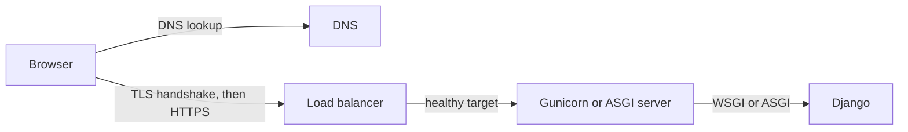

<!-- content/skills/networking-and-load-balancers.md — Trace a request through DNS, TLS, load balancers and proxies to Django. -->
---
title: "Networking and load balancers: from domain name to Django"
slug: networking-and-load-balancers
section: skills
summary: "Follow one request through DNS, TLS, a load balancer and a proxy, and learn to design each hop to fail safely."
order: 3
tags: [skills, networking, dns, tls, https, load balancer, alb, nlb, proxy, websockets, retries, deployments, concepts, education]
status: established-pattern
lastReviewed: "2026-10-21"
sources: [reference_sources/skills-gap-review.md]
related: [skills-gap-map, containers-fundamentals, troubleshoot-alb, lumen-aws-architecture, django-channels]
lesson:
  level: Foundation
  duration: 60 minutes
  prerequisites: [containers-fundamentals]
  objectives:
    - Trace a request through DNS, TLS, a load balancer and an app server
    - Choose between a layer 4 and a layer 7 load balancer
    - Configure Django correctly behind a proxy
    - Design health checks, timeouts and retries that fail safely
    - Explain how blue-green and canary releases use a load balancer
---

## Why this matters

When a page is broken, the question "where is it broken?" has more possible answers than most developers realize. By the time a request reaches your Django view, it has already passed through four or five other systems. Each one can fail, and each one fails in its own recognizable way.

On Heroku, almost all of that path is hidden. On AWS, you build it yourself. Lumen's design puts an Application Load Balancer in front of your services, and the Troubleshoot ALB guide assumes you already know what a target group and a health check are. This lesson gives you that foundation.

## The big idea

Let's follow one request. Imagine you're visiting a large office building to see someone.

1. **You look up the address.** You know the company's name, but you need its street address. That's **DNS**: it turns `app.example.com` into an IP address computers can connect to.
2. **Security checks ID at the door.** Before you share anything private, you want proof this is really the right building, and you want the conversation kept private. That's **TLS**: the server shows a certificate proving its identity, and everything after that is encrypted. This is the "S" in HTTPS.
3. **The receptionist sends you to an available clerk.** The building has several clerks doing the same job. The receptionist knows which ones are at their desks and sends you to one of them. That's the **load balancer**. Checking who's at their desk is the **health check**.
4. **The clerk handles your request.** That's your app server (Gunicorn, or an ASGI server) handing the request to **Django**.



On Heroku, the [router](https://devcenter.heroku.com/articles/http-routing) plays receptionist and handles TLS for you. On AWS, an Application Load Balancer does. Same ideas, different owner.

Now let's look at each stop more closely.

## Stop 1: DNS

DNS is the internet's address book. The record types you'll actually use:

- **A / AAAA**: name → IP address (IPv4 / IPv6).
- **CNAME**: name → another name. For example, `www.example.com` → your platform's hostname.
- **ALIAS / ANAME**: like a CNAME, but allowed at the bare domain (`example.com`). Provider-specific; AWS Route 53 calls it an alias record.
- **TXT**: text, used to prove you own a domain.

Every record has a **TTL** (time to live): how long other servers may cache it. Here's the practical trick: before you move a domain to a new server, lower the TTL to a few minutes and wait for the old TTL to expire. Then the switch spreads in minutes instead of hours. Raise it again once things are stable.

## Stop 2: TLS

TLS does two jobs: it proves the server is who it says it is, using a certificate, and it encrypts the conversation. The place where traffic gets decrypted is called **TLS termination**, and it's usually the load balancer. Behind it, traffic travels on your private network.

Certificates expire. Every outage caused by an expired certificate was preventable, so always automate renewal: AWS Certificate Manager, Heroku's Automated Certificate Management or Let's Encrypt.

## Stop 3: the load balancer

There are two kinds, and the difference is what they can "see."

A **layer 4** load balancer (AWS calls it a [Network Load Balancer](https://docs.aws.amazon.com/elasticloadbalancing/latest/network/introduction.html)) sees connections, not requests. It's like a receptionist who forwards phone calls without listening to them. Fast, and good for non-web protocols, but it can't make decisions based on what you're asking for.

A **layer 7** load balancer (an [Application Load Balancer](https://docs.aws.amazon.com/elasticloadbalancing/latest/application/introduction.html)) reads each HTTP request: the host, the path, the headers. So it can route `/api` to one group of servers and `/admin` to another. For web apps and APIs, this is almost always what you want.

An ALB sends requests to a **target group**, a set of servers or containers, and only to targets that pass their **health check**.

**Pause and check:** you want `/api/*` to go to your Django containers and `/media/*` to go somewhere else. Which load balancer can do that? (The ALB, because it reads the path. An NLB never looks inside the request.)

## Stop 4: what Django sees

Here's a subtle problem. When the load balancer forwards a request, Django sees a connection *from the load balancer*, not from the browser. The original details travel in headers the balancer adds:

- `X-Forwarded-For`: the real client IP address.
- `X-Forwarded-Proto`: whether the browser used `https`.
- `Host`: the domain the browser asked for.

Django doesn't trust those headers by default, and that's a good thing, because a browser can send them too. You tell Django which ones to trust, and you only do that when your own proxy is guaranteed to set them. We'll do this in the build section.

## Modern patterns

**Edge first.** Put a CDN in front of everything. It serves static files and handles TLS from servers close to your users, using modern protocols like HTTP/2 and HTTP/3. Your app servers only handle what actually needs your app.

**HTTPS only, with HSTS.** Redirecting HTTP to HTTPS is good, but that very first plain-HTTP request can still be intercepted. The [`Strict-Transport-Security`](https://developer.mozilla.org/en-US/docs/Web/HTTP/Headers/Strict-Transport-Security) header tells browsers to never use plain HTTP for your site again.

**Separate "alive" from "ready."** These are two different questions. *Liveness* asks "is this process running and responding?" If not, restart it. *Readiness* asks "can it serve real traffic right now?" A server that's still starting up is alive but not ready. Mixing the two causes the most common load-balancer outage, which you'll see in the mistakes section.

**Graceful shutdown and connection draining.** During a deploy, old servers are removed. Without draining, any request in progress gets cut off. With it, the balancer stops sending *new* requests to the old server and waits for current ones to finish (AWS calls this the [deregistration delay](https://docs.aws.amazon.com/elasticloadbalancing/latest/application/edit-target-group-attributes.html)). Your app helps by finishing in-flight work when it receives the shutdown signal.

**Timeout budgets.** Every hop has a timeout. Make each one shorter than the timeout of whoever is calling it, and give every outbound call from your app an explicit timeout. Otherwise one slow external service can tie up every worker you have.

**Retries with backoff and jitter.** Retrying a failed call is fine, but think about a recovering service. If a thousand clients all retry after exactly one second, then two, then four, they hit it in synchronized waves. *Backoff* spaces retries out; *jitter* adds randomness so clients spread out instead of moving in lockstep. Only retry calls that are safe to repeat. ([AWS Builders' Library](https://aws.amazon.com/builders-library/timeouts-retries-and-backoff-with-jitter/))

**Blue-green and canary releases.** An ALB can split traffic between target groups by weight. *Blue-green* means running the new version alongside the old and switching all traffic at once, with instant switch-back if something breaks. *Canary* means sending 1% of traffic to the new version, watching for errors, then 10%, then everyone. Either way, a bad deploy reaches a few users instead of all of them.

**Private by default.** Only the load balancer faces the internet. App servers and the database live in private subnets, and their firewall rules (security groups) only accept traffic from the layer right in front of them.

## Mistakes to avoid

- **A health check that queries the database.** This is the big one. The database has a two-second hiccup, every server fails its health check at the same moment, and the load balancer removes them all. A brief blip becomes a full outage. Health checks should test "can this process serve," not "is every dependency perfect."
- **Trusting forwarded headers from anyone.** A client can send `X-Forwarded-Proto: https` or a fake IP. Trust them only from your own proxy.
- **No timeouts on outbound calls.** One hung provider eventually blocks every worker.
- **Long work inside the request.** It will hit a timeout somewhere. Move it to a [background job](/guide/reliable-job-lifecycle).
- **Sticky sessions as a crutch.** Pinning a user to one server usually hides in-memory state that breaks during deploys. Keep servers stateless instead.
- **Blindly retrying writes.** A retried payment request can charge twice. Retry writes only with an idempotency key.

## Let's build it

**Step 1: tell Django about your proxy.** Behind a load balancer that sets `X-Forwarded-Proto` and removes any value the client sent:

```python
SECURE_PROXY_SSL_HEADER = ("HTTP_X_FORWARDED_PROTO", "https")
SECURE_SSL_REDIRECT = True
SECURE_HSTS_SECONDS = 31536000
ALLOWED_HOSTS = ["app.example.com"]
```

Line by line: the first trusts the proxy's report of HTTPS. The second redirects plain HTTP to HTTPS. The third turns on HSTS for a year. The fourth only accepts requests for your real domain. Set the first line only when that proxy guarantee is true ([Django docs](https://docs.djangoproject.com/en/5.2/ref/settings/#secure-proxy-ssl-header)), and start HSTS with a small value like 3600 until you're sure HTTPS works everywhere.

**Pause and check:** what happens if you forget `SECURE_PROXY_SSL_HEADER` behind a TLS-terminating load balancer, but keep `SECURE_SSL_REDIRECT`? (An infinite redirect loop. Django sees plain HTTP from the balancer, redirects to HTTPS, the browser obeys, the balancer forwards plain HTTP again, and it repeats.)

**Step 2: split liveness from readiness.**

```python
from django.db import connection
from django.http import HttpResponse

def live(request):
    return HttpResponse("ok")

def ready(request):
    connection.ensure_connection()
    return HttpResponse("ready")
```

Point the load balancer's health check at `live`. Use `ready` for startup checks and monitoring, so a database problem triggers an alert instead of the balancer pulling every server.

**Step 3: give every outbound call a timeout.**

```python
response = requests.get(url, timeout=5)
```

Without `timeout`, the `requests` library will wait indefinitely. Five seconds is an example; choose a value shorter than your own request limit.

**Step 4: plan for WebSockets.** [Django Channels](/guide/django-channels) needs an ASGI server, not plain WSGI Gunicorn workers. ALBs support WebSockets, but they close connections that sit idle past the idle timeout (60 seconds by default), so send a small heartbeat message periodically.

**Checkpoint:** in production, Django's logs should show `https` as the scheme and the real client IP, not the load balancer's.

## When things break: reading the symptoms

Now you can work out where a failure lives:

| Symptom | Where to look |
| --- | --- |
| The domain doesn't resolve | DNS: the record, or a TTL still caching old values |
| Browser certificate warning | TLS: expired, wrong name, or missing intermediate certificate |
| 502 or 503 from the balancer | No healthy targets, or targets crashing (see [ALB troubleshooting](/guide/troubleshoot-alb)) |
| 504 | The app was too slow and a timeout fired. Heroku's router ends requests after 30 seconds. |
| Redirect loop to HTTPS | Django doesn't know the request was already HTTPS |
| `DisallowedHost` error | The domain is missing from `ALLOWED_HOSTS` |

## Your turn

Pick one of your deployed apps and trace a real request.

1. Run `dig yourdomain.com` and note the record type and TTL.
2. Open the certificate in your browser: who issued it, when does it expire, and how does it renew?
3. Find the router or load balancer and its timeout.
4. Add separate `live` and `ready` endpoints, and point the health check at `live`.
5. Confirm Django logs the correct scheme and client IP.

**You're done when:** you can draw every hop with its timeout from memory, and your health check no longer depends on the database.

## Check your understanding

1. Why can an ALB route `/api` and `/admin` differently while an NLB can't?
2. What goes wrong if `SECURE_PROXY_SSL_HEADER` is set but no proxy strips that header from client requests?
3. Why add random jitter to retries?
4. How does a weighted target group make a canary release possible?
5. Which timeout ends a 45-second request on Heroku?

## Answer key

1. An ALB works at layer 7 and reads each HTTP request, including its path. An NLB works at layer 4 and forwards connections without reading them, so it never sees a path.
2. Any client can send `X-Forwarded-Proto: https`, and Django will treat an insecure request as secure. Security features that depend on HTTPS, like secure cookies and redirects, can be bypassed.
3. Without jitter, every client retries on the same schedule, so a recovering service gets hit in synchronized waves. Randomness spreads the retries out.
4. The balancer sends a chosen percentage of traffic to the new version's target group. If errors rise, you shift the weight back before most users are affected.
5. Heroku's router, which ends a request with no response after 30 seconds. That's why long work belongs in a background job.

## Recap

- A request passes DNS → TLS → load balancer → app server → Django, and each stop fails differently.
- Use a layer 7 balancer (ALB) for web apps; it can route by path and host.
- Trust proxy headers only from your own proxy, and tell Django explicitly.
- Health checks test "alive," not "everything is perfect."
- Timeouts everywhere, retries with backoff and jitter, and gradual releases through weighted traffic.

Next up: [Lesson 3, PostgreSQL performance](/guide/postgres-performance), the most common reason a request is slow once it reaches Django.

## Go deeper

- [ALB target group health checks](https://docs.aws.amazon.com/elasticloadbalancing/latest/application/target-group-health-checks.html)
- [MDN: DNS](https://developer.mozilla.org/en-US/docs/Glossary/DNS)
