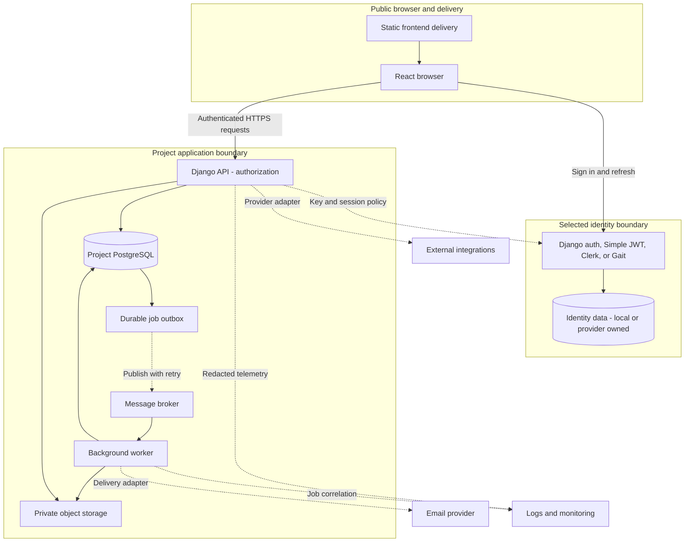
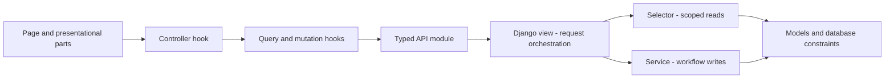
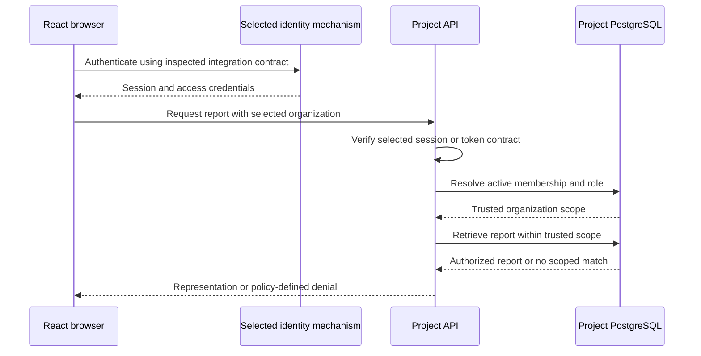

<!-- content/system/system-overview.md — Teach the system, end to end. -->
---
title: "The system, end to end"
slug: system-overview
section: system
summary: "Follow a request through the browser, application, and durable data."
order: 1
tags: [architecture, request, trust]
status: proposed-design
lastReviewed: "2026-10-12"
sources: [reference_sources/MOONLIGHT_ENGINEERING_HANDBOOK_BUILD_PLAN.original.md]
related: [django-setup, frontend-architecture, security-boundaries]
---

## How the system gets built

[Foundry is the primary engineering workflow](/guide/building-with-foundry): it coordinates tasks, workstreams, artifacts, evidence, and release authority. It governs development of the code delivered to these runtime components. It does not replace the application API, identity provider, or hosting platform.

## Start with boundaries

A useful system map separates code organization from running processes. A Django service is a Python function that owns a business operation. A worker is a separate process that executes queued work. Moving a function into a service does not make it asynchronous.

The baseline application has a React browser, a Django API, and PostgreSQL. Add a worker, broker, and private object storage when slow jobs or durable files require them. The handbook itself is a static frontend; this map describes the applications it teaches.

## The platforms behind the diagram

My main application host is Heroku; I have used Vercel for frontend delivery and AWS S3 for file storage. This handbook runs on Netlify. [Deployment and storage](/guide/deployment-platforms) maps those responsibilities, while [backups and scheduled tasks](/guide/backup-and-scheduled-tasks) covers recurring operations. Broader AWS infrastructure is proposed learning material rather than deployed experience.

## The complete runtime map

The diagram separates the public browser, identity provider, and project-owned runtime. Dashed edges represent asynchronous or supporting flows. It is a proposed reference architecture; these services are not provisioned by the handbook.

**Text alternative:** Static delivery serves React. React signs in through Gait and calls the project API. Identity ownership depends on the selected mechanism; project-managed Django identities and external-provider identities have different data boundaries. The diagram separates identity/session truth from business data logically; Django-managed identity tables may share the project database. The project API owns authorization and project PostgreSQL. A durable outbox feeds a broker; workers consume jobs, update business status, and create private files. Provider adapters connect email and integrations; redacted telemetry connects web and worker processes to monitoring.

[React responsibilities](/guide/frontend-architecture), [Django boundaries](/guide/services-and-selectors), and [security controls](/guide/security-boundaries) explain the components in detail.

## Application layers versus processes

**Text alternative:** UI parts emit intent through a controller and server-state hooks to a typed API module. Django views orchestrate scoped selectors for reads and services for writes. Both reach models and database constraints. These are code layers; selectors and services normally run inside the same web process. Workers are separate runtime processes.

## Authentication and authorized reads

**Text alternative:** The browser establishes a session or credentials through the selected identity mechanism. The API verifies the selected session or token credential, resolves active membership from project data, and retrieves a report inside that scope. Authentication alone does not grant report access. Fresh-session checks depend on the actual integration contract and required revocation policy.

## Follow a read

1. The browser resolves the frontend domain and downloads versioned JavaScript and CSS.
2. A user action selects an organization and report. The frontend sends an authenticated API request.
3. The API verifies identity, resolves active membership, and checks report access.
4. A selector queries PostgreSQL with the trusted organization scope.
5. A read serializer shapes the result. React renders loading, error, empty, or successful data.

The browser's organization identifier is a request for scope. It is never proof of authority. The server must establish membership before retrieving data.

## Follow a write

A write serializer checks input shape. A service checks workflow rules and commits the change inside a database transaction. Database constraints protect durable invariants even when two requests arrive together. The API returns the authoritative representation, and the frontend updates or invalidates the affected cache.

For report generation, return an accepted job identifier after recording durable intent. A worker generates the file and updates job status. The frontend polls or subscribes to an actual supported status mechanism. Completion should refresh report data rather than merely close a modal.

## Who owns what?

| Component | Durable responsibility | Boundary |
| --- | --- | --- |
| Gait | Identity and sessions | Authentication |
| Project API | Memberships and domain rules | Authorization |
| PostgreSQL | Reports, tenant relationships, job status | Durable business truth |
| Object storage | Private generated files | Authorized downloads |
| Browser | View state and local preferences | Untrusted client |

The identity provider shown is selected per project; Django auth and Simple JWT may use project-managed identity data, while Clerk and Gait introduce an external identity boundary. Gait integration contracts have not been inspected for this handbook. Treat these roles as a proposed architecture, not verified endpoint behavior.

## Failure and recovery

An API timeout does not tell the browser whether a write committed. Use an idempotency contract for operations that cannot safely be duplicated. A broker outage can strand work between a database commit and message publication; a durable outbox records work for retry. A worker may receive the same job twice, so state transitions and file publication must tolerate duplicate execution.

## Verify the boundaries

Trace one synthetic report with a request identifier. Confirm the organization filter reaches every query and related-object lookup. Repeat the request with a different organization's report identifier and expect denial. Observe durable status after a worker restart rather than inferring success from a queued message.

Continue with [Django setup](/guide/django-setup) and [frontend architecture](/guide/frontend-architecture).
