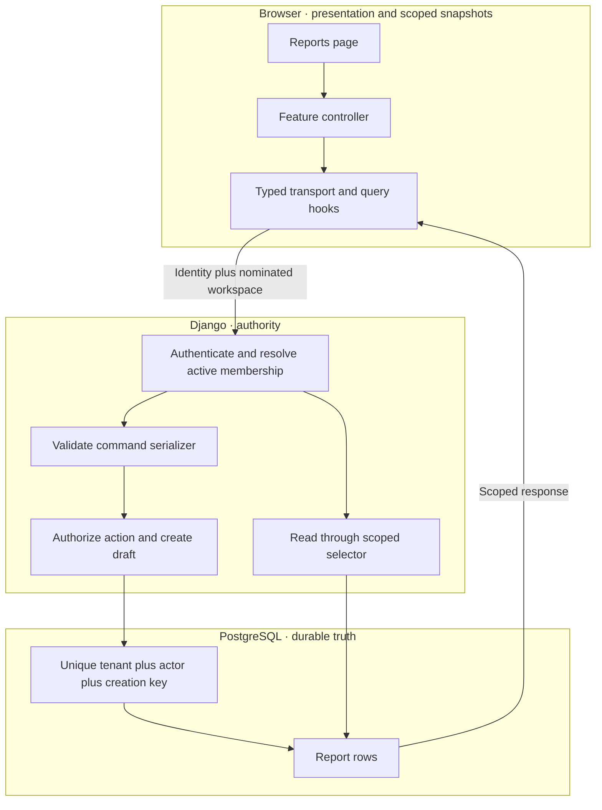

<!-- content/walkthrough/reports-contract.md — Teach one stage of the synthetic Reports feature. -->
---
title: "01 · Define the Reports feature"
slug: reports-contract
section: walkthrough
summary: "Write the contract and a Foundry task brief before choosing models or components."
order: 19
tags: [reports, walkthrough, django, react, foundry, tenant, implementation]
status: proposed-design
lastReviewed: "2026-10-12"
sources: [reference_sources/reports-walkthrough.md, reference_sources/estateiq-inspection.md, reference_sources/foundry-inspection.md]
related: [building-with-foundry, reports-data]
---

## The outcome

Build one small feature all the way through: an active editor creates a draft report, lists reports in their workspace, and opens a report detail. An active viewer can read. Someone without membership cannot read or write. A request repeated after an uncertain response must not create a second draft.

Reports contain a title and a draft status. They do not calculate financial results, generate PDFs, or ask an AI provider for facts. Those extensions come after this slice has evidence behind it.

This is an authored reference design inspired by the EstateIQ boundaries. The Django and TanStack examples are unexecuted reference code. The [interactive Reports lab](/lab/reports) runs a browser-only simulation with synthetic records.

## Trace the feature



The browser chooses a workspace. The server proves the user belongs to it. Query keys prevent accidental cache mixing, while scoped database queries enforce access. Each has a different job.

## Freeze the API contract

The tutorial assumes an existing JWT-authenticated Django REST Framework application. A separate application must configure JWT authentication, a user model, installed apps, PostgreSQL, and migrations. Django session authentication is also possible, but needs its own CSRF and response-code contract; do not paste JWT expectations into it.

| Request | Allowed actor | Success | Important rejection |
| --- | --- | --- | --- |
| GET `/api/v1/reports/?limit=20&offset=0` | Active viewer or editor | 200 paginated list | 401 identity missing; 403 membership missing |
| POST `/api/v1/reports/` | Active editor | 201 new draft; 200 replay | 400 invalid input; 403 forbidden; 409 key conflict |
| GET `/api/v1/reports/{uuid}/` | Active viewer or editor | 200 detail | 404 object outside current scope |

Every request carries `X-Org-Slug`. The backend derives the tenant from authenticated membership; the body cannot grant tenant access. The command has exactly two fields:

```json
{
  "title": "Quarterly portfolio review",
  "creationKey": "20ee76c4-334d-46d5-a527-7650c52902e3"
}
```

The result is a report object with `id`, `title`, `status`, and `createdAt`. The list uses `count`, `next`, `previous`, and `results`. Field names stay consistent through serializers, TypeScript, and tests.

## Decide retry semantics

A creation key identifies one command by one authenticated actor in one tenant. A retry uses the same key and normalized title. A changed title with that key returns 409. A different actor cannot retrieve the original actor’s result by guessing their key.

A 503 or connection failure may happen after commit. Treat the outcome as unknown until the original command is replayed or reconciled. A form edit starts a new command only after that uncertainty is resolved. The lab deliberately refreshes its synthetic list immediately to make the committed row visible; a real client might still have a stale list.

## Give Foundry a concrete brief

Foundry helps coordinate the work and evidence. It does not replace backend permission checks. The handbook's local Foundry initialization does not imply that governed release automation has already been configured.

```text
Outcome: Editors create draft reports in their active workspace.

Scope:
- Reports model and reviewed migration.
- Scoped list/detail selectors and authorized create service.
- DRF contract; typed React transport, hooks, controller, and parts.
- Tenant, role, replay, conflict, and uncertainty checks.

Acceptance evidence:
- North member cannot retrieve a South report by UUID.
- Viewer reads but POST returns 403; outsider list returns 403.
- Same actor + tenant + creationKey returns the same ID on replay.
- Same key + different normalized title returns 409.
- Scope change clears old detail and pending command.
- PostgreSQL concurrent replay creates one row.
- Backend and browser test output attached to the implementation.

Review:
- Backend reviewer checks scope, transaction, constraint, migration.
- Frontend reviewer checks request identity, cache keys, recovery UX.
- Anthony owns acceptance and release authorization.

Non-goals: exports, AI-generated facts, worker deployment, billing.
```

Use the Foundry commands and task schema available in your installed version. This is a task brief, not an invented CLI invocation.

## Checkpoint

Before writing code, answer: who can create, where does tenant authority come from, and what happens if the write succeeds but the response disappears? Continue to [models and migrations](/guide/reports-data).
