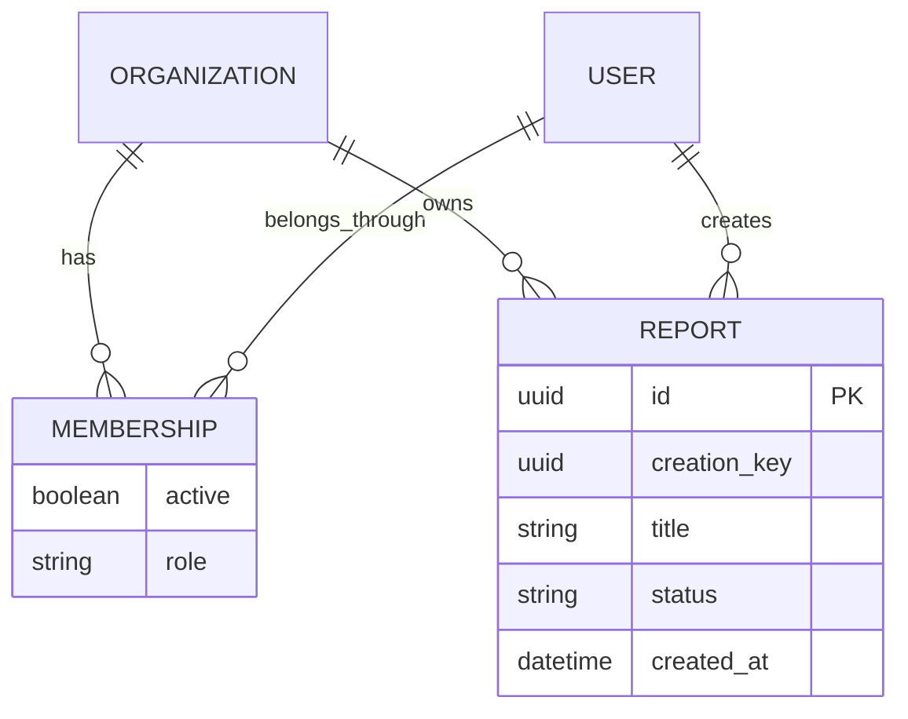

<!-- content/walkthrough/reports-data.md — Teach one stage of the synthetic Reports feature. -->
---
title: "02 · Model the tenant and report"
slug: reports-data
section: walkthrough
summary: "Express ownership and replay identity as database relationships and constraints."
order: 20
tags: [reports, walkthrough, django, react, foundry, tenant, implementation]
status: proposed-design
lastReviewed: "2026-10-12"
sources: [reference_sources/reports-walkthrough.md, reference_sources/estateiq-inspection.md, reference_sources/foundry-inspection.md]
related: [reports-contract, reports-api]
---

## Establish the application scaffold

Use a separate Django application for the backend tutorial. The handbook remains a static frontend. The reference paths below assume `apps.organizations` and `apps.reports` are installed Django apps with normal `__init__.py`, `apps.py`, and migration packages. If your application already owns organizations and membership, reuse its canonical models instead of duplicating them.

Target the Django 5.2 documentation series for these examples. Lock compatible Django, DRF, JWT, and PostgreSQL driver versions in the backend repository and test that lock. This chapter does not provide or claim a verified environment.

## Represent membership explicitly

```python
# apps/organizations/models.py — Canonical organizations and active roles.
from django.conf import settings
from django.db import models


class Organization(models.Model):
    slug = models.SlugField(unique=True)
    name = models.CharField(max_length=120)


class Membership(models.Model):
    class Role(models.TextChoices):
        VIEWER = "viewer"
        EDITOR = "editor"

    organization = models.ForeignKey(Organization, on_delete=models.CASCADE)
    user = models.ForeignKey(settings.AUTH_USER_MODEL, on_delete=models.CASCADE)
    role = models.CharField(max_length=12, choices=Role.choices)
    active = models.BooleanField(default=True)

    class Meta:
        constraints = [
            models.UniqueConstraint(
                fields=["organization", "user"], name="unique_org_member"
            )
        ]
```

Membership is a relationship, not a claim accepted from a browser dropdown. The lab's role selector is deliberately a simulation control.

## Keep durable command identity

```python
# apps/reports/models.py — Store a draft and the identity of its create command.
import uuid
from django.conf import settings
from django.db import models


class Report(models.Model):
    id = models.UUIDField(primary_key=True, default=uuid.uuid4, editable=False)
    organization = models.ForeignKey(
        "organizations.Organization", on_delete=models.PROTECT
    )
    created_by = models.ForeignKey(
        settings.AUTH_USER_MODEL, on_delete=models.PROTECT
    )
    creation_key = models.UUIDField()
    title = models.CharField(max_length=120)
    status = models.CharField(max_length=12, default="draft", editable=False)
    created_at = models.DateTimeField(auto_now_add=True)

    class Meta:
        constraints = [
            models.UniqueConstraint(
                fields=["organization", "created_by", "creation_key"],
                name="unique_report_create_command",
            ),
            models.CheckConstraint(
                condition=models.Q(status="draft"), name="report_is_draft"
            ),
        ]
        indexes = [models.Index(fields=["organization", "-created_at"])]
```

`PROTECT` makes deletion policy explicit: deleting an organization or creator cannot silently remove reports. That is a teaching choice, not a universal retention policy. Decide anonymization, archival, and deletion requirements for the real product.

The draft constraint fits this slice. Adding ready/failed states later requires a reviewed schema change. Do not expand a frontend enum and assume the database now accepts it.

## Review the migration

Run these commands in the separate backend repository after configuring the apps and database:

```bash
python manage.py makemigrations organizations reports
python manage.py sqlmigrate organizations 0001
python manage.py sqlmigrate reports 0001
python manage.py migrate --plan
python manage.py migrate
python manage.py check
```

Inspect generated dependencies, foreign keys, the replay uniqueness constraint, and the tenant index. Commit generated migrations with the code. For an existing table, inspect duplicate command identities before applying uniqueness; a migration should not discover the cleanup policy in production.

Django documents that `get_or_create` needs database uniqueness on its lookup fields to protect against competing inserts. Our lookup uses all three constrained fields. Review that relationship rather than relying on the method name. [Django QuerySet reference](https://docs.djangoproject.com/en/5.2/ref/models/querysets/#get-or-create).

## Draw the ownership boundary



The ER diagram shows relationships; it does not prove an API query includes the tenant predicate. That proof belongs in the next chapter and its tests.

## Checkpoint

Verify the generated migration against PostgreSQL and inspect the resulting constraints. Backend commands above have not been executed in this handbook. Continue to [services and the API](/guide/reports-api).
