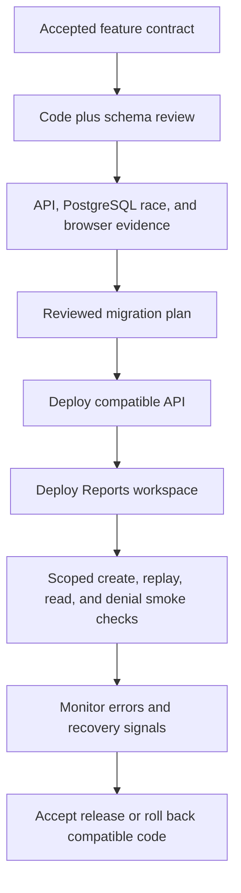
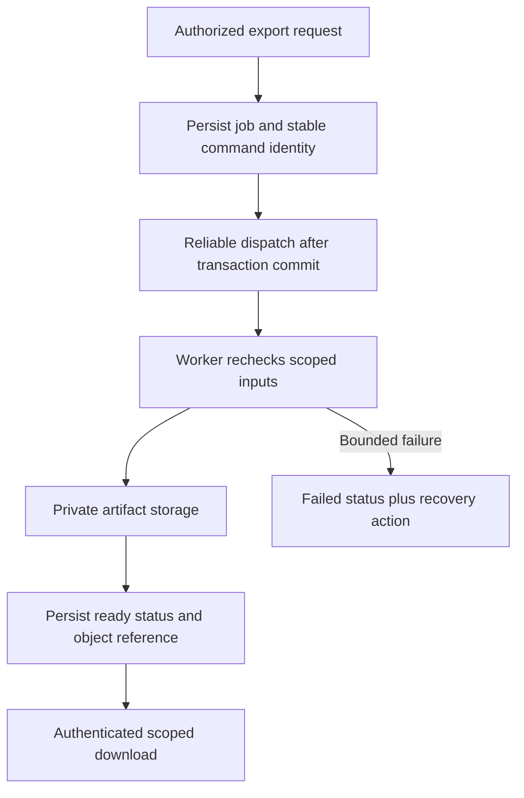

<!-- content/walkthrough/reports-release.md — Teach one stage of the synthetic Reports feature. -->
---
title: "06 · Release the slice, then extend it"
slug: reports-release
section: walkthrough
summary: "Connect migrations, deployment, recovery, workers, and AI without weakening the feature contract."
order: 24
tags: [reports, walkthrough, django, react, foundry, tenant, implementation]
status: proposed-design
lastReviewed: "2026-10-12"
sources: [reference_sources/reports-walkthrough.md, reference_sources/estateiq-inspection.md, reference_sources/foundry-inspection.md]
related: [reports-verification, deterministic-ai]
---

## Release only what has evidence

This handbook publishes static frontend assets to Netlify. The Reports lab ships with those assets. It does not deploy a Django API, run migrations, or establish a production tenant boundary.

The separate full-stack feature needs its own release record. Foundry can organize the task, review artifacts, and acceptance evidence once configured in that application. A local initialization or manual Netlify deploy should not be described as an automated governed release.

## Sequence the real application release

Use a compatibility window: adding a new model and endpoint before publishing its caller is usually easier to reverse than changing an existing field in place. A code rollback does not automatically reverse a migration. Decide whether the schema remains compatible and retain the data needed for recovery.

For Heroku, connect this plan to the application's actual release process and PostgreSQL backup policy. For Vercel or Netlify, deploy the frontend with its correct public API URL and backend origin rules. S3 storage is a separate document concern, not API hosting. Verify the concrete deployment configuration instead of assuming a platform supplies the missing components.

## Keep the operational runbook concrete

| Event | Immediate action | Evidence before closing |
| --- | --- | --- |
| Create timeout | Replay the same command identity | Same report ID, one persisted row |
| 403 spike | Inspect auth and active membership checks | No tenant predicate or permission disabled to resolve it |
| Migration failure | Halt incompatible rollout; inspect plan | Database state and compatible code recorded |
| Incorrect data | Identify affected scoped rows; follow repair policy | Reviewed repair, audit trail, and tenant-specific verification |
| Restore required | Restore into an isolated environment first | Recovery time and integrity checks; no untested production overwrite |

Record backup frequency, retention, restore owner, and tested recovery time in the real application. “Automatic backup enabled” is not evidence that recovery works. A scheduled command needs a defined schedule, overlap policy, tenant scope, failure signal, and retry behavior.

## Add exports with an explicit lifecycle

A later PDF/export feature can add `queued`, `running`, `ready`, and `failed` through a new contract and migration. It needs job identity, attempts, bounded retries, tenant-scoped worker inputs, private storage, and an authorized download path. The current draft-only constraint must evolve with that design.

Persisting a job and reliably dispatching it are two operations. An outbox or equivalent recovery mechanism is a proposed extension, not a capability implemented by the synchronous tutorial. Do not claim a web process deploy proves a worker or scheduler is running.

## Add AI after deterministic facts

For a narrative summary, build scoped deterministic report facts first. Let an AI provider phrase those facts under a narrow schema, with provenance, timeout, budget, and fallback behavior. Reject provider output that invents totals or bypasses scope. A viewer's readable report does not automatically grant permission to export source documents or execute a write tool.

Keep AI failures separate from ledger or report correctness. A missing narrative can display deterministic facts. Prompt text is not a replacement for membership checks, tool allowlists, private document access, or audit evidence. Follow [deterministic AI](/guide/deterministic-ai) and [document Q&A boundaries](/guide/ai-context-and-document-qa) when extending this feature.

## Close the Foundry task with precise claims

A useful completion artifact lists the accepted behavior, changed files, migration plan, executed test output, review decisions, deployment reference, and remaining limitations. For this handbook walkthrough, the backend snippets remain reference code and the deployed interactive feature is a synthetic browser simulation.

Return to the [contract](/guide/reports-contract), explore the [lab](/lab/reports), or use this path as a template for the next real feature.
